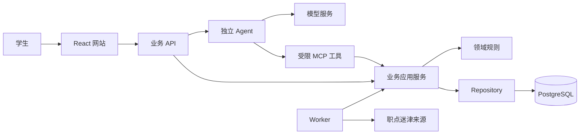

# AI 求职助手

本项目面向大学生，提供持续求职咨询、简历解析与画像确认、岗位查询和资格核验，以及收藏、手动投递进度管理。岗位来源为职点迷津，使用 Codex coding agent 辅助设计、实现、诊断和测试。

截至 2026 年 10 月 31 日，网站已完成首次公网部署，实际投入时间为 8 小时。当前线上记录有 10 条真实岗位，完整人工条件核验为 0；因此，现有数据尚不足以证明能够推荐学生真正可报名的岗位。代码更新后自动部署、连续 7 天可用验证和全部已获取岗位的统一导出仍未完成。以下按考题要求说明交付入口、可信机制、验证结果及缺口。

## 网站地址与使用方式

网站地址：[https://47.95.166.110](https://47.95.166.110)。评审可在注册页使用用户名、密码和图片验证码自行注册，无需邮箱或手机号；注册后进入登录页登录。

建议按以下路径体验：

1. 进入“求职咨询”，直接介绍学历、专业、毕业时间和求职目标，进行连续追问。
2. 在同一入口展开简历面板，上传文本 PDF、DOCX、TXT，或粘贴简历文字。
3. 查看模型生成的画像草稿，核对、修改并明确确认。未确认草稿不作为正式报名资格依据。
4. 查看岗位详情、来源和资格核验结果，检查缺失条件与待核验原因。
5. 收藏岗位，手动记录投递状态、日期和备注；可在隐私入口清除个人数据或删除账号。

公网浏览器已验证注册、登录、刷新后的会话保持、岗位浏览、咨询与简历统一入口、账号删除及会话撤销。正式发布时没有新增收费咨询或简历解析；真实简历解析证据来自此前的修复复验。详见[服务器交付及原始报告](docs/delivery/server-release/README.md)。

## 已实现的功能与架构

| 部分     | 当前实现                                                                    |
| -------- | --------------------------------------------------------------------------- |
| 前端     | React、Vite、React Router，包含咨询、简历、画像、岗位、收藏、投递和隐私页面 |
| 业务服务 | NestJS、Zod 契约、领域对象、Repository、Prisma 和 PostgreSQL                |
| Agent    | 独立服务，配置模型为 deepseek-v4-pro，通过 8 个受限 MCP 工具访问业务能力    |
| 后台任务 | 独立 Worker，处理采集、简历解析、任务租约及文件清理补偿                     |
| 部署     | Docker Compose、Caddy HTTPS、持久卷、备份恢复与独立私有网络                 |

前端只访问业务 API。Agent 不直接访问业务数据库，工具身份来自后端授权上下文，不能由模型随意指定用户。HTTP、内部服务、MCP 和维护命令的实际契约见[运行契约](docs/design/runtime-contracts.md)；本地安装、构建和运行方法见[本地开发与验证](docs/local-development.md)。

## 如何证明助手可信

可信性通过来源追溯、确定性规则、用户确认和可复核测试建立；测试通过不等于所有岗位条件或任意模型回答都正确。

### 岗位事实与报名资格

岗位保留来源 URL、正文版本、抓取观察、内容摘要和核验状态。抓取成功只表示取得页面，不代表条件完整或已核验；抓取失败不会更新成功核验时间。

资格由后端领域规则计算，分别输出“符合已核验条件”“明确不符合”“待核验”。缺失资料、来源冲突、条件未完整核验、未访问的关联来源和过期证据会阻止肯定性结论。模型负责理解、追问和解释，不能把资格结果改成相反结论。

| 容易误判的场景                 | 处理方式                                               | 可核对的证据                                                               |
| ------------------------------ | ------------------------------------------------------ | -------------------------------------------------------------------------- |
| 应届生查看社招岗位             | 按具体学历、专业、经验等要求判断，不因社招标签直接排除 | [资格规则测试](tests/unit/jobs-domain.test.ts)                             |
| 专业、毕业时间或正式经验未知   | 保持未知，列出缺失项；实习不自动折算正式工作年限       | [资格领域实现](packages/business/src/domain/jobs/eligibility.ts)及规则测试 |
| 岗位条件或用户画像变化         | 核验结果绑定所用版本，旧结果失效后重新核验             | [岗位接口测试](tests/integration/jobs-http.test.ts)                        |
| 岗位已截止、证据过期或来源冲突 | 停止肯定性推荐，返回关闭或待核验状态                   | [岗位模块验证](docs/jobs/README.md)                                        |

当前完整人工条件核验为 0，不能把页面可浏览、模型可对话或规则测试通过表述成“真实岗位可报名推荐已经验证”。

### 简历与模型输出

简历先由文档工具提取文字及页段定位，再由模型生成结构化草稿，程序校验结构、日期和原文依据，最后由用户修改并确认。未确认结果不能覆盖正式画像，假设讨论也不自动修改真实资料。

真实诊断曾发现日期格式、学历状态依据和经历描述与引用不一致的问题。修复后，一份真实简历成功生成待确认草稿；学历状态没有明确依据时保持未知。该结果仅证明此份简历的结构和引用校验通过，不代表所有简历的语义准确率。详见[简历修复及真实复验](docs/delivery/resume-parse-fix/README.md)。

网页与简历中的文字作为资料处理，不能改变系统规则或工具权限。模型调用有时间及工具次数上限；超时且结果未知时不自动重复收费调用。失败如实返回，不用固定回复冒充模型结果。

### 数据隔离与验证结果

私有简历、画像、会话和投递记录按用户隔离；写操作校验身份、Origin 和 CSRF。画像确认和投递修改使用版本条件更新，重复请求使用幂等约束。删除会撤销访问并阻止迟到任务恢复资料；文件物理删除失败保留补偿任务。

首次服务器发布所用回归结果如下，具体数量与时间可在[机器报告](docs/delivery/server-release/README.md)中复核：

| 验证类别         | 结果       | 验证边界                                    |
| ---------------- | ---------- | ------------------------------------------- |
| 单元测试         | 60 项通过  | 契约、领域规则及相关基础能力                |
| 集成测试         | 126 项通过 | 真实隔离 PostgreSQL、HTTP、MCP、事务及并发  |
| 浏览器及进程 E2E | 18 项通过  | 页面流程、任务执行及异常路径                |
| 历史验证工具回归 | 77 项通过  | 外部验证工具的可控回归                      |
| 质量门禁         | 17 项通过  | 构建、格式、Lint、类型、架构及接口清单等    |
| 生产容器检查     | 12 项通过  | HTTPS、文档提取、共享文件、重启及备份恢复等 |

前四类共 281 项测试。自动回归中的模型与来源网络使用可控替身；真实模型和真实来源证据单列，不能相互替代。历史模型能力验证使用 5 次真实调用，简历修复使用 7 次真实诊断；首次发布只检查模型列表联通，没有新增模型推理。

## 岗位数据及覆盖范围

来源为职点迷津岗位页面及其关联公告、原始投递入口。实际获取记录分为以下批次，数量不能简单相加为去重后的岗位总数。

| 批次                 | 获取或观察时间                                     | 范围与交付材料                                                                                                                                    |
| -------------------- | -------------------------------------------------- | ------------------------------------------------------------------------------------------------------------------------------------------------- |
| 早期能力取样         | 2026 年 10 月 30 日，逐次时间见报告                | 取得校招、社招和关联公告；[验证入口](docs/verification/README.md)及[公告关联证据](docs/verification/source-association-validation.md)保留实际范围 |
| 采集模块导出         | 2026 年 10 月 30 日 23:14:54 至 23:15:02，北京时间 | [岗位 JSON](docs/ingestion/source-data.json)含 5 条岗位，4 校招、1 社招，含正文版本和观察记录；快照时间为 23:15:02.725                            |
| 本地 Worker 首批采集 | 截至 2026 年 10 月 31 日 10:23:09，北京时间        | 10 条岗位，9 校招、1 类型未知；[运行记录](docs/ingestion/local-worker.md)                                                                         |
| 服务器迁移后更新     | 截至 2026 年 10 月 31 日 11:57:48，北京时间        | 线上仍为 10 条岗位；新增 9 次 HTTP 200 详情观察，详见[线上快照](docs/delivery/server-release/online-status.json)                                  |

5 条历史导出不等于后续业务库的全部 10 条岗位，也没有覆盖早期全部取样资料。当前尚未提供将各阶段全部已获取岗位、版本及证据统一整理后的最终数据包，此项提交要求仍待补齐。完整业务备份包含个人资料，不能直接代替对外岗位数据包。

已保存的历史导出包含来源标识、链接、正文、版本、抓取时间、HTTP 状态、摘要和核验状态；条件不全处保留未知，不补造学历、专业、截止时间或薪资。范围仅为实际取样和首批页面，未完成全站、央国企专项范围或社招全面覆盖，也未完成所有外站原始公告核验。

服务器新增来源额度 10/10 已耗尽，原 39/40 预算记录保留，来源任务因额度耗尽暂停。Worker 仍可处理简历与对话任务；此状态不能表述为岗位持续实时更新已达标。

## 完整源码与线上版本

源码目录为 `career-assistant/`，完整历史保存在本地 Git 仓库，尚未推送远端。

| 对应内容                         | 提交或交付位置                                                                     |
| -------------------------------- | ---------------------------------------------------------------------------------- |
| 运行镜像中的应用代码基线         | `0d8b9319a513620ef62ee0312d7427e76dce6012`                                         |
| 首次发布配置、运维脚本和交付记录 | `79a28ade71fe5ab4ac94cc95033ee048380a766e`                                         |
| 已准备的源码压缩包               | `career-assistant/.artifacts/source-server-20261031.tar.gz`                        |
| 已准备的完整 Git 历史包          | `career-assistant/.artifacts/history-server-20261031.bundle`，包含发布提交及其历史 |

镜像摘要、传输包摘要和发布目录见[发布清单](docs/delivery/server-release/release-manifest.json)。清单中的 `shared/` 是当次归档记录，本机文件位置以上表为准。说明文档后续编辑不会自动改变线上运行版本。

Git 历史包可用 `git clone history-server-20261031.bundle career-assistant` 恢复，再用 `git log` 核对历史。源码包、历史包和协作记录应作为提交附件一并交付；本机路径本身不是评审可下载的地址。私有模型密钥、来源 Cookie、真实简历和业务备份不作为公开源码附件。

## 实际投入时间

实际投入时间为 **8 小时**，由本人确认。以下日志时间用于核对项目进程，其中包含等待、暂停、agent 执行和测试时间，不能直接相加或当作人工工时。

| 可核对的时间                             | 含义                                                                                          |
| ---------------------------------------- | --------------------------------------------------------------------------------------------- |
| 2026 年 10 月 30 日 12:43:54 至 12:57:35 | 已记录的一段设计及首轮文档检查，13 分 41 秒                                                   |
| 2026 年 10 月 31 日 11:59:47             | 首次服务器发布交付提交的本地 Git 时间                                                         |
| 上述设计开始至发布提交                   | 墙钟跨度 23 小时 15 分 53 秒，约 23.26 小时；不代表总人工投入，且不包含更早工作和后续文档整理 |

详细阶段记录见[执行记录](docs/execution-record.md)。题目接收时刻和最终提交时刻尚未形成完整计时记录，因此也不能仅凭上述跨度认定已满足“收到题目后 24 小时内提交”。

## 未完成事项与已知问题

| 事项                    | 当前状态与影响                                                                                                              |
| ----------------------- | --------------------------------------------------------------------------------------------------------------------------- |
| 真正可报名的岗位推荐    | 完整人工条件核验为 0；当前不足以证明题目要求的核心推荐效果，未知条件应保持待核验                                            |
| 代码更新后线上自动生效  | 仅准备 push/PR 检查流程与手动镜像打包流程，未接通服务器自动发布；首次部署为手动执行                                         |
| 提交后至少 7 天正常可用 | 已配置容器重启、Docker 开机启动和证书自动续签，尚未经历完整 7 天及首次实际续签，不能记为已验证                              |
| 全部岗位数据交付        | 已有 5 条历史 JSON 和 10 条线上岗位状态，尚缺各阶段统一、完整且适合对外交付的数据包                                         |
| 24 小时期限核对         | 实际投入时间已确认为 8 小时；仍需补充收题和最终提交时刻，才能核对是否在收到题目后 24 小时内提交                             |
| 长期更新和完整覆盖      | 来源新增额度已耗尽；全站覆盖、外站完整核验及长期更新未完成                                                                  |
| 数据说明页状态提示      | API 将自身禁止来源网络的设置用于提示，不能准确反映独立 Worker 状态；实际应以任务和预算为准                                  |
| 文档解析范围            | 支持文本 PDF、DOCX、TXT 和粘贴；扫描件不做 OCR，复杂文档和不同简历仍可能解析失败                                            |
| 容量与产品边界          | 会话、简历最多读取 100 条，收藏及投递/历史最多 500 条，消息读取最近 1000 条；这些列表暂无翻页；不提供密码找回或外部自动投递 |

公开 HTTPS 证书在首次检查时的到期时刻为 2026 年 11 月 7 日 02:49:03（北京时间），见[证书检查记录](docs/delivery/server-release/public-check.json)。保持 7 天可用需要实际续签成功，配置自动续签不能代替后续运行结果。

## 与 coding agent 的原始协作记录

原始协作材料位于工作区的 `conversation-records/`，独立于代码仓库。每个会话保留 `dialogue.md` 可读对话、`collaboration.jsonl` 消息与工具记录，以及 `manifest.json` 来源快照、计数、摘要和脱敏范围。

| 会话                     | 内容入口                                                                                                                                                                                                                                                                                                      |
| ------------------------ | ------------------------------------------------------------------------------------------------------------------------------------------------------------------------------------------------------------------------------------------------------------------------------------------------------------- |
| 主要开发、验证与发布会话 | [对话](../conversation-records/2026-10-30_01a18ae5-e796-75e0-81b3-38b52d2dbf56/dialogue.md)、[工具与消息记录](../conversation-records/2026-10-30_01a18ae5-e796-75e0-81b3-38b52d2dbf56/collaboration.jsonl)、[范围清单](../conversation-records/2026-10-30_01a18ae5-e796-75e0-81b3-38b52d2dbf56/manifest.json) |
| 另一已归档协作会话       | [对话](../conversation-records/2026-10-30_01a18bcf-fc3a-79f3-a28a-87fdb87208f3/dialogue.md)、[工具与消息记录](../conversation-records/2026-10-30_01a18bcf-fc3a-79f3-a28a-87fdb87208f3/collaboration.jsonl)、[范围清单](../conversation-records/2026-10-30_01a18bcf-fc3a-79f3-a28a-87fdb87208f3/manifest.json) |
| 本次说明文档整理会话     | [对话](../conversation-records/2026-10-31_01a1903e-ecd7-7410-9ce9-a5c40d497694/dialogue.md)、[工具与消息记录](../conversation-records/2026-10-31_01a1903e-ecd7-7410-9ce9-a5c40d497694/collaboration.jsonl)、[范围清单](../conversation-records/2026-10-31_01a1903e-ecd7-7410-9ce9-a5c40d497694/manifest.json) |

这些材料来自真实日志的过滤与脱敏导出，并非事后总结。导出排除了内部运行上下文、系统和开发者消息、推理记录，并脱敏密钥、密码、Cookie 和会话令牌；保留来源行号及摘要，原始日志未修改。仅覆盖已归档会话的可见文字和工具记录，其他未归档会话或终端外操作不在交付范围内。

记录按轮次同步，没有后台实时监听。当前最终回复需发送落盘后在下一轮补齐；对外提交时以各 `manifest.json` 的实际截止时间和缺失范围为准，并单独复查个人信息。仅交源码 Git 包不会包含这些独立协作附件。
