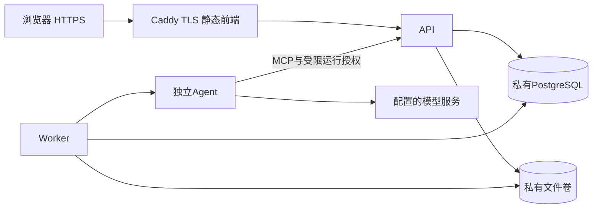

# 部署、备份与回退

本文件最初记录本地部署准备及通用操作。后续用户已授权并完成首次服务器发布，实际URL、IP证书、完整迁移、独立10次额度及验证见[服务器交付](server-release/README.md)。默认Compose仍关闭来源网络；本次服务器通过显式覆盖文件启用，额度耗尽后暂停。启动Agent健康检查不调用模型；发送咨询或解析简历才调用配置的deepseek-v4-pro。

## 部署拓扑



只发布Caddy的80/443，API/Agent/DB均无宿主端口映射。公网反向代理拒绝`/mcp`和`/internal/*`。生产浏览器与API同源，Secure HttpOnly Cookie和CSRF校验启用。Agent没有数据库凭据。日志只记方法、状态和请求ID，不记录正文和凭据。

## 初次启动

1. 准备Linux、Docker及Compose，域名指向服务器，80/443开放给Caddy；检查已有端口和卷，使用独立项目名。
2. 将`deploy/.env.production.example`复制为`deploy/.env.production`，权限0600。各秘密分别生成随机值，例如`openssl rand -hex 32`；填入模型密钥。不要把值发到聊天或提交Git。
3. 配置PUBLIC_HOST及精确AUTH_PUBLIC_ORIGIN。需要代理真实IP时，只信任实际Caddy来源地址或受控CIDR；默认不信任转发头。
4. 已批准目标机部署后执行：

```sh
docker compose --env-file deploy/.env.production -f deploy/compose.yml build
docker compose --env-file deploy/.env.production -f deploy/compose.yml up -d
```

`migrate`等数据库healthy后执行所有迁移，失败时API不启动；Agent等API就绪，Worker等Agent就绪。检查`docker compose ... ps`、公共`/health/ready`和浏览器注册登录，内部Agent健康仅在私网以服务凭据读取。不要在控制台输出展开后的完整Compose配置或环境。

生产镜像保留Prisma CLI用于独立迁移任务，运行用户node；文件卷由镜像目录以node权限初始化。数据库、私有文件、导出和Caddy证书分别持久化。模型与来源网络仅Agent/Worker有出口；真实来源持续执行需另行配置与授权。浏览器默认工作台不会插入测试岗位，空库如实显示空状态。

## 备份与恢复

`deploy/backup.sh /受保护目录`保存自定义格式PG dump及私有文件/导出tar；umask077，输出包含个人资料，必须受控保存并按运营保留策略清理。密钥配置单独由运营方安全托管。备份应在维护窗口暂停Worker及写流量，使DB与文件形成一致恢复点；数据库dump本身是一致快照，文件不能在同时写入时假称一致。

在隔离目标验证备份后，维护窗口执行`deploy/restore.sh 数据库.dump 文件.tar.gz`。脚本会停止业务、替换当前配置项目的数据并恢复文件权限；只在明确选择并检查目标后使用。使用服务器覆盖文件时恢复后保持全部业务停止，先核对额度高水位及删除屏障，再显式启动；默认本地离线配置恢复后自动启动。恢复失败保持业务停止，修复后重新验证健康、数据归属和登录。备份恢复后还需重放该备份点之后的用户删除请求，避免被删个人数据重新可见。

## 发布与回退

GitHub CI配置执行完整17项检查，报告保留7天；配置存在不代表已在远端实际执行。手动release流程仅构建两个镜像并生成带提交SHA的离线镜像包，不推送、不自动上线。最初交付未提供目标服务器，当时未执行真实迁移；现已按用户后续授权完成独立目标发布，Git远端仍未推送。

发布前保存旧镜像标签、提交SHA、schema迁移状态及一致备份；将CAREER_IMAGE与CAREER_WEB_IMAGE固定到已经检查的SHA。先迁移，再启动新API/Agent/Worker，最后切换Caddy流量。迁移失败禁止切换。应用回退仅在旧程序兼容当前schema时替换旧镜像；schema不兼容时停止流量，先在隔离库验证恢复，再显式执行备份恢复。禁止未经检查自动删除列或回滚数据库。

首轮发布检查：注册登录、简历草稿确认、问答、岗位核验、收藏投递、删除补偿、进程重启持久化、HTTPS/Secure Cookie及公网内部入口拒绝。真实模型验证需要新增调用预算，持续采集需要新预算及运营计划；未执行项不能登记为上线通过。
