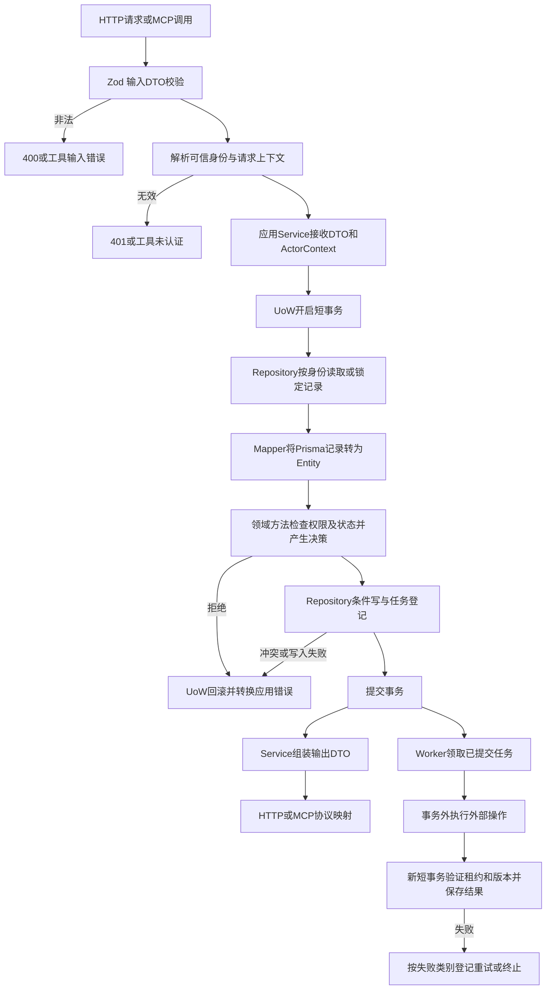

# 公共实现设计

版本：0.1；待用户确认。本文是方案，不创建任何运行工程或数据库结构。

## 输入输出和职责

| 层 | 输入 | 操作 | 输出 |
| --- | --- | --- | --- |
| HTTP / MCP | 协议请求、受信身份、请求 ID | Zod DTO 校验、授权上下文、调用 Service、协议映射 | 输出 DTO / SSE / 工具结果 |
| Service | 输入 DTO、ActorContext | 决定 UoW、读取实体、传入时钟和身份、调用领域行为、持久化、外部协调 | 输出 DTO 或应用错误 |
| Entity | 独立领域类型和完整运行事实 | 不变量、权限、状态转换、业务决策 | 新实体状态或类型化 Decision |
| Repository | Entity / ID / 有类型的查询 / 不透明事务上下文 | 过滤、锁、条件写、Mapper | Entity、投影、ID、受影响行数 |
| Mapper | Prisma 记录或领域实体 | 显式字段映射 | Entity 或内部持久化参数 |
| 外部适配器 | Service 指定的受控请求 | 文件、HTTP、模型或进程外调用 | 校验后的专用结果 / 外部失败 |

异常映射：领域错误归属领域模块；Service 转换外部及持久化冲突；入口映射协议。错误码为业务命名字符串，注明触发条件及客户端行为，不引用开发步骤编号。

## 数据关系和版本

所有 ID 采用 UUID，时间以 UTC 存储、ISO 8601 输出，页面默认 Asia/Shanghai。公告截止时区保留证据；未写截止时刻的日期不擅自补为可肯定判断的精确时刻，当天视为待核验。仅查看“今天”等相对文字不足以核验截止。

| 数据模型 | 关键字段与约束 | 数据含义 |
| --- | --- | --- |
| User / Session / Captcha | usernameNormalized 唯一；sessionDigest 唯一；authEpoch；personalDataEpoch；deletedAt | 身份、撤销、个人数据删除屏障和一次性挑战；不保存明文密码、会话或验证码答案 |
| Profile / ProfileDraft | userId；version；draftVersion；baseProfileVersion；sourceVersion | 已确认画像与草稿分开；职业状态、教育、实习和正式工作分别表达 |
| Resume / ResumeText | userId、fileDigest、storageKey、version、deletedAt；文字页/段定位 | 私有文件及可追溯文字；不能通过公开 URL 读取 |
| Job / JobVersion | source、sourceId 唯一；currentVersionId；contentHash | 稳定岗位标识和不可变版本，招聘类型不表示资格 |
| Announcement / SourceSnapshot | sourceId、hash、fetchedAt、verifiedAt、locator | 岗位关联公告、原始快照、抓取与核验分开 |
| RequirementSet | jobVersionId、reviewStatus、ruleTree、evidenceIds、version | 有 AND/OR/例外的条件树；模型草稿不能自动成为核验通过 |
| EligibilityCheck | userId、profileVersion、jobVersion、evidenceVersion、rulesVersion、evaluatedAt | 三态结果及逐条件解释；依赖更新后不可当作当前结果 |
| Conversation / Message / AgentRun / RunEvent | userId；conversationId+clientMessageId 唯一；runId+sequence 唯一 | 单会话单活跃运行、消息与事件持久化 |
| Favorite / Application / ApplicationHistory | userId+jobId 唯一；version；操作唯一键 | 自有求职管理及变更历史 |
| Task / ExecutionAttempt | dedupeKey 活跃唯一；leaseOwner、leaseUntil、fencingToken、attempt | 至少一次执行、带租约条件写；运行尝试和业务任务分开 |
| IdempotencyRecord / DeletionRequest | actor、operation、key 唯一；requestHash；status | 结果重放、冲突检测及清理进度 |

Prisma 模型和 Mapper 只在 `business` 的持久化基础设施内部，Service 看不到 ORM。UoW 接口与 Repository 端口由业务包导出，具体事务对象不公开。

岗位下架不物理删稳定 Job；个人收藏和投递继续引用其已保存的标题及最近可用版本。用户删除只删除个人数据，不删除公共岗位证据。数据库迁移在第四步以后获批实施，当前只定义关系。

## 公共读写规则

- 读操作也经 Service：按身份过滤；他人私有资源与不存在资源统一 404。
- 修改操作的幂等记录与业务写同一事务；键按用户和操作隔离，保存请求摘要，默认保留 24 小时。自然唯一约束继续防止过期键造成重复。
- 同键同内容返回首次业务结果；同键不同内容 409；运行中返回同一个任务/运行 ID，不重新调用外部系统。
- 更新使用 expectedVersion，失败 409 并让用户刷新，不静默覆盖。
- 全局锁顺序：User → Conversation / Profile / 其他所属主实体 → 子记录 → Task。短事务禁止持有锁等待模型或网络。
- User 逻辑删除和 authEpoch 变化须在写入结果时复查。已删除实体不能被迟到任务恢复。
- 清空个人资料增加 personalDataEpoch；运行/解析任务绑定发起时版本，结果提交必须相等。单个资源删除另校验其deletedAt和version，不必取消用户所有无关任务。
- 长任务登记、状态变化、结果保存分事务。可靠提交后动作与主记录在同事务插入 Task；不用内存回调作为唯一交付保证。
- Worker 领取使用数据库条件领取和行锁跳过已锁记录；租约默认 60 秒、每 20 秒续期，参数配置化。结果提交检查 fencingToken 和主体版本。
- 网络可重试失败最多 3 次，指数退避带抖动；明确 4xx、解析不支持和业务拒绝不重试。模型结果未知标记 interrupted，不无条件重试以掩盖重复计费风险。

## 身份、流和外部边界

- Cookie 为随机不透明会话，数据库只保存摘要；HttpOnly、生产 Secure、SameSite=Lax，默认 7 天有效；修改密码撤销全部会话。
- 同源部署，所有写操作验证 Origin 和 CSRF token；登录与注册也验证，token 通过验证码或当前用户接口获取。验证码响应不包含答案。
- API 在短事务中建立运行并提交后调用 Agent；Agent 内部接口不对公网开放。
- 服务间使用私有网络、服务凭据及后端签发的短时运行授权；绑定 userId、runId、authEpoch、允许工具和过期时间。MCP 每次校验授权和活跃状态，身份不来自模型参数。
- 健康检查、Agent状态查询和取消等控制操作只要求服务身份及明确控制作用域；用户运行及其事件、工具另要求对应运行授权。取消不会因先撤销用户工具授权而失去服务控制权限。
- Agent 不直接写数据库。模型事件经受信回调 DTO 提交业务 Service，再持久化及发布 SSE。事件 ID 由 runId+递增 sequence 标识，重复回调自然去重，乱序不能直接终结运行。
- SSE 是已落库事件的输出，持久化失败时不输出未保存的最终成功。断开页面不自动启动新运行，重连用 Last-Event-ID 回放；显式取消才取消运行。
- 外部网址只接受来源允许的 HTTPS 主机，限制重定向、大小和时长，禁止任意用户 URL 访问内网。文件和网页文字不作为指令。
- 日志不写密码、密钥、完整简历或消息正文。输出引用只能指向实际返回的 evidenceId，前端以安全文本渲染。

## 公共配置提案

默认值均集中于配置 Schema：单文件 10 MiB、最多 30 页、文本 50,000 字符、消息 4,000 字符、每轮最多 8 次工具调用、模型运行 120 秒、源码抓取 20 秒、分页默认 20 最大 100。过长上下文保留正式画像、近期 12 条消息和已持久化摘要，按模型上下文上限继续裁剪；摘要不成为正式用户事实。

HTTP 详细错误、DTO 和工具契约见 [接口契约](contracts.md)；模块级流程和事务以各模块文档为准。任何实质变化重新提交用户确认。
