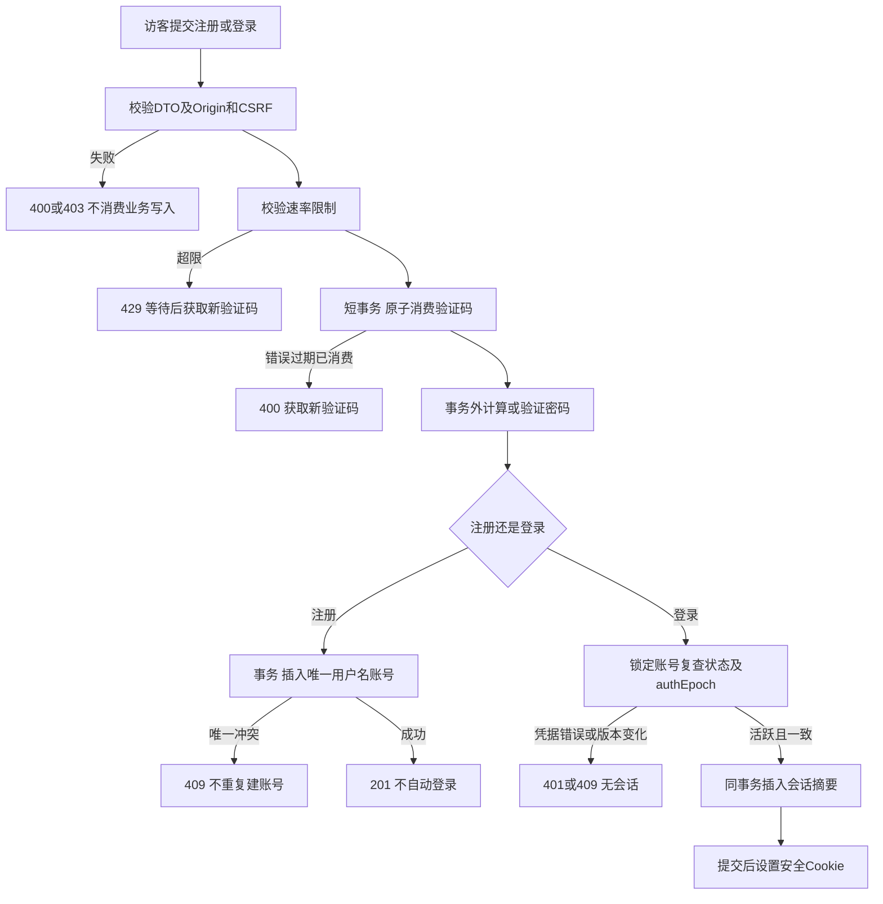
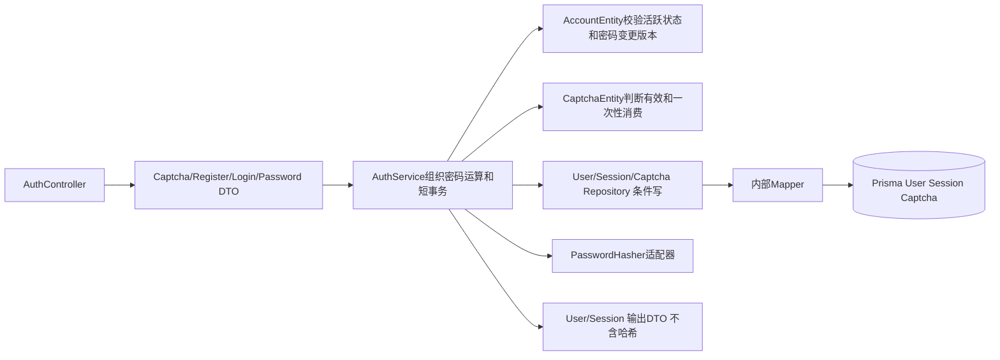

# 账号认证方案

版本 0.1，待用户确认；对应第五步。仅定义方案，不实施账号服务。

## 业务与数据

访客在注册/登录页获取服务端图片验证码，提交用户名、密码及验证码。用户名采用 3—32 位 ASCII 字母、数字、下划线，统一小写作为唯一键；密码 12—128 字符，不裁剪、不记录日志。验证码 6 位不易混淆字符，5 分钟有效，任一校验尝试即原子消费。注册不自动登录，返回账号创建成功后进入登录页；重复注册同名返回冲突，不返回他人资料。

密码使用 Node scrypt、随机盐和带算法参数的哈希格式，参数经工程步骤测试确认并配置化；会话与限流由数据库支持，首版无需 Redis。密码计算放事务外，保存前再次校验相关版本。验证码、限流及会话摘要只能在持久化基础设施访问。

登录失败统一“账号或密码不正确”，避免区别账号不存在；每 IP 每分钟最多 10 次注册/登录、每账号 5 次密码失败进入 15 分钟冷却。成功登录创建 7 天会话；退出幂等撤销当前会话。密码修改需当前密码，成功后增加 authEpoch 并撤销所有会话，用户重新登录。

## 实现和转换

Repository 能力为 getByNormalizedUsername、getForUpdate、insert、consumeIfUnused、insertSession、revokeSessions、updateIfVersion；业务拒绝由实体决定。Service 映射领域错误到应用错误，HTTP 映射见契约。

验证码消费是独立已提交动作，后续注册或密码失败不恢复验证码；网络超时后需要新验证码。重复注册由唯一用户名约束保护；重复登录不承诺重放旧会话凭据，各次成功登录创建独立会话且可统一撤销。退出重复返回 204。

密码哈希计算失败不产生账号；会话落库成功但 Cookie 丢失会留下有有效期的不可使用孤立会话，允许重新登录，不回滚已提交记录。所有私有资源验证账号活跃状态，跨用户读取 404。页面表单不自动重试注册/登录。

## 测试与提交边界

接口见 AUTH-01—06。分层测试覆盖 DTO、密码摘要不泄漏、验证码并发只消费一次、用户名大小写竞争、账号撤销和密码版本竞争。E2E-AUTH 从浏览器注册、登录、读取本人资料、修改密码到旧会话失效；另测错误、冷却和重放。提交边界为账号模型、迁移、认证接口、页面及对应测试；不得提前实现其他模块。
