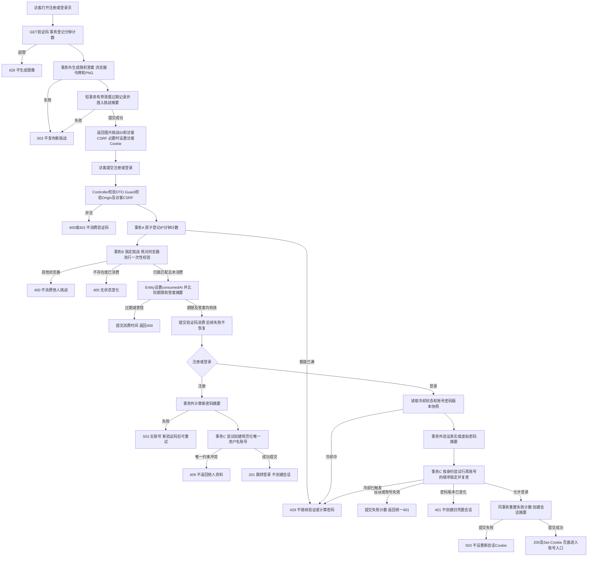
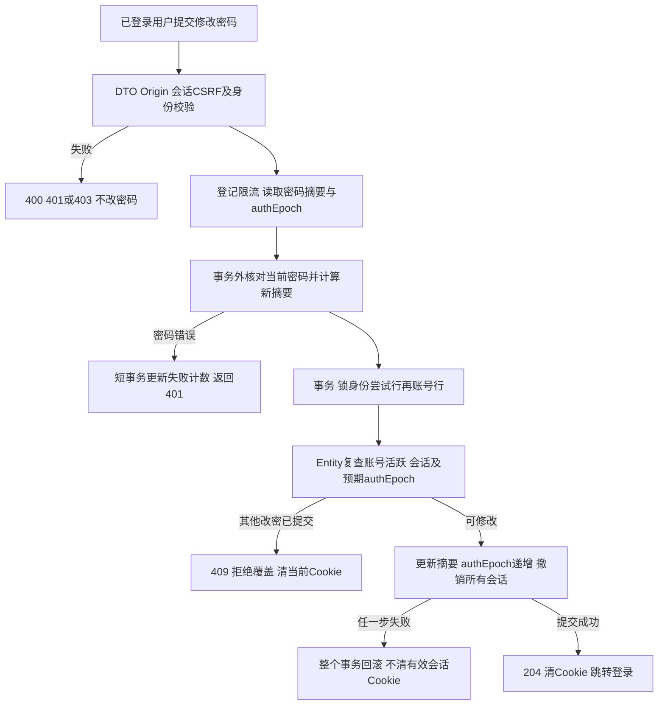
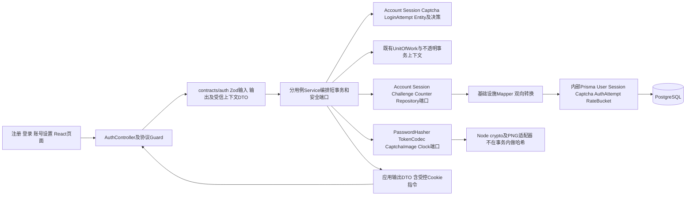

# 账号与认证实施方案

版本0.2，已确认；对应第五步。用户在单独收到本版方案及模块确认请求后回复“继续”，记录为批准按本方案完整实现第五步；完成后停下验收，不授权第六步。

## 1. 目标与本次边界

实现用户名、密码、服务端图片验证码注册登录，当前账号查询、退出和修改密码；无需邮箱或手机号。交付注册页、登录页、账号设置页及受保护页面入口，不提前实现岗位、采集、简历或Agent对话。

正常路径：打开注册页 → 获取图片验证码 → 注册成功 → 进入登录页 → 获取新验证码并登录 → 查看本人账号 → 修改密码或退出。注册不自动登录，改密后所有设备均需重新登录。

相对0.1，本方案补齐匿名CSRF初始化、验证码浏览器绑定、会话撤销竞争、真实图片生成、表结构/端口、逐接口验收及第四步能力复用。下列参数均是本项目待确认的具体方案，不代表已经实现或测试通过。

## 2. 规则与配置

| 项目               | 方案                                                                                                                                       |
| ------------------ | ------------------------------------------------------------------------------------------------------------------------------------------ |
| 用户名             | 3—32位ASCII字母、数字、下划线；统一小写作为显示和唯一键；不自动裁剪，非法空格直接400                                                       |
| 密码               | 12—128个Unicode码点，UTF-8最多512字节；不裁剪、不做Unicode归一化；不得入日志、明文数据库或浏览器持久存储                                   |
| 图片验证码         | 6位数字，字符集23456789，5分钟有效；PNG 240×80，通过pngjs编码自带位图字形与噪点，不依赖系统字体或外部验证码服务                            |
| 验证码随机性与存储 | crypto.randomInt生成；明文仅生成图片时短暂存在；持久化绑定挑战ID的HMAC摘要和浏览器摘要，不在JSON、日志或图片元数据中写答案                 |
| 验证码消费         | 结构、Origin、CSRF、限流通过后才尝试消费；同一浏览器对已存在挑战的第一次业务校验尝试即消费，答错也不能复用；其他浏览器不能消费该挑战       |
| 刷新与多标签页     | 每次获取独立新挑战；不自动作废其他标签页仍未过期的挑战；过期、已消费统一400，提示刷新                                                      |
| 密码摘要           | Node异步scrypt：N=131072、r=8、p=1、16字节随机盐、64字节派生结果、maxmem=192MiB；编码保存算法及参数，恒定时间比较                          |
| 密码计算资源       | 每个API进程最多2个并行计算，排队最多16个；满载429，拒绝后不能偷偷再次计算；计算在事务外，运行时实测耗时及内存，不静默降低参数              |
| 请求限流           | PostgreSQL固定分钟窗口：每IP注册+登录合计10次/分钟，验证码30次/分钟，修改密码10次/分钟；超限429并附Retry-After                             |
| 密码失败冷却       | 每个规范化用户名连续5次失败，冷却15分钟；不存在的用户名同样计数和执行虚拟密码验证；第5次失败401，冷却中的后续尝试429；成功或冷却到期后重置 |
| 会话               | 32字节随机不透明令牌，7天固定有效期，不滑动续期；数据库只存HMAC摘要，不用JWT或localStorage                                                 |
| Cookie             | HttpOnly、SameSite=Lax、Path=/、不设置Domain；生产HTTPS使用Secure和__Host-前缀，本地HTTP采用独立dev名称；不把会话令牌放JSON                |
| 配置               | 新增AUTH_PUBLIC_ORIGIN、AUTH_TOKEN_PEPPER、AUTH_CSRF_SECRET及限流/哈希配置；秘密随机生成并仅写本地忽略文件，生产禁止空秘密或不安全Cookie   |

scrypt参数起点参照[OWASP密码存储说明](https://cheatsheetseries.owasp.org/cheatsheets/Password_Storage_Cheat_Sheet.html)，异步接口和资源限制参照[Node crypto](https://nodejs.org/api/crypto.html#cryptoscryptpassword-salt-keylen-options-callback)。PNG编码能力参照[pngjs官方实现](https://github.com/pngjs/pngjs)。编码阶段锁定兼容依赖版本，不使用浮动latest。

IP只从受信网络上下文提取；默认不信任X-Forwarded-For。需要反向代理时仅接受配置的可信代理范围，不能由客户端伪造限流身份。数据库限流键使用带作用域的HMAC，不记录原始IP或把账号是否存在写入限流响应。

## 3. Origin、CSRF及身份边界

- 浏览器同源访问/api/v1，开发Vite代理转发该路径。所有写操作要求Origin精确匹配AUTH_PUBLIC_ORIGIN，缺失或不匹配403；不启用任意跨域凭据访问。
- 首次GET验证码时下发随机HttpOnly访客Cookie；CaptchaDto的csrfToken为与访客令牌绑定的HMAC。挑战保存访客摘要，注册/登录既校验CSRF，也校验挑战浏览器归属。
- 登录成功新建会话令牌。会话CSRF由独立秘密对带用途前缀的原始会话令牌派生，GET /auth/me可重新返回，不需要在数据库保存可恢复的明文CSRF。
- 不采用直接比较两个未签名Cookie的方式；HMAC使用用途前缀与明确长度编码区分访客、会话、挑战和限流数据。参考[OWASP签名双提交方案](https://cheatsheetseries.owasp.org/cheatsheets/Cross-Site_Request_Forgery_Prevention_Cheat_Sheet.html)。
- Origin/CSRF属于HTTP Guard或安全适配器职责；Service不处理Express对象或HTTP头。API只把经校验的输入DTO和受信身份DTO交给应用服务。
- 会话解析每次核对会话有效期、revokedAt、账号deletedAt及authEpoch；用户身份不得由JSON中的userId指定。涉及账号变化的写操作必须在提交事务内再次核验。
- 退出特殊幂等规则：有Cookie时必须校验CSRF，但已撤销/已过期令牌也只能用于退出；无Cookie时有效Origin下直接204清Cookie，不访问或修改他人记录。其他私有入口均仍为401。
- 认证JSON统一Cache-Control: no-store；不在URL放凭据，不记录正文、Cookie或Set-Cookie。注册返回访客CSRF，登录和me返回会话CSRF；HTTP适配器负责相应Cookie映射，Service不输出完整HTTP响应。

## 4. 业务流程、事务和异常

流程说明：错误验证码和密码失败等需要保留的安全计数先提交，再由Service返回类型化拒绝结果，不能通过抛异常回滚掉应保留的消费或计数。数据库本身失败则回滚当前短事务并503；此前已提交的验证码消费和限流计数不回滚。

受保护读取路径：Guard提取候选会话 → AuthSessionService以摘要获取Session/Account Entity → Entity验证时间和版本 → 输出CurrentUserDto → Controller映射UserDto。GET不延长会话或改变账号状态；密码修改不能追溯撤回已经完成认证的读取，但后续写入必须重新验证事务内状态。

状态机：验证码unused→consumed，或由expiresAt推导expired；会话active→revoked/expired；账号以deletedAt决定活跃状态，authEpoch只递增；登录尝试available→cooldown→到期可重置。时间由Clock端口显式传入，Entity不得自行读取系统时间。

## 5. 分层实现与转换位置

- Controller/API：HTTP解析、结构校验、受信上下文提取、Service调用、Cookie/状态码映射。不能调用Repository或执行账号状态判断。
- Service：分别组织IssueCaptcha、Register、Login、ResolveSession、Logout、ChangePassword；DTO→领域输入在这里转换，Entity→公开DTO也在这里完成。共享会话服务复用，不把全部认证流程塞进单一大Service。
- Entity：Account决定活跃状态和密码版本变化；Captcha决定归属、到期与消费；Session决定是否可用或已撤销；LoginAttempt决定冷却与计数。复杂判断不得塞在Controller、Service或Repository。
- Repository：getByNormalizedUsername、getForUpdate、insertAccountIfAbsent、getSessionByDigest、insertSession、setRevokedAtIfUnset、updatePasswordIfEpoch、getChallengeForUpdate、markConsumedIfUnused、insertBucketIfAbsent等数据动作；只接收/返回Entity、明确投影及写入结果。
- 密码和令牌处理：原始凭据只通过受控DTO/端口处理；领域或持久化所需摘要以内部VO/Entity表示，绝不进入公开输出。Prisma Model和生成类型仍只存在持久化基础设施。
- 应用异常：业务拒绝映射到稳定应用错误码；HTTP统一映射400/401/403/409/429/503，扩展现有错误DTO，健康接口原契约继续兼容。
- 账号级锁顺序固定为身份尝试行→User→Session；验证码消费和IP限流是独立事务，不能与长密码计算持锁混用。不存在的用户名竞争依赖唯一约束，不能先查不存在后无约束插入。

## 6. DTO、数据结构和数据库变化

完整HTTP路径如下；输入均strict，拒绝额外userId/角色字段。请求/响应沿用requestId契约，204无JSON正文。

| 操作                               | 输入                                    | 输出与效果                                 |
| ---------------------------------- | --------------------------------------- | ------------------------------------------ |
| AUTH-01 GET /api/v1/auth/captcha   | 无查询字段；可带已有访客Cookie          | 200 CaptchaDto；必要时设置访客Cookie       |
| AUTH-02 POST /api/v1/auth/register | RegisterInput；访客Cookie及X-CSRF-Token | 201 UserDto；不创建登录会话                |
| AUTH-03 POST /api/v1/auth/login    | LoginInput；访客Cookie及X-CSRF-Token    | 200 UserDto；提交后设置会话Cookie          |
| AUTH-04 POST /api/v1/auth/logout   | 空输入；Cookie及适用CSRF                | 204；撤销当前会话并清Cookie，重复无副作用  |
| AUTH-05 GET /api/v1/auth/me        | 无输入；有效会话Cookie                  | 200 UserDto；不接受userId，不泄漏会话摘要  |
| AUTH-06 PUT /api/v1/auth/password  | PasswordInput；会话Cookie及X-CSRF-Token | 204；摘要更新、authEpoch递增、全部会话撤销 |

| DTO                        | 字段与约束                                                                                                                                                                              |
| -------------------------- | --------------------------------------------------------------------------------------------------------------------------------------------------------------------------------------- |
| CaptchaDto                 | captchaId UUID；imageDataUrl为image/png，完整data URL最多160KiB；expiresAt ISO时间；csrfToken为64位十六进制HMAC；无答案                                                                 |
| RegisterInput / LoginInput | username；password；captchaId UUID；captchaAnswer为23456789中的6位数字；HTTP头不塞入该公开DTO                                                                                           |
| PasswordInput              | currentPassword/newPassword各自遵循密码长度约束；允许新旧相同但仍撤销会话；不额外传userId                                                                                               |
| UserDto                    | id UUID；username规范化后的小写名；createdAt ISO时间；csrfToken；不含哈希、摘要、epoch或原始会话                                                                                        |
| AuthContextDto             | requesterDigest为64位十六进制；visitorDigest可选且同格式；actor可选，含userId/sessionId UUID及authEpoch非负整数；均由Guard构造，不取自JSON                                              |
| AuthServiceOutput          | 登录结果为user:UserDto和sessionCredential:43位base64url；验证码结果为captcha:CaptchaDto及可选visitorCredential同格式；退出/改密为clearSessionCookie:true；凭据仅映射Cookie，不入payload |

SessionCredentialInput为仅供HTTP适配器调用会话解析服务的内部DTO，含可选43位base64url会话令牌；解析结果为AuthenticatedActorDto（userId、sessionId、authEpoch），不允许客户端在请求JSON提供。Clock提供的当前时间作为领域方法参数，不把HTTP细节带入Entity。

新增表：

| Model            | 字段、索引及映射                                                                                               |
| ---------------- | -------------------------------------------------------------------------------------------------------------- |
| User             | id UUID；usernameNormalized varchar(32)唯一；passwordHash；authEpoch非负整数；createdAt、updatedAt、deletedAt? |
| Session          | id UUID；userId外键；tokenDigest唯一；authEpoch；expiresAt索引；revokedAt?、createdAt；不存原始令牌            |
| CaptchaChallenge | id UUID；visitorDigest；answerDigest；expiresAt索引；consumedAt?、createdAt；无明文答案                        |
| AuthAttempt      | identityDigest唯一；consecutiveFailures非负；cooldownUntil?；updatedAt；不存在的用户名也能登记                 |
| AuthRateBucket   | scope+subjectDigest+windowStart复合唯一；attemptCount非负；expiresAt索引                                       |

Prisma↔Entity转换仅在各Repository/Mapper内部。扩展既有createPersistence装配入口以提供认证端口，不能让API直接导入Prisma。新增迁移只创建认证表、唯一/外键/检查约束和索引，不清理既有基础表或用户数据。

过期挑战、桶和会话按索引执行有界清理，每次最多100条，跳过已锁行；不删除仍有效的会话。清理作为创建挑战事务中的维护动作，失败不影响既有登录；本次挑战创建失败则503。不提前建立完整采集Worker。

## 7. 重复、并发、失败及恢复

| 场景                          | 确定行为                                                                          |
| ----------------------------- | --------------------------------------------------------------------------------- |
| 相同验证码并发提交            | 挑战行锁及条件写保证至多一个请求消费；其他请求400；不会重复创建账号或重复验证密码 |
| 两个验证码注册同名/大小写变体 | usernameNormalized唯一约束保证一个201，另一个409；返回值不带已有用户资料          |
| 答错/密码错/用户名冲突后重试  | 原验证码不恢复；前端刷新新验证码，注册/登录不自动重发                             |
| 客户端网络超时                | 结果可能已提交；注册可用新验证码尝试登录；不能承诺重放原会话Cookie                |
| 同账号多个正常登录            | 各自新建独立会话，原有设备不被自动退出；账号改密统一撤销                          |
| 登录计算期间发生改密或删号    | 提交前复核epoch/活跃状态，旧凭据不创建有效会话                                    |
| 并发改密                      | 首个提交成功204；旧版本的另一个请求409，已失效请求在入口即401；不能静默覆盖       |
| 改密与退出/登录竞争           | 最终在账号锁和epoch上串行判定，改密前创建的会话全部失效；不可在旧版本下补建会话   |
| 退出重放/空Cookie             | 仅撤销当前令牌；相同令牌、已撤销令牌或空Cookie重复退出204，不放宽其他私有入口     |
| 数据库失败                    | 当前事务回滚503，不签发新登录Cookie；已有消费和限流提交保持原样                   |
| 哈希/PNG适配器失败            | 明确503，不生成伪成功；哈希计算失败不创建账号，渲染失败不发布新挑战               |
| DB已提交但响应或Cookie丢失    | 不补偿删除已创建账号；会话自然过期，可用新验证码重新登录                          |
| 多API进程                     | 限流、验证码消费、账号和会话一致性均由PostgreSQL保证；哈希并行上限是每进程配置    |

稳定错误码与恢复动作：

| 错误码                      | HTTP | 触发与调用方动作                                                            |
| --------------------------- | ---- | --------------------------------------------------------------------------- |
| INVALID_INPUT               | 400  | 结构非法；修正字段，未进入验证码消费                                        |
| FORBIDDEN                   | 403  | Origin/CSRF不匹配；从本站刷新安全上下文，不自动重发写操作                   |
| AUTH_INVALID_CAPTCHA        | 400  | 挑战不存在、答错、过期、已消费或浏览器不匹配；统一刷新提示，不泄漏答案/归属 |
| AUTH_INVALID_CREDENTIALS    | 401  | 登录信息不匹配或当前密码错误；登录统一提示账号或密码不正确                  |
| AUTH_UNAUTHENTICATED        | 401  | 会话不存在、过期、撤销或账号不可用；清前端身份并重新登录                    |
| AUTH_USERNAME_CONFLICT      | 409  | 规范化用户名唯一冲突；换用户名或进入登录，不返回已有资料                    |
| AUTH_VERSION_CONFLICT       | 409  | 改密期间版本改变；重新登录后再操作，禁止旧请求覆盖                          |
| AUTH_RATE_LIMITED           | 429  | 分钟预算、密码冷却或哈希队列额度耗尽；按Retry-After等待，不自动重试         |
| AUTH_DEPENDENCY_UNAVAILABLE | 503  | 数据库、哈希或图片适配器失败；如实提示，不能推断本地前序事务未提交          |

本模块不发送邮件、短信或外部通知，不调用模型、MCP或来源网站，无外部网络事务需要补偿。所有Cookie在本地事务提交成功后设置；提交后传输失败不能回滚数据库。

## 8. 前端路径与操作

- /register：用户名、密码、确认密码、验证码图片及刷新；确认密码仅前端一致性检查；提交过程中禁用重复按钮。
- /login：用户名、密码、验证码；成功读取me并进入账号入口；失败按状态显示提示，验证码已尝试时刷新，表单保留用户名、不长期保留密码。
- /settings：展示本人用户名，修改密码和退出；改密成功后清前端身份并跳转登录；刷新页面通过me恢复状态。
- 访问受保护入口未登录跳转/login；登录后不展示尚未实现的岗位或聊天功能。第四步首页连接检查保留，避免破坏现有E2E。
- API与前端共享contracts Zod契约；私有页面不从localStorage读取身份或令牌，不用前端路由守卫代替后端鉴权。

## 9. 测试、复用及提交边界

编码前已检查：可复用UnitOfWork、现有Prisma装配、Logger/请求标识/异常框架、Zod契约包、隔离PostgreSQL启动器、Playwright和接口AST检查器。当前没有User/Session/Captcha表或密码/验证码公共实现；不得复制第三步模型/来源客户端来实现认证。

计划将安全领域与用例放packages/business对应domain/application目录，crypto/图片/数据库适配器放infrastructure；HTTP Guard/Controller归apps/api，DTO归contracts/auth。保留API与Agent独立运行，现有4个健康操作不迁入私有业务前缀或改变认证规则。

| 测试范围       | 待实现的断言                                                                                                   |
| -------------- | -------------------------------------------------------------------------------------------------------------- |
| DTO            | 用户名边界、额外字段、Unicode密码长度、验证码格式、响应无敏感字段                                              |
| Entity         | 活跃/删除、挑战归属和一次消费、过期精确边界、session撤销、epoch冲突、冷却到期                                  |
| Repository     | 全部映射/索引/唯一性；两条独立连接抢验证码、用户名、改密和限流；回滚后不留下错误会话                           |
| Service/适配器 | 哈希在事务外、成功后才设Cookie、失败计数不会因业务拒绝回滚；虚拟密码验证；密码异常/PNG异常；原始秘密不进入日志 |
| AUTH-01        | PNG真实可显示；无答案字段/文本元数据；新挑战、绑定、过期及30次限流                                             |
| AUTH-02        | 注册201且不登录；大小写冲突409；错误验证码消费；两个验证码抢用户名；CSRF/Origin拒绝和失败不创建账号            |
| AUTH-03        | 正确Cookie及me；错误统一401；未知账号/错误密码相同响应；重放400；5次冷却；版本竞态无旧会话                     |
| AUTH-04        | 仅撤销当前设备；重复/空Cookie204；坏CSRF或Origin403；其他私有接口不受该幂等例外影响                            |
| AUTH-05        | 仅返回本人安全字段和会话CSRF；不存在/过期/撤销会话401；伪造userId不能切换账号                                  |
| AUTH-06        | 当前密码错误401；成功全部旧会话失效；并发冲突；更新和撤销同事务回滚                                            |
| E2E-AUTH       | 浏览器实际注册→登录→刷新恢复→第二浏览器登录→改密→两个旧会话失效→新密码重登→重复退出；另测错误、限流和重放      |
| 回归           | 保留第四步真实浏览器/进程E2E、4个健康接口和第三步77个工具回归；不新增真实模型/来源请求                         |

浏览器E2E从测试专用进程装配可控验证码随机源和Clock，生成与已知答案一致的真实PNG，走真实HTTP、scrypt和PostgreSQL。生产main不读取测试答案/跳过验证环境开关，不新增可绕过认证的HTTP调试入口；生产随机源另有适配器测试。正式哈希参数至少有实际执行测试，不能只测低成本替身。

新增/修改实际接口必须同步tests/interface-registry.json及逐操作测试，未登记时构建门禁失败。完整模块通过分层测试、真实PostgreSQL并发、本地启动和E2E后才能交付。

实现顺序：契约/领域与配置 → 迁移/Repository/安全适配器 → Service/HTTP身份边界 → 注册登录设置页面 → 逐层/接口/并发及模块E2E → 完整检查与本地提交 → 提交第五步检查并停下。提交只包含认证模块和必要的基础适配及测试，不夹带第六步功能；不推送远端。

## 10. 确认与执行状态

- [x] 第四步由用户“我已检查完成，继续实现”明确验收。
- [x] 核对现有公共能力并生成账号模块0.2完整实施方案。
- [x] 用户在本版本及模块确认请求后回复“继续”，确认第五步编码。
- [x] 完整实现并验证后[交付用户检查](../auth/README.md)，136个测试和16项检查通过；未进入第六步。

## 实现记录

账号模块按本方案完成，详细证据见交付记录。HTTP状态映射只保留在API适配器；清理总预算为三表合计100条。SQL外键与Prisma规则一致，新增无漂移测试。API就绪检查同时确认认证表可解析，表缺失不误报可用。源码、测试、迁移和必要基础适配一并提交本地，不推送。
