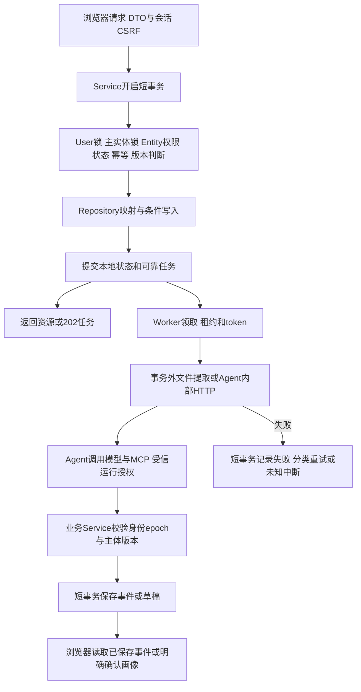

# 第七至十二步批量本地实施补充

用户明确要求“将后面任务全部写完吧，明天我来检查”，本轮据此连续执行。第七步沿用jobs-eligibility.md 0.2；第八至十二步在各既有方案0.1基础上按本补充实现，不等待中间确认，集中交付检查；未获得远端或新增收费预算授权。

## 顺序和模块边界

1. 岗位查询、只读正式画像和资格规则：按第七步0.2实现6个接口及页面，新增Profile/Check存储。
2. Agent/MCP/聊天：新增Conversation、Message、AgentRun、RunEvent。业务后端保存运行及事件，独立Agent只接收受信任务，通过官方MCP SDK Streamable HTTP调用业务Service，不访问业务DB。模型为deepseek-v4-pro，生产使用配置密钥，测试用可控HTTP模型，不能用固定答复假装真实模型。
3. 简历画像：multipart文件、粘贴、私有内容读取、解析任务、画像草稿编辑/确认和删除；正式画像只能显式确认更新。PDF/DOCX/TXT本地提取，独立Agent生成结构草稿并返回定位，后端验证原文再保存，扫描/加密/超限失败，不OCR、不自动确认。
4. 收藏投递：用户+岗位自然唯一，收藏重复成功；投递状态和备注版本CAS，历史与主记录同事务，删除不复活。
5. 工作台与隐私：整合页面、加载/错误/移动端和可信说明；用户删除增加个人数据epoch、撤销运行写权限并登记清理，文件清理失败可恢复；公共岗位保留。
6. 部署准备：Dockerfile/Compose/反向代理HTTPS配置、备份恢复/回退和CI模板、本地生产构建启动验证、交付清单。无远端时不伪造线上URL或7天可用承诺；自动发布配置保持需显式启用。

## 数据流与事务

所有HTTP/MCP输入输出使用DTO；Service不导入Prisma。Domain维护会话单运行、草稿/画像版本、投递转换、删除屏障与资格三态；Repository仅数据操作。并发锁顺序User→所属主实体→子记录/任务；来源依赖沿用来源流→按UUID锁资源。网络、模型、文件正文I/O不在业务事务内。

消息以conversationId+clientMessageId防重，同内容返回原runId，改内容409；新消息遇活跃运行409。后端提交运行后由持久队列派发，租约到期且模型结果未知标interrupted，不盲目再次计费。Agent事件以runId+sequence唯一，同序同内容幂等，乱序/终结后拒绝；SSE只回放落库事件，断线不新建运行。

服务令牌只用于服务身份，另加短期签名授权绑定userId、runId/资源、authEpoch、personalDataEpoch、工具范围和到期。模型不能指定用户身份，MCP每次复查活跃运行和删除状态。取消立即撤销写入权限，外部取消失败不恢复本地授权。注入资料作为不受信文本，不改变工具范围；模型引用必须来自真实工具返回的证据。

简历先预存私有文件，再事务登记Resume和解析任务。解析完成复核文件/用户epoch及版本；删除后晚到结果不得写入。提取文字按页/段定位，模型每项事实须对应真实片段；草稿与正式画像分表。确认锁User和Profile/Draft，expectedVersion冲突409；重复确认返回原结果及是否当前。删除文件保留已确认用户事实但移除可访问原文；清空画像才清正式事实。

## 接口、测试和预算

沿用contracts.md中CHAT/INT/MCP/RES/PROFILE/FAV/APP/PRIV操作清单，不开放未实现工具。每个HTTP和每个MCP工具登记独立测试，包含认证/归属、DTO、错误、重放；持久化使用真实隔离PG，模块分别有浏览器或真实进程E2E。覆盖模型超时/注入/工具失败、消息与事件并发、画像确认冲突、跨用户、删除迟到写入及文件清理补偿。

每轮模型运行120秒、最多8次工具调用，限制文本/文件/上下文和响应大小；模型失败明确失败。常规验证不消费真实模型/来源；历史来源53、模型5不改变，最终报告区分第三步真实模型能力证据与本轮可控服务端到端验证。运行时密钥只从本地私有配置加载，不写日志、Git或对话导出。

## 交付

按模块创建可Review中文本地提交，保留各步方案、逐接口矩阵、实际测试报告和限制。最终集中供用户检查，不将批量开发授权当作用户已经验收实现。出现环境或外部资源缺口时继续完成不依赖该资源的部分，交付明确未执行的真实调用、远端和上线事项。

## 实现落点

具体入口、响应、重复请求、容量和UI适配以[运行契约](runtime-contracts.md)为准。文件预存前先登记延迟清理凭据，避免进程崩溃留下无记录的孤立文件；HTTP受信上下文同时绑定认证时的个人资料epoch，删除前已认证的迟到上传返回409，不恢复已删数据。共享执行和文档资源上限集中在contracts/execution-policy.ts，与运行数据库CHECK同步维护。
