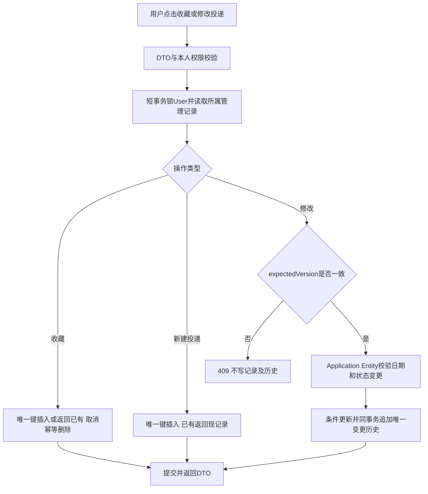
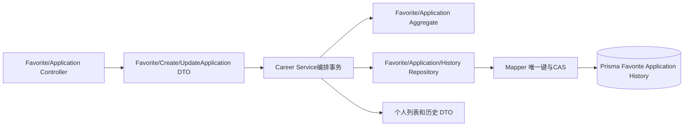

# 收藏与投递管理方案

版本 0.1，待用户确认；对应第十步。收藏与投递分别有模块 E2E。

## 业务与操作

只有用户明确点击才能写入。收藏与投递彼此独立，收藏不自动建投递，聊天“我想投”不等于报名完成。外部投递只打开经过核验的 HTTPS 地址，系统不代填或提交。

Favorite 按 userId+jobId 唯一，添加返回已有，取消不存在记录也 204。Application 同样唯一，创建默认准备投递，保存用户所见岗位版本和标题；备注最多 2,000 字符，用户输入操作日期不能在未来。状态包括准备投递、已投递、笔试、面试、录用、未通过、已撤回。

允许用户纠正任意状态，改变时记录 oldStatus、newStatus、用户日期、记录时间及备注，不强制现实中所有流程都必须经过笔试。相同状态且相同备注不制造新历史。删除投递记录连同个人历史，后续重新创建为新资源；外部岗位过期不删管理记录。

Repository 为 getOwned、insertOrGet、updateIfVersion、insertHistoryIfAbsent、deleteOwned、listOwned。Entity 决定变化是否有效；Repository 不使用“处理用户投递业务”等用例方法名。对两个并发不同变更，只有一个 expectedVersion 成功；历史写入失败回滚主记录。所有动作本地事务完成，无外部副作用或远端报名补偿。

## 测试和提交

FAV-01—03、APP-01—06。E2E-FAVORITE 包括详情收藏、列表、重复点击、取消、下架记录；E2E-APPLICATION 包括创建、日期备注修改、状态纠正、历史、刷新登录持久化、删除和跨用户隔离。Repository 实测并发唯一插入和冲突时不追加历史；接口均验证期望版本。仅提交本模块及相应测试。
