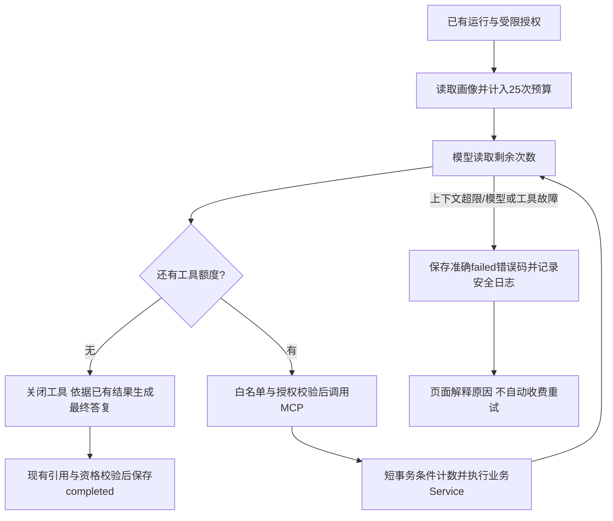
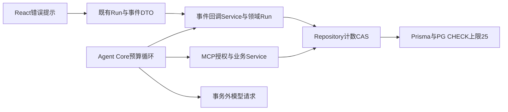

# 咨询工具预算与失败处理修复

用户明确要求“工具次数调成25次，修改错误代码，然后推送到github并且更新线上”，据此执行本次既有模块修复、GitHub推送及47.95.166.110更新，不重复申请同一授权。历史未授权推送说明不再限制本次操作。

## 范围与处理

- 单运行工具调用上限从8改为25，仍包含自动读取画像和失败调用。共享策略、授权校验、持久化条件更新与新增数据库CHECK迁移保持一致，保留历史迁移。
- 模型每轮收到可信剩余次数提示；达到25次后关闭工具，仅允许根据已获取证据收尾。单批超过剩余额度时，未执行的工具返回明确未执行结果，不能伪造成功；不调用第26次工具。模型不遵守禁用要求时明确失败。
- 上下文超限使用独立MODEL_CONTEXT_EXCEEDED，不再冒充工具次数不足；失败事件标记可操作性，页面按错误码说明。Agent日志只记录运行ID和安全错误码，不含用户正文、参数、授权和密钥。
- 保持资格规则、已确认画像、幂等与User→Run锁顺序、事务边界和收费重试规则。数据库仅放宽既有计数CHECK，不清零运行和来源预算。

## 验证与发布

覆盖超过旧8次仍成功、25次允许/26次拒绝、并发计数不超过25、预算耗尽后禁用工具收尾、单批超额未执行、上下文错误分类及页面提示。复用真实PG/MCP/浏览器夹具和受控模型，不发新收费推理。执行质量检查、构建与相关回归。

推送外层job-search仓库main的明确修复提交，保留未相关改动。线上使用新发布目录与固定镜像，等待在途运行结束，暂停业务形成备份；保留原卷、私有配置、证书及来源预算，迁移后更新本项目容器。迁移/健康失败则保留备份并恢复兼容旧镜像，不覆盖未知服务。发布后核对HTTPS、实际策略25与数据库约束、数据摘要/数量、来源预算和新错误提示。记录实际结果，完成不代表用户验收。
