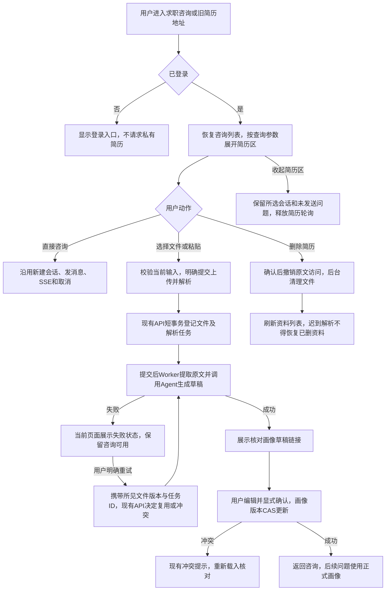
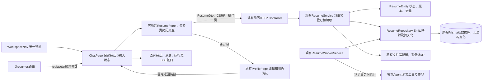

# 求职咨询与简历统一入口方案

版本0.1；状态：已实现，待用户检查。用户提出“求职咨询和上传简历放到一个入口里吧”，方案9ccdc86提交后，用户“先执行改动”明确要求优先落实该入口调整；岗位采集不在本次执行范围。实现完成后仍待用户检查。

## 用户操作与范围

统一使用`/chat`，导航只保留“求职咨询”。咨询输入区增加“上传简历 / 管理简历”，点击后在当前页面展开简历区，可上传PDF/DOCX/TXT或粘贴文本，查看历史资料、解析状态、提取原文、显式重试与删除；收起简历区后继续原对话，未发送问题和所选会话不清空。

不要求先创建会话才能上传，不要求先上传才能咨询。简历仍归属于用户，供不同会话复用；本次不引入会话附件绑定或把原文自动追加到聊天消息。

生成草稿后沿用“核对画像草稿”，打开现有画像编辑/确认页，提供返回求职咨询的明确链接。只有用户确认后的正式画像能进入后续咨询和资格判断。一次正在进行的回答不因画像确认自动重启或重复计费，后续问题读取新正式画像。

旧`/resumes`地址使用replace跳转到`/chat?resumes=open`，自动展开简历区；刷新保留展开状态。不再提供第二个独立简历导航入口。手机上简历区纵向展开，按钮可触达，不产生横向滚动。

## 业务流程与异常

- 上传进行中禁用该上传提交，双击、同文件复用、跨标签重复及重试竞争由现有幂等/版本契约处理；不添加前端自动收费重试。
- 解析失败不会阻止输入咨询，不自动发送“分析简历”消息。现有`MODEL_INTERRUPTED`错误分类过于笼统的问题仍属已知限制，合并入口不视为已修复该故障。
- 上传、读取列表或查看原文失败显示各自区域错误；聊天连接和简历轮询相互独立。收起/离开后释放简历轮询，后台已登记任务继续。
- 同时解析与问答沿用独立运行与额度；画像草稿未确认时不会进入正式事实。删除、会话串行、并发确认和迟到防护保持现有后端规则。
- 不改数据库、DTO、Entity、Repository、事务或权限边界，不迁移和删除已有用户资料。

## 开发实现图

复用现有`ResumesPage`的上传/粘贴、列表、轮询、原文和重试交互，抽出无导航、无页面主标题的`ResumePanel`；仅在已登录且展开时挂载。`ChatPage`负责展开状态和组件布局，不混入上传协议；避免嵌套两个工作台导航和两个h1。`ProfilePage`增加固定咨询返回链接，不接收任意跳转URL。

API使用原有DTO、应用Service、领域Entity及Repository；所有写入继续通过原API认证、CSRF、幂等和版本校验。前端不直连Agent/MCP或数据库。模型及文件调用仍发生在既有事务外，本次不新增外部调用或补偿任务。

## 实施TODO与验证

1. 用户确认本方案后，抽出简历面板，合并导航和旧路由，添加输入区入口及画像页返回咨询路径。
2. 完善桌面/移动端展开、失败/空状态和键盘操作；验证展开/收起不丢失问题和所选会话。
3. 更新原简历E2E兼容跳转及操作路径；更新移动端全流程，从咨询入口上传、核对确认、返回咨询。增加统一入口E2E，覆盖无简历直接问答、展开/收起保留输入、解析失败时仍可咨询、刷新展开状态；用受控模型和隔离数据库，不使用用户简历或新增真实模型请求。
4. 构建、格式、Lint、类型、架构及接口清单检查，执行受影响的聊天、简历、画像和移动端浏览器回归；API未改动，不新增HTTP契约。检查git diff --check和产物/凭据，完成中文本地提交和页面验证后交付检查。

本方案已按授权实现，8项受影响浏览器E2E通过，结果见[本次交付](../delivery/consultation-entry/README.md)。原完整测试报告为历史交付结果；本次不把旧报告当作全套重跑。
