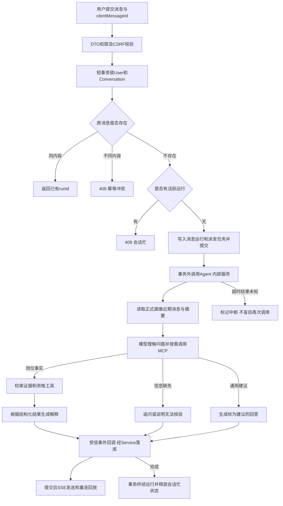
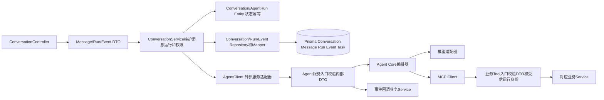

# Agent、MCP 和多轮对话方案

版本 0.1，待用户确认；对应第八步。第九步增补简历和画像草稿工具，不把未实现工具伪装为可用。

## 对话和数据路径

用户登录后可创建会话，无简历也能询问求职问题。消息绑定 clientMessageId；同会话同 ID 重复发送先返回原运行，再检查忙状态，避免原消息重试被误报忙。新 ID 遇活跃运行返回 409，由用户完成或取消后重发，不静默排队改顺序。

## 层次实现

Agent Core 不维护自己的用户数据库。业务 Service 取出已经映射的会话实体后组装 AgentRunInputDto；个人原文只在需要时通过工具读取。API 调用 Agent 时不持有事务。派发任务和回调幂等键都含 runId；Agent 进程只允许同 runId 同时执行一次，重启后由后端状态判定恢复，不声称跨系统恰好执行一次。

回调事件包括 text_delta、citation、job_cards、profile_draft、completed、failed。事件带 sequence，从 1 连续递增；相同序号同内容返回原确认，不重复写；内容不符或出现缺口 409，Agent 顺序重送，不提前完成。运行终结后不得追加正文。浏览器不持有内部凭据。

Repository 能力为 getForUpdate、findMessageByClientId、insertRunIfIdle、appendEventIfNext、finishIfRunning、listEventsAfter。Entity 校验状态、权限、序号和幂等；Service 决定事务和 DTO 映射。终结记录和最终回复保存同一事务。

## 问答策略与失败

| 问题 | 必要上下文和工具 | 输出要求 |
| --- | --- | --- |
| 求职方向 | 已确认画像、目标；缺少时追问 | 可执行建议，不承诺录用 |
| 推荐 | search_jobs → get_job_evidence → evaluate_eligibility | 卡片字段由后端证据生成；符合、待核验分区 |
| 能否报名/是否截止 | 证据和资格；过期时 request_job_refresh | 刷新未成功期间保持未知 |
| 简历优化 | 用户原文字段或 read_resume | 不添加未发生业绩；修改方案待用户确认 |
| 面试准备 | 岗位要求和用户背景 | 预测题目标“练习建议”，不称真实题库 |
| 其他实时政策/公司事实 | 不具备通用联网检索 | 明示核验范围，不杜撰最新信息 |

保留正式画像、近期 12 条消息、历史摘要和当前证据；摘要来自聊天，但不会变成正式画像。资料变更创建 draft，不自动确认。每轮默认 8 次工具调用、120 秒执行预算，超限终止并说明。

引用 evidenceId 必须来自本轮工具结果；非法引用拒绝保存为引用。资格卡片和报名状态以业务 DTO 为准。自由文本的事实一致性仍存在模型风险，需评测和人工抽查，不宣称仅靠提示词可证明零幻觉。

SSE 重连回放落库事件；客户端断线不启动新任务。取消将数据库状态置 cancelled 并撤销运行工具能力，向 Agent 发取消信号；取消失败不恢复运行权限，迟到事件不得改写终结结果。模型超时保留 interrupted，用户明确重试产生关联的新 attempt 并提示可能重复计费。无关私有资源工具返回 404。无人工后台替用户发消息。

## 测试与提交

CHAT-01—09、INT-01—04、MCP-01/03—06/08、HEALTH-03—04。E2E-CHAT 从浏览器发问到真实 API、Agent、MCP、可控模型、数据库和 SSE；E2E-AGENT 通过内部服务测试身份、工具循环、预算、失败、取消；E2E-MCP 走真实握手和调用，测任意 userId 无效及日志不泄密。重连、回调乱序、重复消息、User 删除、同会话竞争均须测试。真实模型联通另外记录。
