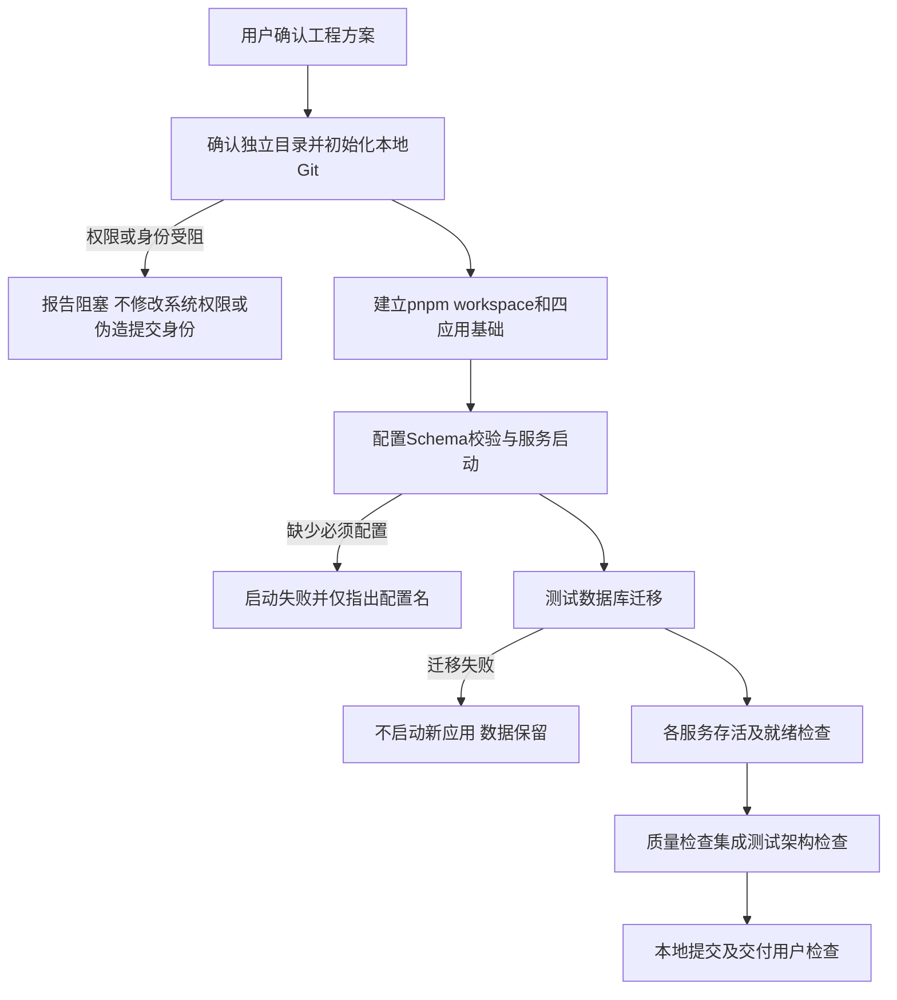
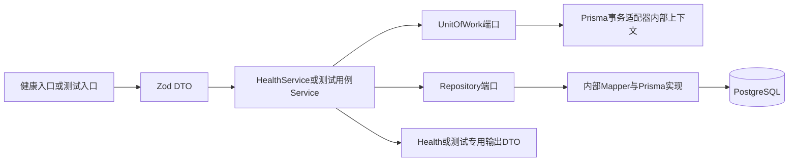

# Monorepo 和公共基础方案

版本 0.1，待用户确认；对应第四步。没有业务公共实现可复用，旧脚手架不承载当前服务架构。

## 初始化与正常异常路径

公共实现：HealthController → 无敏感输入 HealthQueryDto → HealthService → DatabaseProbePort / RuntimeStatus → HealthDto。健康检查不绕过 Repository 访问业务记录；Probe 属基础设施诊断接口，只返回依赖是否可用，不返回 DSN 或错误堆栈。Agent 存活/就绪不消耗模型费用，就绪表示配置和必要工具服务可用，不代表模型实时一定正常。

配置由 `config` Zod Schema 校验；入口只注入模块所需配置。明确区分模型、数据库、文件路径、服务身份、时限和版本标识。依赖版本在执行时依据兼容性锁定，不使用未锁定 latest；NestJS 装饰器元数据与 Vitest 转译需用小型启动测试证明兼容，失败先修测试配置不换业务规则。

`business` 导出 DTO Service 端口、领域对象及基础设施装配入口；禁止导出 Prisma 类型。UnitOfWork.run 接收不透明 TxContext，Repository 绑定该上下文。事务只能由应用 Service 开始/结束；异常使整个回调回滚。公共事务验证用测试夹具表，不以未获批业务用例“顺手实现”作为演示。

初始迁移只包含必要公共任务/幂等/审计能力与测试支持；业务迁移随模块提交。第七步提供画像只读基础关系，尚无数据时返回空，不把不存在的业务模型列为已实现。

## 公共质量和测试

提供 format:check、lint、typecheck、test、test:integration、test:e2e、build 和接口覆盖清单校验命令，实际命令在锁定工程后写 README。Lint 检查层级和跨包路径、禁止非基础设施导入 Prisma。依赖矩阵和 DTO 作为契约包的唯一来源，字段说明可审查。

PostgreSQL 测试使用隔离数据库或 schema，测试结束清理；不能连生产数据库跑迁移/清表。E2E 通过真实 HTTP、MCP、Worker，外部模型和来源可控；静态 docs 校验与代码用例分开。

HEALTH-01—04 均有接口测试。E2E-FOUNDATION 从进程启动、迁移、就绪、事务写入/回滚、重启读取到退出清理；数据库断开时存活 200、就绪 503，不能泄漏连接信息。并发测试使用两个独立连接，不能串行测试冒充竞争验证。无远端提交或发布。
