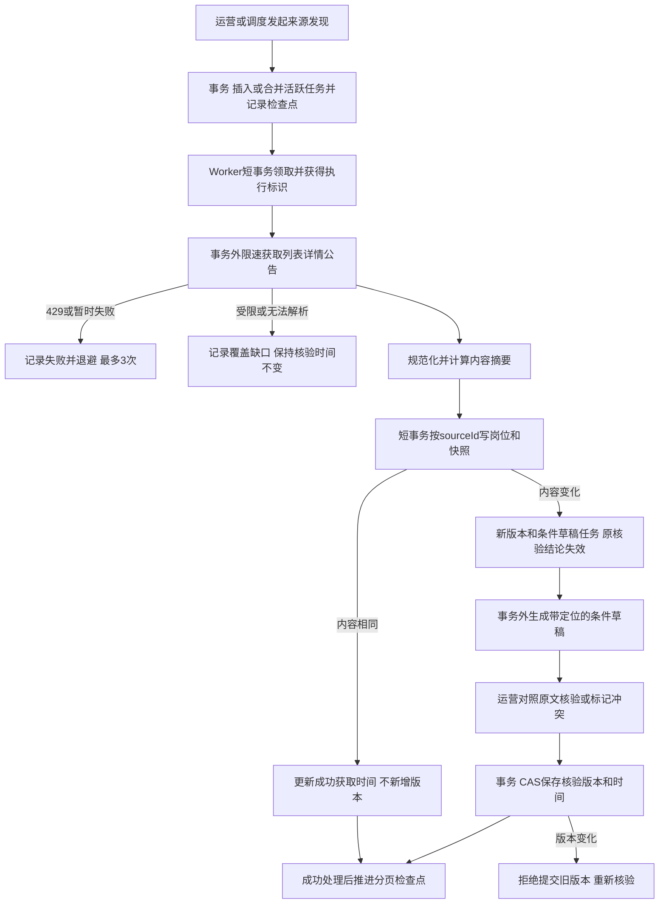
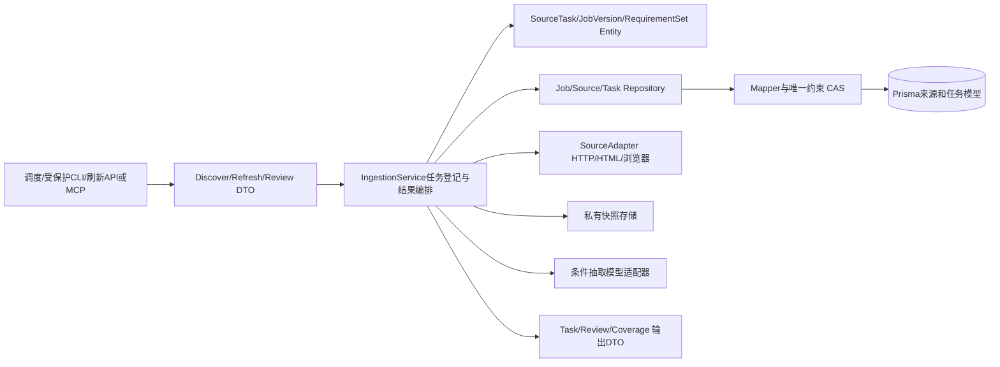

# 采集、证据与更新方案

版本 0.1，待用户确认；对应第六步。具体来源入口需第三步实测，不能把本方案当作已验证接口。

## 业务和数据变化

运营者启动首次采集，之后调度器每 2 小时发现新增；按来源 ID、分页检查点继续扩大覆盖。岗位包括校招社招，经验未知保留未知，不能只收经验不限岗位。采集岗位、关联公告、原始投递入口和关键时间；只保存可公开访问的范围，不突破验证码、登录或访问限制。

数据区分原始来源快照、规范化岗位版本、模型条件草稿和已核验条件。自动抽取有证据不等于完整条件已核验：首版肯定性资格使用运营核验的完整条件树；其他已采岗位可探索但显示待核验。人工核验须对照详情和完整公告，写入证据定位、缺口、冲突、时间与操作者，不将百万数据都标成已核验。

## 实现图

Repository 方法：claimReadyBatch、updateIfLease、upsertBySourceId、insertVersionIfHashChanged、listDueSources、saveCheckpointIfVersion、insertReviewIfCurrent。Service 管理事务，外部请求、模型和文件写入都在事务外；文件预写失败不发布 DB 快照，DB 失败后的孤立快照由清理任务回收。

## 新鲜度、冲突与恢复

- 新增每 2 小时发现；已收录可能在招每 24 小时复查；截止 48 小时内每 2 小时优先复查；明确定时到点即本地停推。
- 页面列表无变化不代表公告未变化，应复查具体证据；成功 HTTP 请求不自动刷新 verifiedAt。
- 临近截止判断要求明确时区/时刻；不明确的当天不作肯定推荐。
- 来源声明“长期招聘”仍需核验活跃状态，未能确认不能因无固定截止而永远推荐。
- 本地以 source+sourceId 唯一，快照以来源与内容摘要去重，活跃刷新以 dedupeKey 合并。重复请求返回同一 taskId；不同用户共享公共刷新但不泄露个人信息。
- 每次外部执行后短事务检查租约 token，过期执行者无权写结果。成功完成一个批次后推进 checkpoint；失败批次重跑幂等。
- 未知招聘关闭、404、反爬、解析失败、来源冲突均不凭空改成开放/关闭，记录待核验。明确源文截止或关闭才改变确定状态。
- 优先级：用户核验、临近截止、已核验记录、其他在招回查、扩大覆盖；监控各队列积压，过期记录自动降级。无法达标时展示实际覆盖，不提高并发掩盖限制。

## 测试与提交边界

JOB-04、TASK-01、PUBLIC-01、OPS-01—03 及对应 MCP。真实 PostgreSQL 测幂等、批领取、租约、checkpoint、并发版本核验；来源夹具测分页、字段缺失、429、404、截止冲突和内容变化。E2E-INGEST 从 CLI 发现、Worker、来源替身、快照、岗位展示到复查变化；真实站点抽样另测。提交仅本模块的适配器、模型、任务、CLI、契约和测试。
