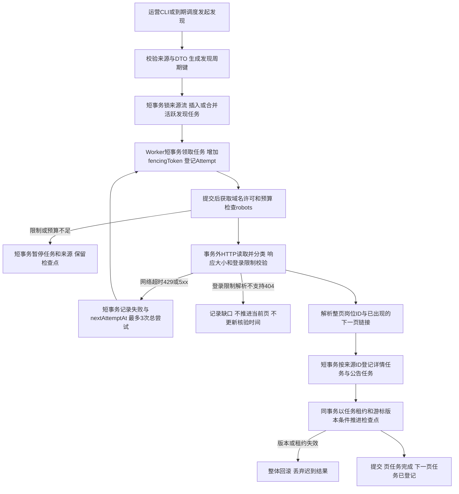
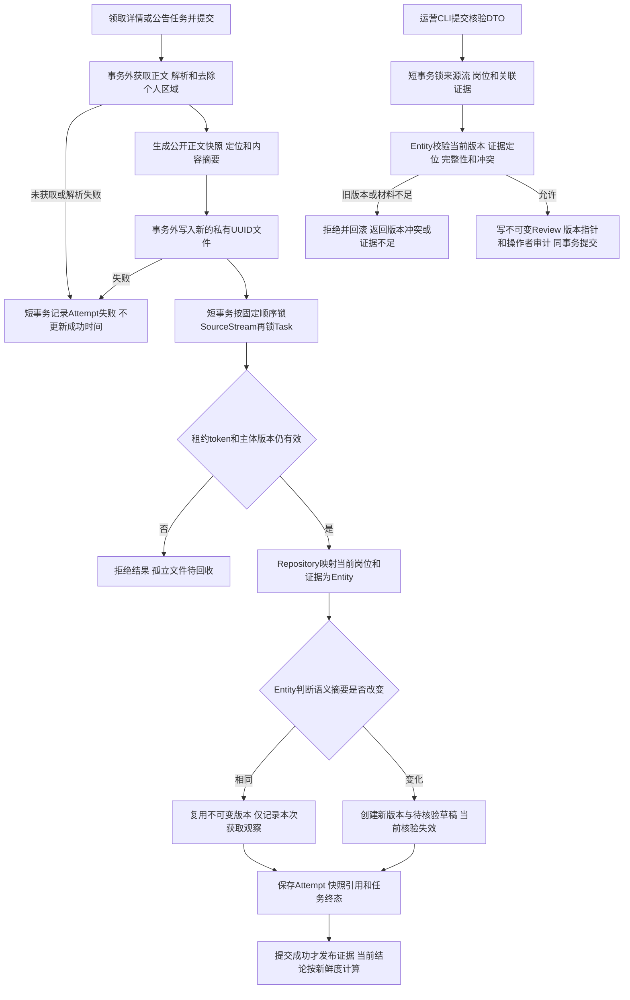
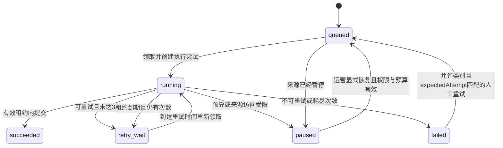
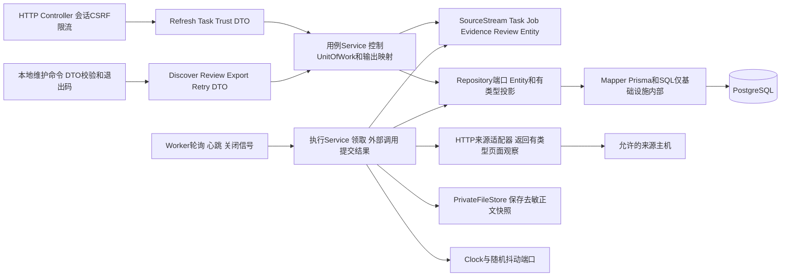

# 采集、证据与更新实施方案

版本0.2，已确认；对应第六步。用户在df71a44方案交付及明确确认请求后回复“继续”，批准本模块实现及最多40次新增来源验证预算；持续真实采集仍默认关闭。此前用户在第五步交付后回复“继续”，仅授权准备方案；本轮在独立方案交付后再次“继续”，才进入实现。方案提交轮只有文档变更，实现和真实验证记录另见交付报告。

## 1. 范围、现状与验收目标

本模块负责发现岗位、采集详情和公告、保存证据、生成待核验草稿、运营核验、更新调度、刷新任务、覆盖统计和数据导出。校招、社招及类型未知记录都采集，不按经验要求预先排除岗位。资格计算和岗位搜索页面属于第七步，MCP入口属于第八步。

复用已实现的UnitOfWork、不透明TransactionContext、幂等记录、AuditEvent、私有文件接口、认证/CSRF、健康检查、日志和真实PostgreSQL/进程E2E。当前Worker只有心跳；TaskOutbox只有登记字段，尚无租约执行器。第三步工具为独立验证工程，只复用已验证规则和公开夹具，不让正式包导入tools中的脚本或秘密文件。

[既有验证](../verification/README.md)只证明职点迷津公开HTML、带Cookie第2页及两个校招岗位与公告双向关联；不证明内部API、全量分页、外站原文、持续会话或采集吞吐。源站ID是最长200字符的不透明字符串，不作标准UUID验证；本地jobId等仍为UUID。

相对0.1的细化和调整，须随本版本一并确认：

- 首轮使用HTTP和HTML解析，不猜测内部API，不引入自动登录或浏览器反检测；遇到必须浏览器才能读取的页面记录缺口，再单独提交适配方案。
- 第六步通过程序抽取明确字段及证据形成草稿，完整条件由运营核验。旧图中的模型抽取推迟到第八步具备Agent适配器后另行设计；本步不重复实现模型客户端，也不消耗现有模型5次预算。
- 公告及原文入口均记录；只访问当前获准主机。外站链接暂存为未访问证据入口，未经获取不能支持已核验结论。新增外站域名及调用范围另行确认，不冒充已经采集完整公告。
- 三个HTTP入口、四个本地维护命令和Worker执行器属于同一个采集模块，按下列子步骤实现；第六步完成后统一交付验收，不提前实现第七步查询页面或第八步MCP。

验收时必须能通过真实CLI/Worker和隔离数据库证明：重复发现/采集不重复建岗位；失败可恢复、检查点不跳过未登记内容；迟到执行者不能写入；原文变化或过期使既有核验失效；导出可复现；真实抽样及替身结果分开呈现。

## 2. 用户路径、访问和调用预算

1. 运营在可信服务器通过本地CLI登记一次来源发现任务；Worker领取后分页获取、登记岗位详情和公告任务。
2. Worker读取详情，保存脱敏证据和不可变版本、生成字段草稿；运营阅读证据后通过CLI提交条件核验文件。
3. 调度器按到期时间登记复查任务；用户登录后可请求已收录岗位刷新并查询自己关联的任务，立即返回taskId，不同步抓网页。
4. 公开`/trust`展示真实覆盖和积压统计；运营可导出一致快照。完整岗位浏览在第七步实现。

### 网络约束

| 配置         | 本版本提案                                                                                                                             |
| ------------ | -------------------------------------------------------------------------------------------------------------------------------------- |
| 允许来源     | https://www.zhidianmijin.com.cn；路径限/jobs、/jobs/:sourceId、/announcements/:sourceId及robots.txt，查询参数仅允许已验证分页/排序字段 |
| Cookie       | 由用户私有配置注入；只发往精确源站origin的/jobs列表，robots、公开详情、公告和任何重定向均不带Cookie；不自动登录/续期                   |
| 同域速率     | 多Worker共享数据库许可，同域最多2个在途请求，实际请求启动至少间隔1秒；robots的更长间隔优先                                             |
| 请求限制     | GET；20秒超时；响应流解压后最多2MiB；最多3次重定向，每跳重新校验域名/路径/地址及独立计费                                               |
| robots       | 无Cookie检查，24小时缓存；404按无声明处理，401/403/超时/不可解析时暂停该来源；拒绝路径不得访问                                         |
| 本步真实验证 | 新增最多40次来源请求总额度，robots、跳转、失败及重试均计入；批准本方案才授权使用，未调用余额不得写成已验证                             |
| 默认启动     | 生产来源网络开关默认关闭；获批实现中只在显式验证运行启用上述40次额度，不启动无限后台采集                                               |
| 后续持续运行 | 代码具备定时调度；开启真实持续采集前单独确认日预算与覆盖范围，不能把40次验证许可解释为无限运行许可                                     |

预算以持久化的单调计数原子预留，崩溃后未发出的预留也不退还，不能因重启清零。不同来源、验证运行和历史账本隔离；历史来源26次及模型5次保持不变，新调用另记账。本轮方案准备不使用额度。

目标URL只能由受控SourceAdapter根据来源ID/存量记录生成，HTTP用户输入不能提供URL。解析DNS后拒绝回环、私网、链路本地等非公开地址，实际连接绑定已检查地址并验证TLS主机名，防止解析与连接间替换；测试进程通过代码注入本地适配器，不提供生产“允许内网”开关。跨域跳转作为未访问入口保留，若没有允许的完整材料则不能完成核验。

401/403、HTTP200登录页、验证码页、会员限制统一暂停相应来源队列并报来源访问受限，Cookie失效不退化为无穷重试或把登录页当岗位。敏感Cookie、Set-Cookie及认证HTML禁止落库、写日志或导出。

## 3. 正常、异常及状态流程

发现检查点表示“本页发现项及下一页任务已可靠登记”，不表示所有详情或条件已核验；详情失败由自己的持久任务恢复。空页只有合法列表结构且无下一页才能结束；页面异常、重复游标或相同页循环报错，不当作扫描结束。列表动态排序可能移动记录，每2小时新一轮从首页重叠扫描，历史回填使用独立游标；不承诺上游缺少快照分页时绝无遗漏。

本步不新增通知或模型调用。错误最多3次指含首次在内的总尝试，退避默认5秒、30秒并加0—20%抖动；429的Retry-After更长时优先，最多24小时后再试。无效解析、明确4xx及访问受限不自动重试。租约超时导致HTTP重复获取是允许的，结果写入仍需token防护。

## 4. 开发实现图和职责

- Controller/CLI只处理DTO、身份和协议映射，不查询Repository。Worker不写SQL，只调用导出的领取、执行、续租和维护Service；app包不跨包访问内部文件。
- Service拆为发现登记、刷新登记、任务查询、执行、核验、统计和导出等用例；组装实体所需完整上下文，控制事务及外部调用顺序。
- SourceStream决定游标推进和暂停恢复；SourceTask决定合并、领取、续租、重试和终态；JobVersion/EvidenceBundle决定版本变化和新鲜度；RequirementReview决定核验有效性。领域方法不读取数据库、文件、环境或网络。
- Repository能力为insertIfAbsent、getForUpdate、listDue、claimReadyBatch、updateIfToken、advanceCheckpointIfVersion、listBySnapshot等数据动作；Service不导入Prisma类型。DTO→Entity由Service明确构造，ORM↔Entity在Repository/Mapper，Entity/投影→输出DTO由Service处理。
- HTTP使用Node原生传输及受控连接适配，HTML使用结构化DOM解析器而非正则拆整页；robots沿用验证工程已使用的robots-parser能力。正式依赖在获批实现时核对Node24兼容并写入锁文件，不在本轮安装。
- 外部适配器返回`FetchedListPage`或`FetchedEvidencePage`等判别联合，包含状态、来源ID、候选字段和定位；不把任意HTML对象或未校验dict向上层传递。

## 5. 数据库及快照设计

| 模型                               | 关键字段、约束和含义                                                                                                                                                                                                                                  |
| ---------------------------------- | ----------------------------------------------------------------------------------------------------------------------------------------------------------------------------------------------------------------------------------------------------- |
| SourceStream                       | sourceKey+streamKey唯一；generation、checkpoint、checkpointVersion、nextDiscoveryAt、pauseReason、stateVersion；分开新增与历史回填                                                                                                                    |
| SourceResource                     | sourceKey+kind+sourceId唯一；canonicalUrl、currentVersionId、lastAttemptAt、lastFetchedAt；岗位与公告均有稳定ID                                                                                                                                       |
| Job                                | resourceId唯一、currentVersionId；稳定内部UUID供收藏/投递引用，不随下架删除                                                                                                                                                                           |
| SourceVersion                      | resourceId+materialHash唯一；不可变规范化正文、parserVersion、标题/单位/地点/类型/截止字段、snapshotId、createdAt；A→B→A可复用旧正文版本，但新的获取和核验记录独立保留                                                                                |
| FetchObservation                   | 每次成功执行观察：resourceId、versionId、attemptId唯一、httpStatus、fetchedAt、rawDigest、parserVersion；相同正文也记录成功获取事实                                                                                                                   |
| SourceSnapshot                     | UUID私有storageKey、sanitizedDigest、byteLength、format、createdAt；只存去敏后的main正文或定位文本，不对外暴露存储路径                                                                                                                                |
| JobEvidenceLink                    | jobId、resourceId、associationVersion、relationKind、associationStatus；单向提及与双向关联区分；关联集合变化亦使核验依赖变化                                                                                                                          |
| RequirementDraft                   | jobVersionId、字段候选、evidenceRefs、parserVersion；字段缺失为unknown，不把空白解释为不限                                                                                                                                                            |
| RequirementReview                  | reviewId、jobVersionId、expectedReviewVersion、完整条件树、evidenceVersion向量、bundleHash、isComplete、conflicts、reviewedAt、actorReference、reason、reviewDigest；只增不改历史                                                                     |
| TaskOutbox扩展                     | 保留现有id/eventKey/kind/resourceReference/availableAt/completedAt；增加dedupeKey、sourceKey、status、priority、attempt、leaseUntil、fencingToken、requestedAt、claimedRefreshGeneration、errorCode；eventKey仍唯一，活跃dedupeKey使用SQL部分唯一索引 |
| TaskAttempt                        | taskId+attempt唯一；token、startedAt、endedAt、resultCode、nextRetryAt；不存凭据及认证页面                                                                                                                                                            |
| TaskRequester                      | userId+taskId唯一且外键；仅表示谁请求过公共刷新，不把运营/其他用户身份返回请求者                                                                                                                                                                      |
| SourceRequestBudget / DomainPermit | 原子累计额度；主机启动间隔与在途许可到期时间；所有Worker共享，不因进程重启刷新额度                                                                                                                                                                    |
| ExportRun                          | exportId、snapshotAt、cutoffSequence、scopeHash、manifestDigest、status及文件引用；固定一致视图，重复导出按同一exportId复用                                                                                                                           |

迁移仅在方案批准后创建：扩展TaskOutbox而非建立第二套任务总表；历史行以queued/succeeded合理回填，旧eventKey行为保留；增加外键、非负计数CHECK、租约/到期/活跃索引和部分唯一约束。Prisma无法表达的约束写SQL迁移并用真实PG验证，migrate diff不得忽略可表达字段漂移。

`materialHash`覆盖标题、正文、资格、报名时间、状态、公告关联及原文入口等有效业务内容，排除导航、登录区、抓取时间和跟踪参数。`rawDigest`只说明本次响应字节摘要，不存响应全文；`parserVersion`变化需重新解析，不能把旧解析直接认作新规则正确。认证列表只在内存抽取岗位ID/分页，绝不保存原始HTML。

locator采用固定parserVersion下的正文块编号与字符起止偏移，保存对应原文片段及摘要；字段证据引用必须能在去敏快照中复查。

文件先写私有UUID，再提交数据库引用；文件失败不能发布证据。DB失败/租约失效后的孤立文件由提交后维护扫描清理：仅扫描超过24小时的文件，按键加数据库事务级互斥锁，并复查无引用；写入方在引用文件前取同一键锁并复查文件仍存在，防止清理与新引用竞争。清理失败保留恢复记录。维护每轮最多100项，不承诺磁盘无限保留，容量不足明确失败，不淘汰仍用于现行或已导出证据的文件。

导出使用独立REPEATABLE READ事务，通过集合查询固化数据库内的不可变ExportRun条目及明确cutoffSequence，随后事务外流式写文件；该事务会写导出条目，不标为只读。事务超时30秒，超限整体回滚并报告导出失败，不能发布部分清单或降低一致性。snapshotAt是该视图实际取时，不能要求任意过去时刻并假称可还原。重复同exportId按已固定条目重建相同内容；完成前不发布manifest。导出全部已实际获取岗位/公告/证据、来源URL/版本/时间/局限，排除账号、任务请求者、Cookie及内部存储路径。认证列表仅导出不含身份的发现统计。

## 6. 条件草稿、运营核验和新鲜度

程序抽取标题、单位、地点、招聘类型、原文中的学历/专业/经验/时间等候选，每项保存实际引用与locator。先用结构明确的HTML标记，提取失败保存未知；自由文本不直接变成可执行条件。

本步只建立条件树存储、Zod结构及证据校验，第七步实现资格计算。树节点为all/any/except/condition/unknown的判别联合，节点均含证据引用；叶子明确field（学历、专业、毕业状态/时间、年龄、正式经验、证书、报名状态等）、operator、类型化value、计算日期和允许经历类型。叶子value须按field区分，不能用任意JSON；最大深度8、节点100。except同时包含基础规则和例外规则，unknown保留未能表达原文。无法准确表达的条件必须保留unknown，完整性标记不能把它消除；具体运算语义需第七步方案确认后启用。

核验命令先校验输入文件，再由Service读取当前岗位、全部关联公告、证据版本及现行Review交给领域对象：

- 引用必须指向已保存证据、正确版本和可定位的原文片段；无法匹配的引用拒绝，不让运营仅输入一个“已核验”布尔值。
- 完整性须声明所审阅的全部来源、遗漏条款、日期精度、外站入口是否已读取及冲突处理。材料缺失可保存不完整Review，不能标为完整。
- 提交携带expectedJobVersion、expectedReviewVersion及evidenceVersion向量；任一依赖变化返回409。审计、Review和指针变更同事务提交；审计失败全部回滚。
- 相同reviewDigest和同版本依赖重复提交返回已有Review，不改reviewedAt；同幂等键不同内容冲突。再次核验新获取观察时需提供新观察引用，不能靠重复请求刷新时间。
- 多用户同时核验同岗位，只允许一份匹配expectedReviewVersion的修改成功，后提交者409并重新读取。

时间语义：lastAttemptAt仅代表尝试；lastFetchedAt仅成功读取有效正文时更新；reviewedAt为运营实际审阅；verifiedAt为当前完整无冲突Review的有效核验时间，取Review及所依赖证据观察时间的最早值。同内容自动复查只更新lastFetchedAt，不自动更新Review或verifiedAt。证据内容/关联变化、冲突或未知信息出现时，当前Review立即不再有效；A→B→A也不自动恢复旧核验。

调度沿用既有计划：新发现每2小时；可能在招详情及关联公告目标24小时复查；明确截止48小时内目标2小时复查。任务优先级依次为用户刷新、临近截止、已核验复查、普通复查、历史覆盖；每领取10项至少给最老普通任务1个机会，防止回填永远饥饿。需要更长robots间隔或额度不足时按实际降级，不提高并发。

新鲜度在读取时由领域对象根据Clock计算，不依赖某个定时器恰好运行：普通核验超过24小时或临近截止超过2小时，即显示待核验，不作肯定性推荐；明确截止时刻到达则closed。仅有日期且时区/时刻不明确，当天为待核验；404、超时、页面消失、列表不再出现不能直接判定closed。长期招聘也受证据新鲜度约束。统计同时显示已获取、完整已核验、当前仍新鲜、缺口和暂停原因，避免把获取量等同可推荐量。

## 7. 事务、幂等和并发

- 一次业务事务尽量只操作一个SourceStream/资源组，不包含HTTP、文件I/O或模型。涉及用户时先锁User校验活跃身份，再按sourceKey/streamKey排序锁来源流，再按UUID排序锁资源/Job，最后锁Task；涉及预算/域名许可使用独立短事务，不嵌套占锁。领取任务事务只锁Task，不在领取事务内反向加来源锁。
- 领取使用FOR UPDATE SKIP LOCKED及条件更新；每批最多10项且不得超过执行器当前空闲槽位，实际执行并发不超过2；未能及时执行的任务不得提前占租约。租约60秒、每20秒续期，fencingToken每次领取递增，提交和续期均要求token相等且租约未过期。时间来自数据库，进程时钟漂移不延长有效权利。
- 网络操作不保证恰好一次，任务及结果保证原子提交；同页发现登记、游标CAS、下一页登记同事务，任何失败不推进游标。
- 存量资源创建用唯一约束和insert-on-conflict，不能先查询再创建保证唯一。正文版本唯一约束防止重复版本；每次执行观察按attemptId防重。
- HTTP刷新使用用户+operation+Idempotency-Key及内容摘要，记录24小时；重复同键返回原任务，不因旧任务完成重建。不同用户同岗位共用活跃任务，各自登记TaskRequester，查询不能看到其他请求者。
- 在运行刷新收到新请求，记录requestedAt和刷新代次；若新请求发生在领取后，完成时同事务登记一次后继任务并迁移请求者可追踪关系，原任务成功响应包含后继taskId，防止用户把早于请求的观察当成已刷新。requestedAt等于领取时刻以代次判定，不依赖毫秒碰巧不同。
- 刷新限额默认每用户每分钟5次、同岗位新任务至少60秒间隔；相同幂等键重放不再扣额，共享进行中任务仍允许关联但不重复触发网络。不同内容同键409；缺失岗位404。
- Worker关闭时停止领取，等待当前20秒HTTP超时及短事务，释放许可；强杀后许可/租约自然到期，下一Worker恢复。迟到响应绝不能更新成功时间、快照引用或核验状态。

## 8. 接口和错误契约

以下沿用[接口清单](contracts.md)的ID，具体运行时契约获批后落到contracts/独立领域Schema。HTTP输出遵循`{requestId,payload}`，错误为稳定错误码；维护CLI成功退出0、输入错误2、版本/幂等冲突3、来源/存储失败4，stdout只输出DTO JSON，stderr只输出脱敏错误。

| 操作                                 | 输入DTO                                                                                                                                   | 输出DTO与行为                                                                                                                   |
| ------------------------------------ | ----------------------------------------------------------------------------------------------------------------------------------------- | ------------------------------------------------------------------------------------------------------------------------------- |
| JOB-04 POST /api/v1/jobs/:id/refresh | 路径jobId；严格空对象body；Idempotency-Key UUID；活跃用户、Origin和CSRF                                                                   | 202 TaskDto；自然合并活跃任务，body不接受URL或userId                                                                            |
| TASK-01 GET /api/v1/tasks/:id        | taskId UUID；空query；活跃用户                                                                                                            | 200 TaskDto；只允许本人请求过的公共刷新，其他与不存在统一404                                                                    |
| PUBLIC-01 GET /api/v1/trust          | 无输入，拒绝额外query                                                                                                                     | 200 TrustDto，公开聚合统计；缓存最多30秒并明确computedAt，不伪装实时                                                            |
| OPS-01 collect discover              | sourceKey枚举、stream(new/backfill)、runId UUID、pageLimit 1—20、checkpoint?且expectedCheckpointVersion配对                               | DiscoverResultDto含taskId、generation、checkpointVersion；同runId同内容返回原结果，改内容冲突                                   |
| OPS-02 evidence review               | JSON文件：jobId、expectedJobVersion、expectedReviewVersion、evidenceVersion向量、条件树、完整性/缺口/冲突、观察引用、reason、operationKey | ReviewDto含reviewId、reviewVersion、reviewedAt、isComplete和warning；actorReference来自服务器受保护配置，不接受请求自称用户身份 |
| OPS-03 data export                   | 新导出scope与operationKey，或仅existingExportId；输出目录为服务器配置，不接受任意路径                                                     | ExportDto含exportId、snapshotAt、status、manifestDigest、记录数量和受控文件名；同exportId复现                                   |
| OPS-04 task retry                    | taskId、expectedAttempt、operationKey；不得输入新URL或覆盖任务目标                                                                        | TaskDto；仅允许声明可人工恢复的失败类别/暂停原因，活跃任务或版本变化409                                                         |

TaskDto精确字段为id、kind、status、attempt、updatedAt、relatedResourceId、errorCode?、nextRetryAt?、successorTaskId?；不返回lease/token、主机许可、秘密路径和请求者。TrustDto包含computedAt、首次/最近成功获取时间、campus/social/unknown数量、已获取/当前完整核验/新鲜数量、各队列积压、暂停来源类别、coverageWarnings及实际已验证范围；不提供个人任务计数细目或用户信息。统计中的“全站总数”只有来源可靠给出时才呈现并标时间，否则unknown。

稳定错误码在所属领域/应用/协议映射内注释触发条件和调用方动作：`SOURCE_ACCESS_BLOCKED`补充合法会话后显式恢复、`SOURCE_BUDGET_EXHAUSTED`调整获准额度后恢复、`SOURCE_RATE_LIMITED`按retry时间等待、`SOURCE_PARSE_UNSUPPORTED`修正适配器后重试、`SOURCE_UNAVAILABLE`按失败类别退避、`TASK_VERSION_CONFLICT`重新读取、`EVIDENCE_VERSION_CONFLICT`重审当前材料、`EVIDENCE_INCOMPLETE`补齐或保存不完整Review、`IDEMPOTENCY_CONFLICT`换键提交新请求。网络/凭据细节不进入用户错误。HTTP限流429、输入400、身份401/403、不可见404、冲突409、存储不可用503；来源失败保存在异步任务中，刷新登记成功不伪报任务成功。

本地维护命令只在可信服务器运行，校验显式配置的operatorReference和文件权限，不暴露公网管理接口，不允许普通账号升级为运营。HTTP/MCP未来共用同一Service；本步不注册尚未实现的MCP工具。

## 9. 分层及端到端测试计划

所有下列结果当前均为待实现、待执行，不能用第五步136个通过测试代替。

| 层/入口          | 必测路径                                                                                                                                                                              |
| ---------------- | ------------------------------------------------------------------------------------------------------------------------------------------------------------------------------------- |
| DTO              | 7操作输入输出、sourceId非标准UUID、游标/页上限、条件树深度/字段组合、额外身份字段、缺Idempotency-Key、未知枚举                                                                        |
| Entity           | 任务转换/幂等/暂停恢复、同内容不新建版本、未知经验、截止/当天/48小时边界、过期与A→B→A核验不恢复、unknown条件不变通过                                                                  |
| SourceAdapter    | 历史公开HTML及虚构分页、编码/字段缺失、重定向与Cookie不外发、DNS/IP限制、robots、响应超限、登录HTTP200、429/503/404、分页循环                                                         |
| Repository真实PG | TaskOutbox旧行升级、部分唯一索引、双连接领取/续租/迟到拒写、双用户刷新、单调预算与主机许可、游标CAS、同ID创建、内容版本去重、核验与公告变化竞争、审计失败回滚                         |
| Service/文件     | 网络和哈希在事务外、文件先写失败/DB失败/孤立回收与引用竞争、自动重试仅允许类别、刷新后继不丢、停止重启、导出一致视图和写文件失败可恢复                                                |
| JOB-04           | 正常202、会话/CSRF/Origin、缺岗位404、同键同内容/改内容、限流、双用户共用任务、进行中请求后继任务                                                                                     |
| TASK-01          | 本人任务200、他人/运营任务404、无会话401、状态及错误字段白名单、后继可追踪                                                                                                            |
| PUBLIC-01        | 空库、校招社招未知统计、真实核验/新鲜分开、过期/暂停/积压、缓存computedAt、数据库失败503、无隐私                                                                                      |
| OPS-01—04        | 每条命令单独测DTO、退出码、身份、正常/异常/重复；review并发409、export内容复现及脱敏、retry旧attempt拒绝                                                                              |
| E2E-INGEST       | 真实CLI和Worker进程、隔离PG、私有文件与本地来源替身：发现两种类型→详情公告→草稿→人工核验→刷新→正文变化失效→一致导出；另测429恢复、分页检查点、重启/过期租约、Cookie失效暂停和预算封顶 |
| 真实来源抽样     | 获准后最多40次：robots、公开列表/详情、认证有限分页、校招和社招、公告关联与重复复查；记录每次时间/分类/成功范围，不声称测试过任意全量网站                                             |

接口清单检查器同步新增HTTP操作；维护命令新增机器清单及对应逐命令测试检查，防止只有设计表。E2E不依赖真实外网/Cookie/模型；生产执行装配与本地替身只在测试入口通过代码DI区分。Playwright回归第五步；本模块无新页面，按AGENT允许通过真实CLI/Worker入口完成模块E2E。

## 10. 实现顺序、提交与停步点

批准本版本后按依赖顺序执行，以下为第六步内部TODO，不是跳过第六步验收进入下一模块：

1. 建立采集DTO、独立领域Schema/行为、端口、配置；扩展TaskOutbox和证据/版本/核验模型，完成迁移与Mapper/唯一约束/并发测试。
2. 实现HTTP/HTML SourceAdapter、受控Cookie、robots、数据库许可与预算、脱敏正文快照、公开夹具及异常测试；不先运行真实采集。
3. 实现任务登记/领取/续租/失败恢复、Worker调度及分页检查点，打通详情/公告/版本/草稿提交和迟到写入保护。
4. 实现证据核验CLI、刷新和任务HTTP、覆盖统计、导出/恢复命令，更新操作清单和逐入口测试。
5. 执行模块进程E2E、账号回归、完整质量检查、本地启动；在40次额度内做有限真实抽样，保存脱敏报告、实际覆盖和缺口。
6. 检查分层、事务、秘密及文件清理，创建仅本步的中文本地提交，汇报交付并停止等待用户验收。

每个内部TODO完成后简短汇报所做内容和验证结果；出现实质方案变化先暂停受影响实现并重新确认。实现、迁移和测试保持紧密相关，不为小提交拆出不可Review的半模块。不推送远端或部署。

**当前执行：方案0.2已获确认，按上述TODO实现；完成后停止等待第六步验收，不进入第七步。**

实现进展与最终检查见[第六步交付](../ingestion/README.md)。正式网络当前使用更保守的同域串行许可；Worker仍可同时编排两个任务，不突破最多2并发限制。生产持续网络默认关闭，已执行的27次有限来源验证与未来运行额度分开。
