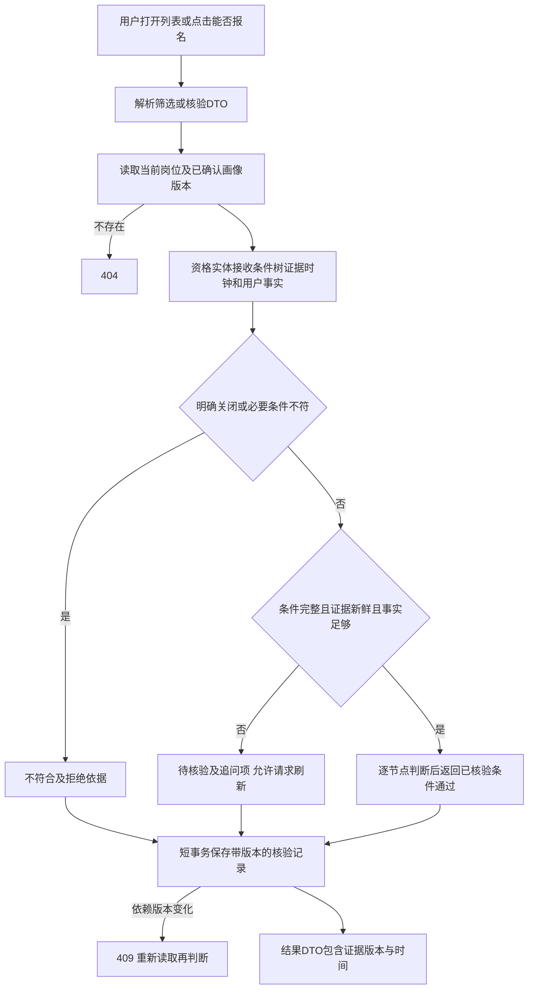
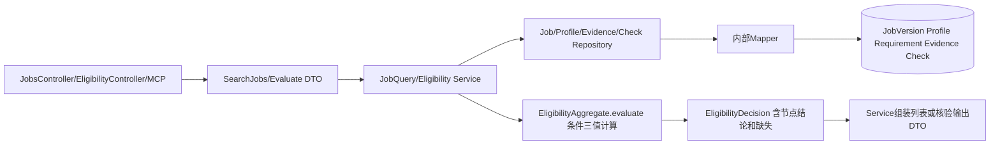

# 岗位查询与资格判断方案

版本 0.1，待用户确认；对应第七步。岗位查询和资格判断分别有接口及模块 E2E。

## 业务规则

用户可搜索标题、公司、地点、招聘类型；不要求先有简历。肯定性资格判断必须使用已确认画像、当前岗位与完整已核验条件。没有画像时返回待核验及需要确认的信息，不推断学历等事实。

每个条件节点保留原文、定位、字段、运算符、适用日期、例外和 AND/OR 子节点。按三值逻辑：AND 有明确不符则不符，无不符但有未知则未知；OR 有通过则通过，无通过但有未知则未知。无法表达的条件及未经完整核验的限制保留未知。不得将主观录用标准自动量化为通过。

已明确截止/关闭或任何确定必要条件不符，返回不符合；没有确定拒绝但存在不完整、过期、冲突或用户缺失，返回待核验；全部已核验必要条件通过且报名状态有效才返回符合已核验条件。最终录用审核不由系统保证。

工作年限按公告计算日期及允许的经历类型计算，重叠月份不重复计数；实习不能默认满足正式经验。专业大类匹配仅使用版本化的已审定映射，模糊“相关专业”不能由模型拍板。偏好只排序，通过、待核验、不符合分别展示，无结果时说明原因。

查询 Repository 返回岗位投影，不返回 API DTO；Service 转换。资格核验外部刷新另建任务，不在核验事务中抓网页。Repository 能力为 listByFilter、getCurrentVersion、getConfirmedProfile、listEvidence、insertCheckIfDependenciesCurrent。写入 Check 需验证来源和画像当前版本；读历史记录时与当前依赖比较并返回 isCurrent=false，不能复用为当前推荐。

## 边界、幂等与测试

列表游标绑定排序和筛选摘要，参数变更需重置游标。默认按更新时间及 ID 稳定排序，未知条件不在默认筛选中被误删。核验请求带 Idempotency-Key；重复返回同一记录，但仍标注当前是否已失效，同键改变内容 409。

测试 JOB-01—03、ELIG-01—02，MCP-03—05。覆盖条件组合、学历层级与具体学历限制、专业映射未知、预计毕业与已毕业区别、年龄生日及日期边界、证书未知、工作重叠、无固定截止、过期证据、画像冲突、社招应届通过。E2E-JOBS 验证列表详情与来源；E2E-ELIG 从画像、岗位、条件版本到结果及依赖更新后失效。提交边界为查询、领域规则、核验记录和相应测试，不实现 Agent 自由决策。
