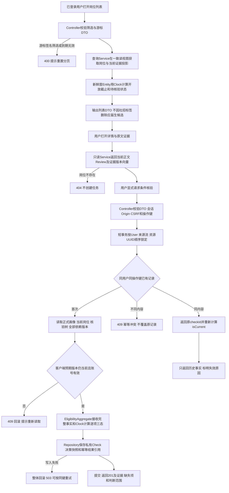
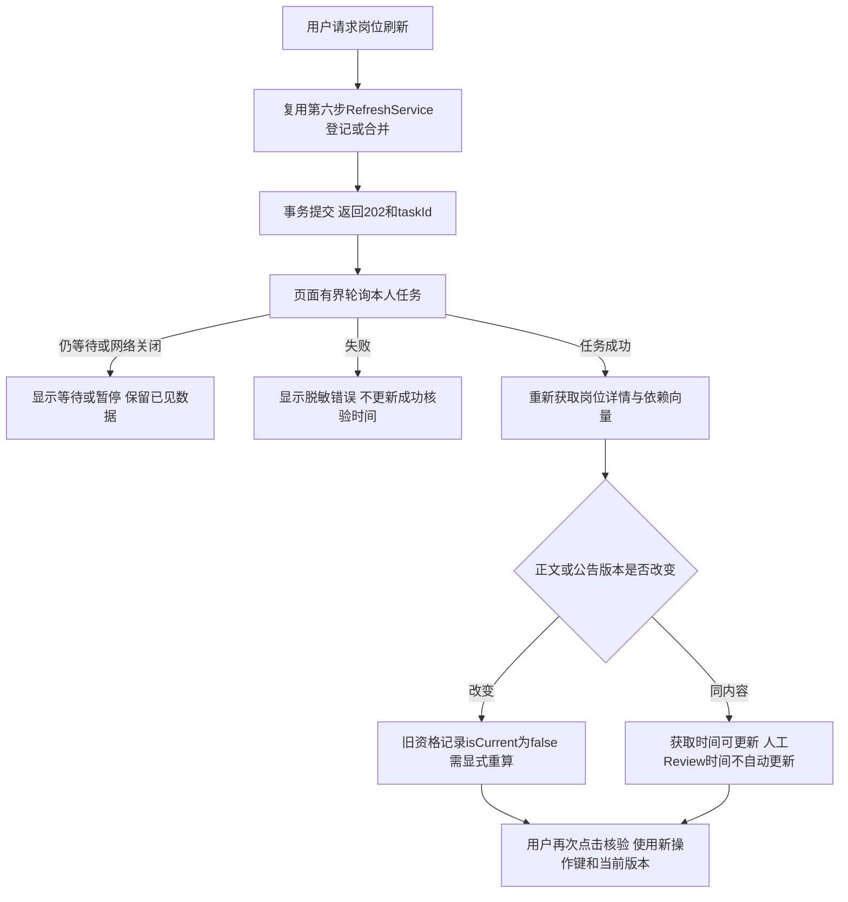
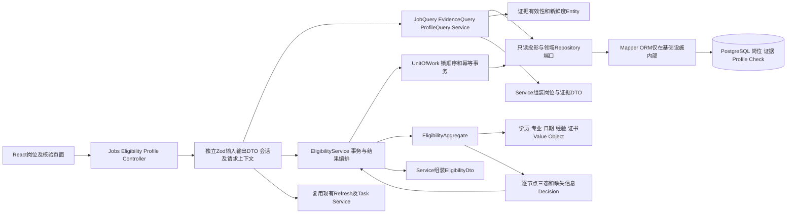

# 岗位查询与资格判断实施方案

版本0.2，已获本次批量开发授权确认；对应第七步，包含岗位查询与资格判断两个相互依赖的能力。用户在079d85d的第六步交付后回复“继续”，记录为第六步验收通过，允许准备本方案，不视为本版实现已获确认。本轮仅修改文档，不写业务代码、迁移、安装依赖或调用模型与来源。

## 1. 目标、现状与本步边界

用户登录后可浏览和筛选岗位、查看来源原文与新鲜度、请求刷新，并获取基于正式画像和岗位条件的三态资格结果。资格判断由领域规则执行，不调用模型，不按校招/社招标签推断应届生能否报名，不进行外部报名。

现有能力：[第六步交付](../ingestion/README.md)已包含Job、SourceResource/Version、FetchObservation、RequirementDraft/Review、关联证据、更新与刷新任务，3个采集HTTP接口、认证/CSRF、UnitOfWork、接口检查和真实PG/浏览器测试。真实取样导出了4个校招与1个社招，完整人工核验0；取样在独立测试库执行，根业务库不自动拥有这5条记录。导出文件不是已导入的生产数据，页面空库必须如实显示。

本步复用既有刷新、任务及覆盖接口，新增岗位列表/详情/证据、资格创建/读取及本人正式画像只读接口，共6个HTTP操作。岗位和资格各有完整模块E2E；MCP在第八步注册，画像写入、简历解析和确认在第九步实现。

### 相对0.1及既有实现需确认的细化

- 建立Profile只读存储与查询基础，生产暂无画像时返回content=null、version=0；不提前开放画像编辑或用请求体临时背景绕过确认。第九步接入确认写入后，资格判断使用同一表与版本契约。当前真实用户在画像未建立时通常得到待核验；符合/不符合完整路径通过真实PG内的虚构已确认画像夹具测试，不伪装真实用户已有画像。
- 列表默认按不可变的首次收录时间和ID排序，页面称“最近收录”；不同于0.1按可变化更新时间排序，减少翻页期间更新造成的位置跳动。新鲜度单独显示，不把收录顺序称为公告发布时间。
- 细化条件树语义，给学历取得要求、专业匹配方式和例外作用增加可选元数据；旧记录缺少这些信息时返回待核验，不偷偷补成宽松条件，不重写旧Review摘要。
- 本步不新增真实模型或来源请求。历史模型5次、来源53次（第三步26+第六步27）保持不变，第六步余下13次不自动转为本步调用许可。生产来源网络仍默认关闭，不启动持续采集。

## 2. 页面和用户操作路径

| 页面           | 功能与边界                                                                                                                                           |
| -------------- | ---------------------------------------------------------------------------------------------------------------------------------------------------- |
| /jobs          | 关键词、城市、招聘类型、学历条件筛选；最近收录分页；空库/无结果/错误/重试；每项显示来源、新鲜度、截止精度与待核验提示                                |
| /jobs/:id      | 岗位正文、安全文本、单位/地点、明确或未知条件、关联公告及外站入口、证据版本/定位；来源原文标示哪些未访问；下架保留稳定岗位及历史提示                 |
| 详情中的资格区 | 读取本人正式画像状态，点击“核验条件”显式创建记录；逐项结果、原文引用、缺失信息与三态说明；当前无画像时提示后续完善资料，不显示未实现的可操作画像表单 |
| 刷新区域       | 使用既有POST refresh和GET task；显示等待/暂停/失败/后继任务；任务成功后重新读取岗位与证据，不将“刷新任务成功”当作“人工条件已核验”                    |
| 历史核验视图   | 按本人checkId读取；依赖变化或时间过期显示已失效，按钮显式重新核验；不自动收费调用或修改画像                                                          |

前端只调用业务API，登录失效使用现有AuthProvider处理；数据库503提示服务不可用，不伪装为未登录或空结果。来源链接仅输出允许的HTTPS链接，正文以文本渲染，不执行HTML、脚本或网页中的指令。移动端可读、键盘可完成筛选与核验，加载/空/失败状态明确。

## 3. 业务流程、数据变化和异常

GET操作不创建画像、核验记录或刷新任务，不推进任务状态。读取详情与证据使用同一数据库一致视图，避免正文和Review来自两个时刻。用户打开页面后数据变化允许收到409，不自动按新数据替用户确认。外部来源失败不回滚已提交的核验或刷新登记；本步资格计算无网络、模型和文件I/O。

## 4. 查询、DTO和接口契约

API成功及错误结构沿用[契约总表](contracts.md)。所有新增字段用Zod描述与约束，API DTO、领域Schema和Prisma类型分别定义，不复用同一个对象代替三层。

| 操作                                       | 输入                                                      | 输出及关键响应                                                                                |
| ------------------------------------------ | --------------------------------------------------------- | --------------------------------------------------------------------------------------------- |
| JOB-01 GET /api/v1/jobs                    | JobQuery，当前用户                                        | 200 JobPageDto；无结果entries=[]，无副作用                                                    |
| JOB-02 GET /api/v1/jobs/:id                | UUID路径，严格空query，当前用户                           | 200 JobDetailDto；不存在404，关闭岗位仍显示历史及当前状态                                     |
| JOB-03 GET /api/v1/jobs/:id/evidence       | UUID路径，expectedJobVersion? UUID；当前用户              | 200 EvidenceBundleDto；预期岗位版本不符409；不读取个人简历证据或任意URL                       |
| ELIG-01 POST /api/v1/eligibility-checks    | EvaluateInput，Idempotency-Key UUID，当前用户+Origin+CSRF | 201 EligibilityDto；同键同内容复用原记录；版本或幂等冲突409；资料/来源未知是业务成功的pending |
| ELIG-02 GET /api/v1/eligibility-checks/:id | checkId UUID，严格空query，当前用户                       | 200 EligibilityDto；他人/不存在统一404；动态isCurrent及失效原因，无写入                       |
| PROFILE-01 GET /api/v1/profile             | 严格空query，当前用户                                     | 200 ProfileDto，仅本人正式版本；不存在时content=null/version=0；不创建空行                    |

### 输入和输出细节

- JobQuery：keyword可选，trim/NFKC后1—100字符；city可选1—100字符；recruitmentType可选campus/social/unknown；degree可选规范学历代码；limit默认20、最大100；cursor可选，最多2048字符；sort首版仅recorded_desc。非法额外userId、任意排序字段或未定义枚举返回400。
- 关键词匹配标题或单位，城市匹配已收录明确地点；招聘类型仅供探索筛选，默认不限。学历筛选只对完整且当前有效的明确条件做候选筛选；未知、未核验或不支持的学历条件保留并标记待核验，不将其误删。该筛选不是个人资格结论，不拼接用户SQL表达式。
- JobSummaryDto：id、jobVersionId、title、company（未知为null）、cities、recruitmentType、recordedAt、lastFetchedAt、verifiedAt?、deadline{value,precision,timezone}、availability(open/closed/unknown)、reviewState、freshness、warnings。未成功获取有效正文的仅发现任务不作为完整岗位卡片。
- JobDetailDto另含正文blocks、当前reviewVersion/reviewId?、条件树或null、完整性/冲突/缺口、原始入口列表、关联公告及evidenceDependencyHash。草稿明确标识为未核验，不用其字段生成“可报考”标签。
- EvidenceBundleDto：jobId、jobVersionId、reviewId?、reviewVersion、dependencyHash、entries。每项含resourceId、versionId、observationId、sourceUrl、正文块/片段、fetchedAt、reviewedAt/verifiedAt、关联状态与冲突；不输出storageKey、内部路径、运营身份、Cookie或整个网络响应。
- EvaluateInput：jobId、expectedJobVersion、expectedProfileVersion（允许0）、expectedReviewVersion、expectedEvidenceDependencyHash。相对0.1增加后两项，保证用户看到的公告/人工核验变化也会冲突；不接受临时profile、userId或模型决定的结果。
- EligibilityDto：checkId、status(eligible/not_eligible/pending)、checks及树节点关系、依赖版本、rulesVersion、evaluatedAt、isCurrent、invalidatedReasons、warnings。每项含稳定节点路径、字段、条件及局部decision、使用的本人事实最小片段、evidenceRefs、missingFields和可解释理由。状态中文为“符合已核验条件 / 不符合已核验条件 / 待核验”，不承诺官方审核或录用。
- isCurrent取决于当前账号/正式画像/岗位/Review/关联证据/规则版本及时间新鲜度；旧结果即使同键重放也重新计算该标记。历史status和evaluatedAt保持首次值，页面在失效状态下不把历史eligible渲染为当前可报。

### 分页语义

新增Job.recordedAt并保持不可变，已有数据以最早已保存版本时间回填，无法恢复原始发现时间的注明为迁移时确定的记录时间，不伪造原公告时间。排序为recordedAt DESC、id DESC；游标含最后键、第一页snapshotAt、筛选/排序摘要、有效期和签名，用现有TokenCodec的独立job-cursor用途签名，15分钟过期。每次请求仍验证会话。

snapshotAt排除翻页过程中才收录的新岗位；它不承诺冻结全部正文和筛选成员。既有岗位内容/城市更新可能改变后续结果，UI提示来源变化时重置筛选；单次响应内部保持一致。重复同一游标只读、不生成任务，不承诺在数据变化时响应字节永久相同。SQL参数化，关键词中的百分号/下划线按普通文字匹配，索引和LIKE转义在Repository实现。

## 5. 正式画像基础和依赖顺序

新增Profile表：userId唯一外键、version为正整数、content为经过独立领域Schema校验的类型化事实、confirmedAt和updatedAt。没有行代表版本0，不存伪造的“已确认空画像”。本步实现只读Repository/Service和PROFILE-01；正式应用没有创建/更新Profile入口，测试通过隔离库内明确标记的虚构已确认Entity设置场景。

读模型至少包括：教育记录（学校/专业/学历、studying/awarded/unknown、毕业日期expected/actual/unknown及精度）、正式工作、实习、证书/明确否认的证书、技能和偏好、可选生日。区分“明确没有”和“尚未提供”，教育/工作经历是否完整另有complete/partial/unknown声明。字段默认unknown/null不等于否定事实；预计取得学历不自动等同已取得。教育记录最多20条、正式工作及实习分别最多100条、证书/明确否认证书分别最多100条、技能和偏好分别最多100项；名称最多200字符，描述最多2000字符。known/unknown与完整性为显式枚举，日期Value Object按precision验证对应格式；不允许用空字符串冒充未知。

日期值使用带精度的Value Object，允许有效YYYY-MM-DD、YYYY-MM、YYYY或unknown；闰日和范围由结构校验验证。生日只用于确实需要年龄的条件，不由学校/姓名猜测。Profile DTO只对本人返回，日志不写事实内容，资格记录仅保存本次判断实际用到的字段。

第九步写画像时必须锁同一个User再更新Profile版本，不能另起第二个画像模型；确认、修改和删除将使旧资格记录失效。删除逻辑和个人数据epoch在对应模块实现，本步以用户活跃状态及当前Profile版本进行屏障校验，不伪称已经完成个人数据删除。第八步get_profile复用本步只读Service，无资料返回真实null。

## 6. 领域规则与三态算法

条件来自第六步当前人工Review，程序草稿不能直接参与肯定性判断。相同字段保留原文位置、版本和适用日期；不把招聘类型、个人偏好或模型解释当作硬性条件。

### 组合与例外

| 节点                    | 三态语义                                                                                 |
| ----------------------- | ---------------------------------------------------------------------------------------- |
| all                     | 有明确false则false；全部true才true；否则unknown                                          |
| any                     | 有明确true则true；全部false才false；否则unknown                                          |
| unknown                 | 始终unknown，返回原文未能表达的原因                                                      |
| except + effect=allow   | 仅对该节点表示基本规则或明确豁免，按base OR exception计算                                |
| except + effect=exclude | 仅对该节点表示基本规则且不命中排除项，按base AND NOT exception计算；NOT unknown仍unknown |
| except未声明effect      | unknown，不猜是豁免还是排除                                                              |

例外只能包裹它实际作用的规则。例如博士免经验只豁免经验，不豁免旁边的年龄、地点或报名截止。完整Review但节点元数据不足时仍可返回unknown，isComplete不能将其强制变true。

### 叶子、事实和边界

| 规则                   | 本版计算方式                                                                                                                                                                                                                                                                                                |
| ---------------------- | ----------------------------------------------------------------------------------------------------------------------------------------------------------------------------------------------------------------------------------------------------------------------------------------------------------- |
| 学历                   | eq为明确指定学历，in为列明的集合；“本科及以上”由核验者明确列出允许集合，不假设中专/高中等可按任意字符串排序。新增credentialRequirement可选awarded/enrolled/expected_by_date/unknown，expected_by_date另带明确byDate和原文允许预计毕业的依据。旧叶子缺此信息为unknown；在读/预计学历不能自动满足已获学历要求 |
| 多段教育               | 首版同组指整棵树中的教育叶子：每次选一条教育记录作为上下文，完整执行根树，再按any合并候选结果；学历、专业、毕业状态/日期须在该记录上判断。不能把本科专业与另一条硕士学历拼成一个人不存在的条件。只有资料声明完整且所有可能记录均明确不符时才否定。跨多学历关联无法准确表达时保留unknown，要求重审规则       |
| 专业                   | 新增majorMatchMode=exact/group/related可选；exact对用户已确认名称/代码与核验列出的集合精确匹配。group需要版本化且已审定映射；本步无现成专业目录，不下载或自造映射。related及未给模式/映射的条件为unknown，不让模型判断“相关专业”                                                                            |
| 毕业状态/届别/应届身份 | studying/awarded、预计/实际毕业日期分别保留。公告明确允许预计毕业且相应日期区间满足时可按该声明判断，并提示依据为用户确认的预计信息。校招/社招标签、毕业年份、是否有实习均不单独证明应届认定；择业期、社保或学校派遣等必要事实缺失/规则未表达时unknown                                                      |
| 年龄                   | 必须有公告计算日期和明确年龄区间；按实际周岁、当地日历日期比较，不按毫秒除365天。2月29日出生在非闰年需要区分2月28日/3月1日计算约定；原文未明确且两种约定影响边界结论时为unknown，结论相同时可使用共同结果；明确约定以新增ageBirthdayConvention元数据保存。部分生日用可能区间判断，不能擅自补1月1日          |
| 经验                   | 默认仅正式工作；原文明确允许实习时才合并对应区间。先按日期合并重叠区间再统计完整日历月；每段按开始日到同日的完整月计算，间断的不足月不自行拼成一个月。当前工作截到公告计算日期，未来时段不计；缺计算日、日期精度不足或经历不完整时使用可确定上下界，跨阈值即unknown，不把缺失当0                            |
| 证书                   | 用户确认具备的准确证书可满足对应精确条件；明确确认不具备才可否定。证书列表未提供/未列出不自动等于没有；资格需在指定日期有效时，缺失到期信息为unknown                                                                                                                                                        |
| 时间和报名状态         | 精确截止到点本地停止肯定推荐；仅有日期且时区/时刻不明确时，当天不肯定通过。长期招聘仍需新鲜证据；HTTP404、列表消失或抓取失败不直接判断关闭                                                                                                                                                                  |
| 未支持限制             | 政治面貌、户籍、健康等未有足够结构化事实或完整规则时保留unknown；不自行猜测、量化主观录用标准或假定不存在此条件                                                                                                                                                                                             |

整体判断顺序：

1. 当前已收录版本有明确关闭/截止依据时可返回该版本已截止的不符合结论并附证据；若来源已过期，注明不能保证最新公告仍相同，并允许请求刷新。
2. 其他资格判断先检查完整当前Review、无冲突、依赖一致和新鲜度；缺任一项整体pending，不用未核验/过期草稿否定用户。
3. 在可信当前条件树上执行三态逻辑；false为not_eligible，unknown为pending；全部条件true且报名状态明确有效才eligible。没有正式画像时需要个人事实的叶子都是unknown，不创建假资料。
4. 保留节点关系和根结果，不能因为any分支中某个false便将整棵树判成不符合。应届生满足社招岗位已核验条件时允许eligible，实习仅在明确允许时计入。

新鲜度复用第六步：普通证据24小时、明确截止48小时内2小时。规则引擎只接收Service提供的Clock和完整上下文，纯函数/领域行为不查询数据库、网络或全局可变状态。rulesVersion取服务端固定版本，不接受客户端覆盖。

## 7. 开发实现图和数据边界

新增包内目录为contracts的jobs/profile/eligibility契约，business的对应domain/application/infrastructure模块，api的对应Controller，以及web的jobs页面与API适配。按现有包边界导出应用服务，Agent Core不访问数据库。复用现有AuthGuard、TokenCodec、SourceVersion/Review、Repository Mapper、UoW和刷新任务，不复制一套权限、时间或任务执行器。

### 表结构与Repository

- Job新增不可变recordedAt及组合索引；必要的标题/单位/城市查询投影由Repository在当前版本上读取，不将API DTO落库。首版使用PG参数化文本匹配，不引入向量库或搜索服务。
- Profile为上述只读基础表，用户外键及version>0 CHECK；无Profile行即0版本。JSON由独立领域Schema及Mapper验证，不返回ORM或任意dict。
- EligibilityCheck保存id/userId、岗位ID和版本、profileVersion、reviewId/reviewVersion、evidenceDependencyHash及规范化依赖向量、rulesVersion、evaluatedAt、status、必要的本人事实和逐项决策快照、可解释警告；证据与树结果用类型化Schema校验。userId外键用于归属，索引userId+id、jobId+evaluatedAt。
- 条件叶子的可选元数据和except.effect不默认填值，不重写旧Review正文或digest；旧树仍可读取，语义不足时pending。核验CLI继续共用同一契约并补兼容性测试；不借机把旧完整标记当作新增语义已核验。
- Repository能力为listJobProjections、getJobProjection、listEvidenceProjections、getConfirmedProfileForUpdate、getCheckOwned、insertCheckIfAbsent、getCurrentDependencyProjection；只描述数据动作，返回领域Entity/有类型投影。Service将投影构造输出DTO，Prisma/SQL与JSON映射留在基础设施。

核验记录保存最小必要个人事实，不能公开返回给其他用户；公开岗位证据不混入画像。后续第十一数据删除须清除本人Check及Profile，公共岗位继续保留。表存在性纳入API就绪探测，缺失时ready503、live200，不让页面把迁移失败当空库。

## 8. 事务、幂等和并发策略

- 创建Check使用短事务：先锁User校验活跃和authEpoch，再锁既有来源new流，再按UUID排序读取/锁定当前岗位与全部证据资源，同时读取Profile；第九步所有画像写同样先锁User。继承第六步来源写锁约定，阻止公告在核验提交中途换版本。
- Entity接收当前全部依赖、明确的空画像Entity或正式画像Entity、Clock计算；保存Check、幂等引用同事务提交。没有网络调用、文件写入、通知或提交后任务，失败整体回滚，不存在跨系统补偿。
- 同用户/操作/Idempotency-Key同内容返回原checkId；改内容409。不同用户同键互不影响；不同键可创建不同核验记录，不承诺全局按内容去重。幂等命中仍检查当前身份且重新计算isCurrent，不重复推进业务状态。
- 核验开始时expectedJobVersion/ProfileVersion/ReviewVersion/DependencyHash任一不符返回409，不悄悄改为用新版本。数据库唯一约束处理并发同键，不依赖先查询不存在再插入保证唯一。
- 已提交结果与后续画像/公告变化之间的先后，以相同锁顺序确定；提交后更新使旧Check失效。源站在未重新获取前发生变化不可凭空感知，输出实际fetchedAt/verifiedAt和已知范围。
- 历史Check GET在一致读事务内获取当前依赖，计算isCurrent；旧依赖内容保留用于解释，不把读取当作新核验。时间跨越新鲜度或截止边界时即失效，无需等待Worker。
- 查询/判断失败映射为稳定应用错误：输入400、未登录401、CSRF/Origin403、不可见404、版本/幂等冲突409、频率429、数据库503；pending/not_eligible均为成功业务结果。复杂比较和角色判断放Entity/Value Object，Service只编排。

## 9. 测试矩阵与验收证据

以下均为待实现/待执行，本轮没有新增通过结果；第六步180个测试不代表本模块完成。

| 层或入口         | 必测内容                                                                                                                                                                                           |
| ---------------- | -------------------------------------------------------------------------------------------------------------------------------------------------------------------------------------------------- |
| DTO              | 6个新增操作输入输出、未知/明确否定区分、日期精度/闰日、元数据结构关联、分页签名/绑定/过期、非法额外身份字段、参数上限                                                                              |
| Entity/规则      | all/any/两种except/旧except未知；同条教育记录约束、在读不等于取得、明确允许预计毕业、专业精确与未知映射、应届社招通过、实习不可自动折算、经历重叠/部分日期、年龄边界、证书未知、无画像、截止与过期 |
| Repository真实PG | 查询筛选/NULL未知/文字转义、稳定记录时间与游标边界、Mapper和CHECK、当前证据一致视图、用户归属、唯一幂等键、事务回滚、双连接画像/Review/公告更新竞争及固定锁顺序                                    |
| Service          | 读取与编排、空画像真实0、版本不符409、幂等结果重放动态失效、写Check与幂等引用原子提交、存储失败不返回成功、没有网络或模型调用                                                                      |
| JOB-01           | 每项筛选和组合、校招/社招/未知、空库/无结果、游标篡改/改变筛选/过期、未知学历不误排除、会话失效                                                                                                    |
| JOB-02           | 已获取详情、未获取/不存在404、关闭历史仍可看、原文安全渲染、日期精度和空单位、证据变化与提示、匿名拒绝                                                                                             |
| JOB-03           | 同站公告与外站未访问标记、真实定位/版本向量、预期版本不符409、无任意URL/私有路径/个人资料、匿名拒绝                                                                                                |
| ELIG-01          | Origin/CSRF/身份、同键重放/改内容/跨用户、四项预期依赖变化、无画像pending、各三态结果、并发仅一个首次结果、失败回滚                                                                                |
| ELIG-02          | 本人可读、他人/不存在404、画像/岗位/Review/规则/时间变化后isCurrent=false、同键重放不恢复旧结论                                                                                                    |
| PROFILE-01       | 空库null/version0不创建行、本人正式事实、安全字段、不读草稿、他人ID参数拒绝、数据库故障503                                                                                                         |
| E2E-JOBS         | 真实浏览器→API→隔离PG：登录、筛选/分页、详情/证据、安全外链、请求刷新和状态；包含空库/失败/关闭/任务暂停及数据更新后重载                                                                           |
| E2E-ELIG         | 真实浏览器与API/隔离PG：无画像pending；虚构已确认应届画像匹配社招成功、必要条件不符、未知条件追问；重复点击、依赖更新冲突、历史结果过期及跨用户不可见                                              |
| 回归             | 第五步账号页面和会话、第六步HTTP/CLI及Worker E2E、旧RuleTree/Review兼容、零真实来源/模型请求；新增接口登记必须关联实际测试                                                                         |

有条件的正向资格夹具均明确标测试数据，不能导入生产岗位/画像或出现在真实样本报告。测试并发用独立真实连接和同步屏障验证最终状态，不用Mock证明锁和唯一约束。页面空库不通过塞入虚构岗位解决。复用现有React Router、AuthProvider、请求封装和样式，本步不为页面引入额外UI依赖。规则版本固定、Clock可注入；本地启动和完整质量检查完成后才标模块实现完成。

## 10. 内部实现顺序与提交边界

批准本版本后按以下依赖顺序执行，每个内部步骤完成汇报；本轮不执行：

1. 建立jobs/profile/eligibility DTO、独立领域Schema、必要的条件元数据兼容及只读画像/查询端口；复查公共能力和已有Review。
2. 建立Job.recordedAt、Profile与EligibilityCheck迁移、索引/约束及Repository Mapper，完成真实PG一致读/归属/并发测试。
3. 实现资格Value Object及Aggregate，完成三态组合、教育同记录、学历/专业/日期/经验/证书/时间规则和领域测试。
4. 实现岗位、证据、画像只读、资格创建及读取Service/6个Controller，复用认证、CSRF、签名、幂等和刷新，补逐接口测试。
5. 实现岗位列表/详情/资格展示及刷新交互，完成E2E-JOBS与E2E-ELIG、账号/采集回归、本地启动和全量质量检查。
6. 汇总结果、真实数据缺口和只读画像阶段限制，创建中文本地提交，交付第七步检查并停止；不推进Agent实现或远端操作。

**本轮停步点：方案0.2提交用户确认。依据[AGENT.md第2节](../../AGENT.md)“提交用户检查并获得明确确认，才能开始该模块的编码”，确认前不执行以上实现步骤。**
