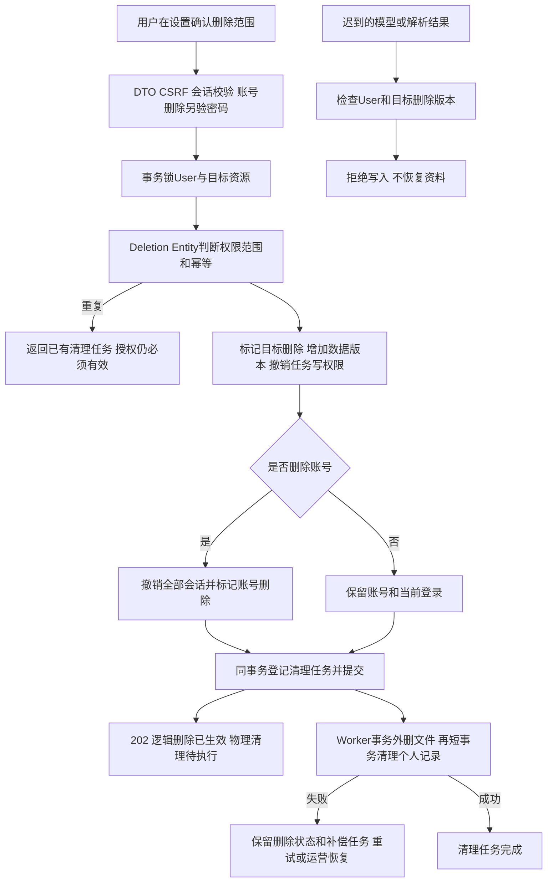
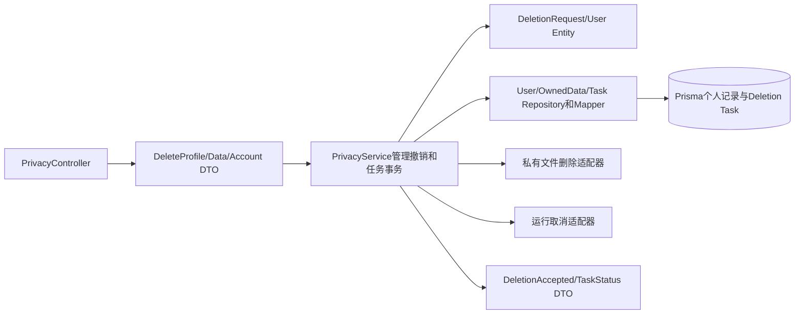

# 个人数据删除与工作台集成方案

版本0.2，按用户“将后面任务全部写完吧，明天我来检查”获批连续本地实现；对应第十一步。依赖模块验收后才做集成，不在本步提前实现其他模块业务。

## 用户路径与数据边界

设置页区分“删除单个简历”“删除一个会话”“清空画像”“清空所有求职资料”“删除账号”。清空资料保留账号，但删除简历文字、草稿、画像、会话、收藏投递和相关结果；公共岗位和来源不受影响。删除账号还需当前密码和二次确认，立即撤销会话。删除资料需要有效登录和二次确认；各动作响应返回清理任务 ID。

账号删除以请求中持久化的幂等键重试：用户会话撤销后不允许无认证重放私有响应；客户端若已收到成功，退出即可。对匿名重试返回 401，不以幂等键充当身份凭据。其他删除请求有认证时可读原任务。关闭账号的清理失败由运营恢复，不开放匿名进度查询。

清理遵循 User 锁先于子记录和 Task 的固定顺序；外部取消失败不能让任务重新获得写权限。数据库逻辑删除立即限制读取，物理文件失败不回滚已确认删除，不再进入模型。相关事件和日志仅保留必要请求标识、状态和无个人内容的操作记录。

清空画像后历史资格记录对当前推荐失效；删除单个简历默认不删除已确认画像，需在页面明确说明并提供清空入口。删除会话同时撤销关联运行，SSE 不回放已删正文。原始协作记录中的真实用户数据不自动被此模块处理，发布前需另行脱敏且如实说明范围。

## 集成与验收

所有已完成页面实现加载、无结果、失败、过期、冲突和重试；表单保持用户输入并在 409 后展示当前版本重新确认，不能自动覆盖。键盘操作和移动端可读。可信说明使用实际数据计数和时间，不写未经验证宣传指标。

PRIV-01—03、CHAT-03、RES-06、TASK-01；E2E-PRIVACY 覆盖清空资料保留账号、删除账号撤销 Cookie、文件失败补偿、取消失败及迟到回调；E2E-WORKSPACE 覆盖注册到简历、咨询、推荐、收藏、投递和删除的整体路径。应用测试使用虚构学生夹具；完整 E2E 不取代各模块 E2E。

本次具体的队列、授权、异常、测试与部署边界见[批量实施补充](batch-local.md)，本轮先完成方案再编码，统一交付检查。
