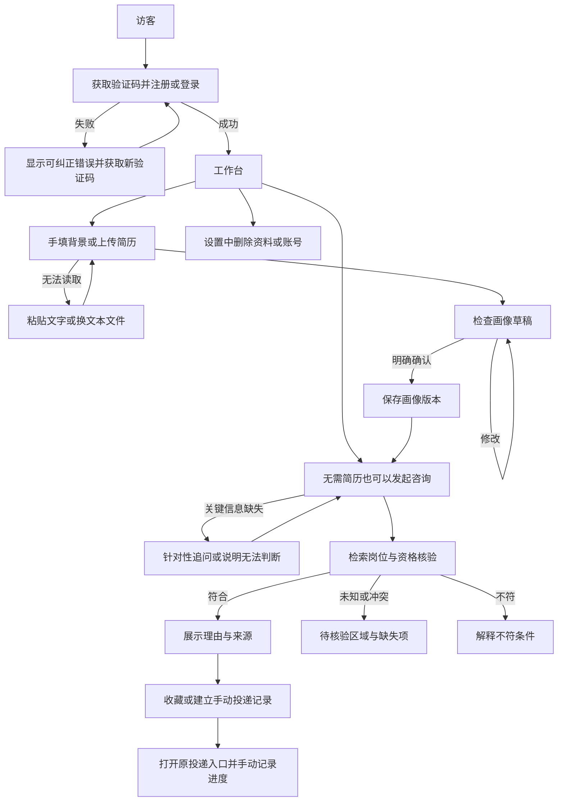

# 业务需求和验收基线

版本：0.1；待用户确认。题目来源：工作区根目录《职点迷津-全栈工程师实战考题.pdf》。下面的具体限额与交互是待确认的项目设计默认值，不代表源站规则。

## 角色与操作路径

| 角色       | 条件                   | 操作                                         | 数据变化                                   |
| ---------- | ---------------------- | -------------------------------------------- | ------------------------------------------ |
| 未登录访客 | 未认证                 | 查看注册登录、验证码、产品说明               | 仅产生有有效期的验证码和限流计数           |
| 注册用户   | 活跃账号和有效会话     | 岗位浏览、咨询、简历、画像、收藏、投递、删除 | 只能读取和改变自己的个人数据               |
| 运营者     | 服务器本地维护权限     | 采集重跑、条件核验、数据导出                 | 数据来源版本和操作审计，不提供公共管理接口 |
| Worker     | 有效任务租约           | 获取来源、解析、调用模型、清理文件           | 仅能提交所属任务及当前执行尝试的结果       |
| Agent      | 后端签发的单次运行授权 | 读取必要资料、检索岗位、提出画像草稿         | 不能确认画像、直接写收藏或推进投递         |

## 功能验收

| 领域 | 必须表现                                                      | 不可接受行为                                 |
| ---- | ------------------------------------------------------------- | -------------------------------------------- |
| 账号 | 用户名密码和图片验证码；跨设备登录恢复本人记录                | 邮箱手机号强制注册、公开他人记录             |
| 简历 | 文本 PDF / DOCX / TXT / 粘贴；原文定位；用户可纠正            | 扫描件无法读却声称解析成功、捏造未写字段     |
| 画像 | 教育、预计/实际毕业、正式工作、实习、技能、证书、偏好分别保存 | 未确认草稿或假设覆盖正式画像                 |
| 问答 | 方向分析、推荐、条件解释、简历建议、面试练习；多轮承接        | 普通建议假冒企业事实、模型失败用模板冒充成功 |
| 推荐 | 校招社招按具体条件；无结果解释数据和条件限制                  | 社招一律排除应届生、把未知视为通过           |
| 资格 | 学历、专业、时间、身份、年龄、经验、证书及条件组合            | 忽略例外、把实习等于工作、保证最终审核通过   |
| 来源 | 每项岗位事实可回溯版本、定位及核验时间                        | 假引用、只抓列表标签就声称完整资格核验       |
| 管理 | 收藏、手动投递状态、日期、备注和历史                          | 聊天提及就自动投递或改变进度                 |
| 采集 | 来源详情和公告；扩大覆盖；显示实际数量、新鲜度和缺口          | 把失败尝试当成功核验、声称采完未覆盖数据     |
| 隐私 | 数据分用户隔离、删除立即阻断访问、文件清理可追踪              | 删除后迟到任务恢复数据                       |

## 页面与边界

- `/login`、`/register`：验证码可刷新，重复提交防抖，错误仍由后端原子保护。
- `/workspace`：会话列表、流式聊天、画像摘要、引用与岗位卡片；无画像也可咨询。
- `/jobs`、`/jobs/:id`：筛选、详情、核验状态、条件逐项判断、来源与外部投递入口。
- `/resumes`、`/profile`：上传/粘贴、解析状态、草稿对照、确认和版本冲突处理。
- `/career`：收藏和投递列表、状态历史、过期岗位提示。
- `/settings`：密码、会话/资料/账号删除；账号删除二次确认。
- `/trust`：公开的数据覆盖、更新时间、判断局限及隐私说明，不公开源文件存储位置。

首版不做 OCR、外部自动报名、通用联网搜索、密码找回、消息提醒、多人协作或复杂多 Agent。外部实时问题无法核实时明示范围；通用建议不伪装为最新政策。

## 首版限制与验收数据

- 单文件最大 10 MiB；文本最多 50,000 Unicode 字符；简历最多 30 页；超过限制先拒绝再进入模型任务。
- 数据采集规模经第三步验证确定，覆盖校招社招，不预设“全量已完成”。
- 测试使用自行编写的虚构学生资料，明确标记为测试夹具，不混入生产岗位或真实个人记录。
- 外部模型、来源与部署参数尚待验证；此文档不代表已运行或已上线。
- 流程与接口细节见各模块方案；验收基线的变更须更新版本并重新提交确认。
