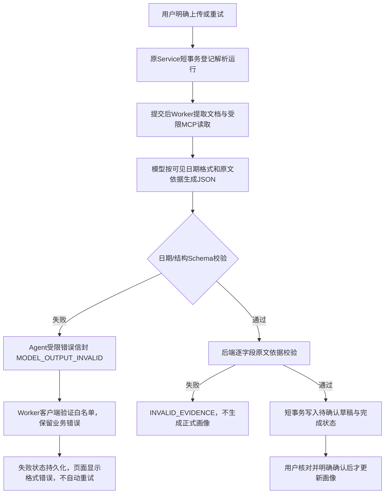
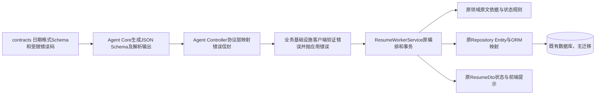

# 简历解析失败修复记录

状态：用户已明确授权“允许多次检查，直到修复”，按现有简历模块修复；非新业务模块，不再次暂停确认同一故障修复。

## 已定位问题

真实诊断请求HTTP200，流正常stop，模型返回合法JSON且未达到4096 token上限；日期Schema校验在毕业日期及实习起止日期3处失败。文档工具已成功提取原文，原文中存在点号年月。原Schema的日期value描述为“原始日期”，日期与精度的自定义校验没有进入提供给模型的JSON Schema，缺少可执行的日期格式约束。

Agent抛出MODEL_OUTPUT_INVALID后，通用HTTP过滤器转成INTERNAL_ERROR，Worker客户端又将所有非2xx统一改成MODEL_INTERRUPTED，导致页面始终显示模型中断。

## 修复方案与实施边界

1. 在原日期value Schema中补充可序列化的年/月/日格式pattern及说明；保留精度关联、真实日历校验，不放宽原来可接受的输入，不补齐未知日期。结构化提示明确只规范格式，原文依据逐字保留。
2. 内部提取接口仅透传已登记的受限错误码，使用现有错误响应信封；协议层完成HTTP映射。非法参数/认证和未知内部异常仍走原过滤器，错误对象、配置及模型正文不输出。
3. 补充日期事实引用必须定位到/value的约束；仅对已知日期对象路径作定位转换，有明确叶子引用时优先采用，不修改字段值或原文。仍由原领域校验拒绝缺失、错误引用和不支持事实的原文。学历取得及毕业性质只能有明确原文别名才生成，禁止按时间反推。领域依据异常只携带字段路径与固定分类，不携带原文或字段值。
4. Worker客户端验证错误信封与白名单后，保留已有业务错误码，未知/畸形响应继续保守报结果未知。前端补齐格式错误提示。
5. 自由文本经历说明直接采用已经定位并逐字核验的引用，不将模型改写当作用户事实；引用不存在或不受原文支持时仍拒绝。
6. 保留草稿、用户明确确认、事务、幂等、并发及删除屏障。无数据库结构变化，原文与模型输出不写入日志；诊断只记录状态、字段路径与分类。

测试覆盖真实HTTP/MCP/隔离PG的格式失败、HTTP不可用和错误传递、点号原文转规范年月后依据校验与草稿、原有断流与显式重试；运行受影响单元、集成和浏览器回归。按用户本轮授权顺序进行真实诊断与复验，成功后停止额外调用，不自动确认画像。

## 真实复验结果

用户授权后顺序进行7次真实诊断调用。第1次证实日期结构失败；后续分别定位日期依据缺失、处理中引用冲突误判、学历状态引用不支持、经历描述与引用不一致。完成修复后第7次HTTP200、正常stop、结构及依据均通过，实际简历ready并生成draft，未自动确认画像。仅保存脱敏分类和字段路径，原文、模型回答及密钥不进入报告。详见[真实复验摘要](../delivery/resume-parse-fix/real-verification.json)。

最终17项检查和281个测试全部通过，报告与当前改动源码摘要见[修复交付](../delivery/resume-parse-fix/README.md)。无数据库迁移；完成实现待用户检查，不标记为已验收。
