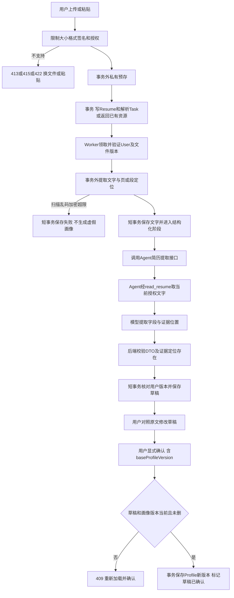
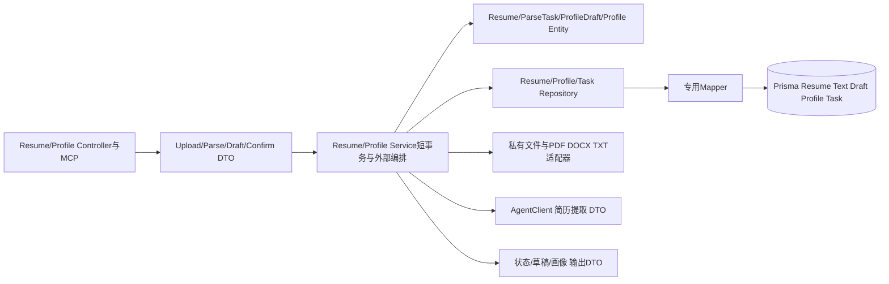

# 简历解析与画像确认方案

版本0.2，按用户“将后面任务全部写完吧，明天我来检查”获批连续本地实现；对应第九步，依赖已验收的 Agent 基础。尚无画像时，前序 get_profile 返回空已确认画像而不是访问不存在的 ORM 表；画像基础只读模型在第七步设计并实现，完整写入在本步完成。

## 用户操作与数据流

上传 10 MiB 内的文本 PDF、DOCX、TXT（最多 30 页、50,000 字符），或直接粘贴文字。校验文件签名与扩展名，不信任 MIME。DOCX 限制解压大小、条目数及外部引用，不执行宏；PDF 加密、扫描件、乱码和超限返回明确错误及替代操作，不进入模型假装成功。

文件事务外预存私有区并计算摘要，短事务登记 Resume 和解析 Task；DB 失败后清理孤立文件。按用户、fileDigest、提取版本和有效未删记录去重；已删后重新上传是新资源，不能恢复旧记录。

## 画像契约与确认

画像字段：educationEntries、formalEmploymentEntries、internshipEntries、skills、certificates、jobPreferences。毕业时间区分 expected / actual，学历状态区分 studying / awarded。政治面貌、生日等敏感且影响资格的字段只在用户提供且需要时记录，未提供为 unknown。每项抽取带 resumeVersion 和 locator，证据指向原始文本，不伪造页码。

ProfileDraft 保存原始抽取、用户修订、baseProfileVersion 和 draftVersion。手填或聊天提议也先创建草稿，用户确认后生效；客户端不能直接 PUT 正式画像。重复确认同一草稿返回原确认画像版本，若已经有新画像则额外标 current=false；同幂等键改内容冲突。

Repository 能力为 getOwnedResume、insertIfDigestAbsent、saveTextIfLease、insertDraft、updateDraftIfVersion、confirmIfBaseVersion、markDeleted。Service 提供 User、时钟和原文定位，领域对象决定状态和版本，不在 Zod validator 内做整套流程。

删除文件即时逻辑删除并取消有关任务、撤销读取；实体结果写入时检查删除状态。已确认画像保留用户确认的字段，移除可访问的原文，相关来源标记已删除；删除整个画像由独立隐私操作完成，UI 说明二者差异。文件实际清理失败为 pending_cleanup 可重试，不能说已物理删除。

## 异常、测试与提交

提取失败可用新格式重传；瞬时文件失败可重试；格式不支持不自动重试。模型超时标中断，明确重试才创建新 attempt。原始文字和画像不进入应用日志。

RES-01—07、PROFILE-01—05、INT-05、MCP-01/02/07。E2E-RESUME 覆盖上传、提取、Agent/MCP、失败和私有读取；E2E-PROFILE 覆盖手填/抽取草稿、修订、确认、重复确认和两个草稿竞争。包括伪装格式、压缩炸弹限制、他人文件、虚构证据定位拒绝、已删晚到结果、实习不计正式工作。提交包含文件模型、迁移、工具、页面和测试，回归对话模块。

本次具体的队列、授权、异常、测试与部署边界见[批量实施补充](batch-local.md)，本轮先完成方案再编码，统一交付检查。
