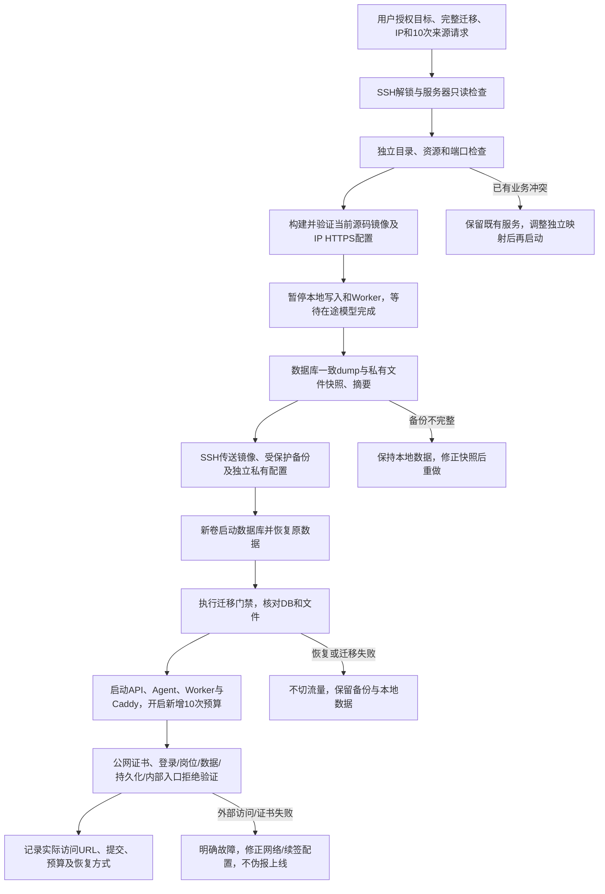

# 首次服务器发布与完整迁移方案

用户已授权发布到47.95.166.110，使用本机SSH/sudo，完整迁移，开启采集并新增10次请求；补充确认暂无域名，先使用IP。按既有第十二步部署方案具体化执行，不重复请求同一发布许可。

## 执行范围与前置检查

- 通过既有SSH配置aliyun-ayanami连接，检查目标系统/架构/资源、Docker/Compose、磁盘、80/443及已有服务。当前公钥被服务器认可，但本机私钥有口令；须用户在终端解锁到本次专用SSH agent。口令、私钥及业务凭据不进聊天、日志或Git。
- 只使用独立应用目录和Compose项目，不覆盖未知已有业务。部署前记录旧配置/镜像/卷并保留回退；服务器现状必须连接后确认。
- IP入口使用显式Let's Encrypt shortlived ACME profile，Caddy持久化证书及自动续签；生产认证保持HTTPS/Secure Cookie。80/443须可达。不能用忽略证书校验的测试冒充公网证书验收。
- 完整迁移包含业务数据库、账号/会话/画像/简历与私有原文/来源快照、收藏/投递及历史、任务/原预算记录。模型和来源私有配置经SSH单独传送，权限0600，不进发布源码包。
- 在镜像和目标准备完毕后暂停本地写入及Worker，确认无进行中模型任务，形成数据库/文件一致备份，再恢复到服务器专用新卷。验证数据库数量/关键状态及文件摘要，保留本地原数据和受保护备份，失败时不删除本地数据。
- 原采集预算与用量完整迁移；新增10次使用本次明确授权的独立预算标识，原记录不清零。Worker单独只读挂载来源Cookie文件；生产文件由node可读且模式0600。额度包含robots、跳转、重试，达到10次暂停，不无限重置。

## 配置与验证边界

应用接口/DTO、Entity、Repository和数据库结构不新增；仅部署配置、证书策略、Cookie挂载和本次预算设置变化。原API/MCP保持私网身份和事务边界。数据搬迁在服务停止的一致窗口进行；恢复不覆盖未知数据库。SSH传输和证书申请不在数据库事务内，失败保留备份后可重新传送；重复恢复须确认目标仍是本次专用项目。

服务器覆盖配置下，恢复脚本恢复数据库和文件后保持全部业务进程停止；必须先把额度对账到真实已用高水位、重放备份之后的删除请求，再显式启动。禁止恢复旧快照后自动启动Worker而重获同一额度。本地默认离线恢复演练仍自动启动；容器回归另覆盖服务器停止门禁。

构建新镜像，运行既有本地生产容器/备份恢复演练，并校验IP配置只使用明确ACME issuer/profile、沿用内部路由拒绝和11MB上传限制。公网实际证书、服务器状态、完整恢复和最多10次采集须部署后另记录；本地通过不能替代线上验收。

参考：[Let's Encrypt IP证书及160小时短证书](https://letsencrypt.org/2026/01/15/6day-and-ip-general-availability)、[Caddy ACME profile配置](https://caddyserver.com/docs/caddyfile/directives/tls)。当前已固定镜像的Caddy实测版本为2.11.7；自动续签与数据卷必须在目标机保留。
