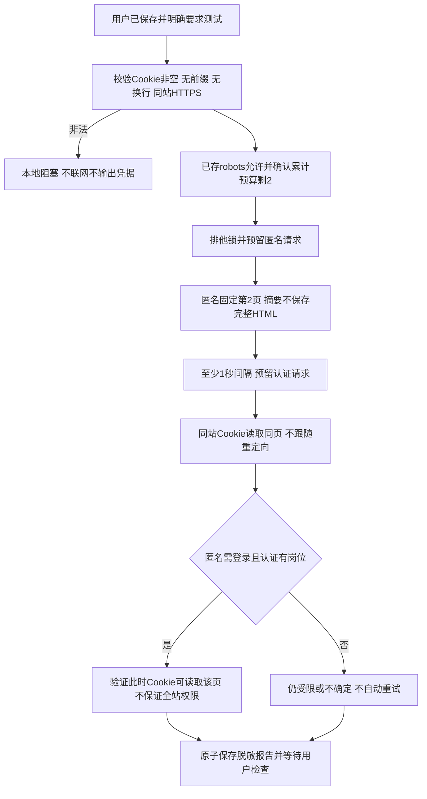

# 第三步：已授权Cookie访问验证

范围：用户配置本地Cookie后要求“你来试试”，并在空配置提示后回复“已保存”；记录为授权本次只读访问测试。继承第三步0.2方案，最多使用剩余2次请求，不增加原20次来源预算，不调用已耗尽5次额度的模型，不开始第四步。

步骤：读取本地私有配置并校验 → 读取已有公开robots快照及18次请求记录 → 登记全局排他锁和请求预留 → 不带Cookie读取固定第2页 → 间隔至少1秒 → 带Cookie读取同URL → 对照登录提示及真实岗位ID → 保存脱敏报告 → 停下交付检查。

实现分工：session-cli只解析运行ID/目录；session-service编排锁和两个请求；session-store只保存预算、锁及报告；session-page只根据响应判断页面类型和前后差异；session-reader只在允许主机发GET并返回脱敏摘要。DTO位于session-dto，所有输入校验先于网络。无数据库或ORM、无业务事务。Cookie和Set-Cookie不输出，不保存认证原始HTML、个人账号、请求头和响应头；只保留固定URL、HTTP状态、标题类别、公开岗位ID数量与判断。

异常：Cookie空或含换行立即拒绝；robots缺失/不允许、预算不足、运行冲突停止。3xx只记录类别，不跟随；网络超时不自动重试。请求先写预算，即便超时也占额度。报告失败保留锁供人工检查，不以新runId重置请求总数。重复同runId回放报告，不再联网；多个进程只能有一个获得全局测试锁。原子报告为执行结果，不等于用户验收。

测试：合法/非法配置、HTTP200登录页、会员限制与未知页面、已有岗位的判定、同站Cookie范围、不跟随重定向、不保存敏感HTML、重复报告和预算、缺Cookie零请求、命令入口与纯本地替身测试；真实请求与替身结果分别交付。

增补确认：两次尝试后发现验证器把源站不透明ID误当标准UUID，并将元数据异常误报网络失败。已经修正和回归，但无法从未保存的认证HTML追溯实际Cookie结论。见[结果](../verification/session-validation.md)。针对追加2次同URL只读对照、总预算22的具体提案，用户回复“允许，可以适当放宽”，记录为批准该增补；本轮只将累计上限调整到22，不增加模型额度、不扩大采集范围。原20次上限及失败报告作为历史保留。
