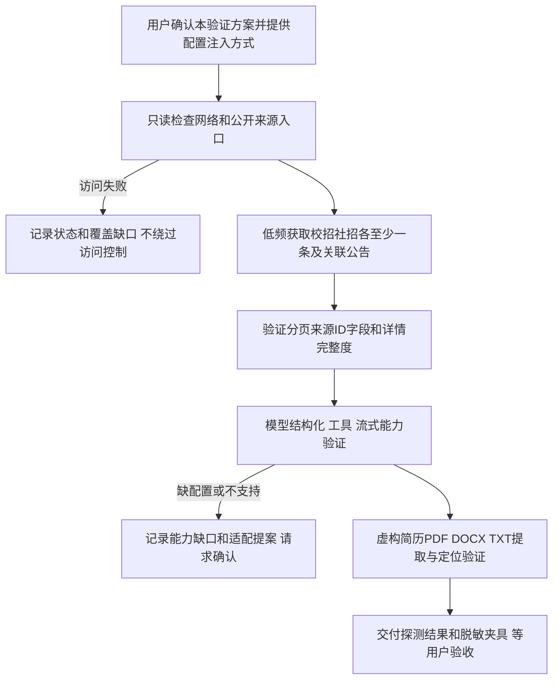
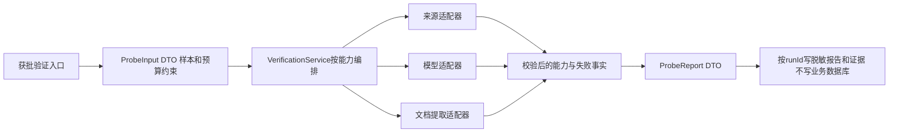

# 外部能力验证方案

版本 0.1，待用户确认；对应第三步。当前仅文档，不运行网络采集、安装依赖或编写探测脚本。

## 验证目标与流程

开发实现：受控脚本入口接收来源允许主机、样本 ID、配置引用和输出目录 DTO → VerificationService 编排 → 网络/模型/文档适配器返回类型化结果 → 证据文件及报告。此阶段不启动业务数据库，无 ORM 或业务事务；外部失败不产生用户业务记录。重复运行按 runId 分目录、摘要去重，不覆盖原报告。

若需要脚本，输入输出及测试先补充进本方案并确认，再写脚本。严禁以能力验证为名开始全站采集。默认同域最多 2 并发、请求间隔至少 1 秒、最多 20 个来源页面、每样本只执行必要模型调用；遇限制停止记录，不扩大成本。

成功产物必须区分：已验证的来源入口/分页、仅推断的部分、模型能力和预算、文档格式支持、无法获取范围。使用自己准备的虚构简历，不上传真实个人资料。不把模型“返回了 JSON”当作字段正确，核对证据定位及工具调用实际执行。

测试：VERIFY-01 网络失败与受限响应不假成功；VERIFY-02 模型超时、非结构化、无工具能力；VERIFY-03 文档文本、加密、扫描及提取证据；E2E-VERIFY 通过真实验证入口串联适配器及报告，外部替身用于回归、真实调用另标记录。提交边界只含获批验证脚本、脱敏夹具及报告。
