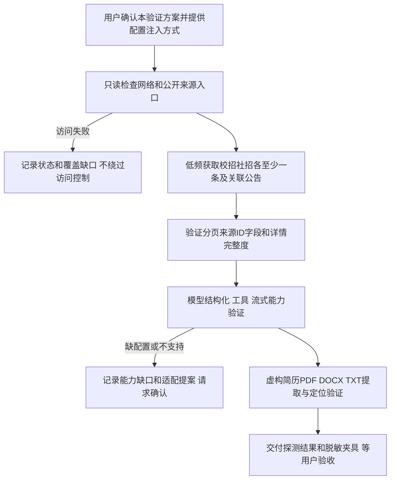
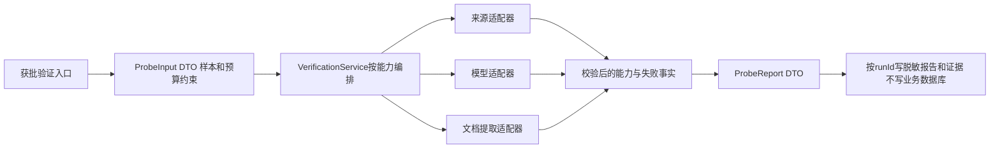

# 外部能力验证方案

版本0.2；用户在单独提交本方案后指示“继续，下一步”，记录为本方案已确认，允许执行第三步验证。完成后仍需用户检查，不授权第四步工程初始化。

## 本轮确认范围

用户随后指定模型 `deepseek-v4-pro`，API Key自行本地配置。默认DeepSeek官方地址 `https://api.deepseek.com` 和Chat Completions协议，配置模板在 `tools/verification/.env.verification.example`，私有文件为同目录 `.env.verification`。官方模型和接口文档已核对，真实适配与调用仍待完成；不自动换模型或因写入配置就执行请求。

后续执行记录：用户“配置好了，继续进行吧，之后完成一步汇报一下这一步做了什么”授权继续本步。实现DeepSeek适配并执行5次真实请求，结果见[模型报告](../verification/736bf63c-45ce-4a7e-b51e-1950a57d8147/report.md)。预算按原方案不变，非思考模式，真实5项已通过；未进入第四步。每步汇报变更、验证和剩余问题，仍按原约定等待检查。

只验证来源、模型和文档能力，完成后交付结果再停下。不实现业务API、账号、数据库、完整采集任务或前端，不进入第四步工程初始化。

相对0.1补全入口契约、样本、预算、失败、并发、测试及交付判定。以下文件和命令是待确认设计，不代表已创建。

## 验证目标与流程

开发实现：受控脚本入口接收来源允许主机、样本 ID、配置引用和输出目录 DTO → VerificationService 编排 → 网络/模型/文档适配器返回类型化结果 → 证据文件及报告。此阶段不启动业务数据库，无 ORM 或业务事务；外部失败不产生用户业务记录。重复运行按 runId 分目录、摘要去重，不覆盖原报告。

若需要脚本，输入输出及测试先补充进本方案并确认，再写脚本。严禁以能力验证为名开始全站采集。默认同域最多 2 并发、请求间隔至少 1 秒、最多 20 个来源页面、每样本只执行必要模型调用；遇限制停止记录，不扩大成本。

## 验证顺序与预算

| 顺序     | 操作                                                    | 输出或失败行为                                                                   |
| -------- | ------------------------------------------------------- | -------------------------------------------------------------------------------- |
| 来源入口 | 检查公开首页、列表、robots、分页及实际请求              | 证明接口/HTML/浏览器何者可用；受限时记录，不绕过访问控制                         |
| 岗位样本 | 校招社招各至少1条及关联公告                             | sourceId、字段、条件、原投递入口、时间和冲突；取不到就报告缺口，不用虚构岗位顶替 |
| 文档     | 自制文本PDF、DOCX、TXT各1份虚构简历及扫描/加密/超限负例 | 文字和页段定位；不支持明确失败，不做OCR，不上传真人资料                          |
| 模型     | 配置齐备后验证结构化提取、流式、工具调用和结果回传      | 字段与证据对照；缺配置blocked，不支持unsupported，超时interrupted                |
| 汇总     | 实际证据、测试和失败记录                                | 可行适配方式、无法获取范围、下一步依赖；不以替身冒充外部成功                     |

来源最多20次真实请求，重定向和重试也计入；同域最多2并发、请求启动间隔至少1秒、单次20秒超时。浏览器若必要，其资源请求同样受限；预算不足记录缺口并请求调整，不暗中扩大。

模型最多5次请求：结构化1次、流式1次、工具请求与结果回传2次、字段证据对照1次；单次输入最多6,000字符、输出最多1,500 token、超时120秒。此为数量预算，不是费用报价；实际费用由用户提供的模型决定。结果未知不自动重试；没有配置时先保持模型项未验证，独立的来源和文档项可继续，但不能报告本步全部完成。

## 入口、DTO与产物

拟提供独立命令 `source`、`document`、`model`、`all`，通过 ProbeInputDto → VerificationService → 适配器 → ProbeReportDto。源码及测试拟放 `tools/verification/`；不启动业务框架或数据库。依赖隔离安装在 `/tmp`，记录实际版本和锁定信息，不提前初始化第四步workspace。

| 类型                | 字段与约束                                                                                                 |
| ------------------- | ---------------------------------------------------------------------------------------------------------- |
| ProbeInputDto       | runId(UUID)、kind、允许来源主机、请求预算、fixturePaths、输出目录；禁止任意内网URL                         |
| ModelProbeConfig    | MODEL_BASE_URL、MODEL_NAME、MODEL_API_KEY、MODEL_PROTOCOL；密钥仅环境注入，协议由用户说明，不从域名猜测    |
| SourceProbeResult   | URL、获取时间、状态、传输方式、分页证据、岗位/公告ID、条件缺口、样本摘要                                   |
| DocumentProbeResult | 样本ID、格式、支持性、文字、定位、字符数、失败代码                                                         |
| ModelProbeResult    | 模型标识、能力、字段定位对照、调用次数、服务返回用量、耗时、失败类别；无密钥或内部推理                     |
| ProbeReportDto      | runId、起止时间、依赖版本、各项passed/failed/blocked/unsupported/interrupted/not_run、证据清单、摘要及缺口 |

结果目录拟为 `docs/verification/<runId>/`，包含 report.md、report.json、manifest.json、脱敏来源样本、虚构文档夹具和测试结果。报告不含Cookie、认证头或密钥。兼容协议也需实际验证，返回JSON不等于字段和工具能力正确。

## 幂等、并发、异常与补偿

- 每runId独立目录和排他运行锁；相同runId并行执行返回冲突，不启动第二个收费请求。
- 已完成runId只回放报告；重新探测必须新runId并保留旧报告。
- 临时文件原子替换，失败不生成完成标记；中断不触发未知结果的模型重试。
- 无数据库事务；外部失败只保存本地事实，不需要回滚用户或岗位。未完成临时文件可清理，已保存证据不覆盖。
- 配置、预算非法时调用前拒绝；网络、限额、格式和字段失败分类记录，中止当前能力项，不伪称通过。其他独立项可继续。

## 测试与验收

| 用例       | 核对内容                                                                          |
| ---------- | --------------------------------------------------------------------------------- |
| VERIFY-01  | URL允许范围、预算、超时/429/404、分页和sourceId、两类岗位及公告关联，失败不假成功 |
| VERIFY-02  | 缺配置无调用、结构化字段定位、流式结束、工具回传、预算、超时不盲重试、脱敏        |
| VERIFY-03  | 三种文本格式，扫描/加密/伪装/超限明确失败，不静默OCR                              |
| E2E-VERIFY | 实际命令经过编排、适配器到报告；可控替身回归与真实外部验证分开                    |
| 并发与恢复 | 同runId排他、重放无外部调用、写失败无完成标记、中断不自动重新计费                 |

获批后实现并运行相关格式、Lint、类型、入口测试和验证E2E，交付命令、结果和实际外部证据。模型配置等缺项如实保留，未验收不进入第四步。本步尚无有效Git仓库，不为提交提前初始化第四步工程；先交付产物，待工程步骤纳入本地历史并注明范围。

成功产物必须区分：已验证的来源入口/分页、仅推断的部分、模型能力和预算、文档格式支持、无法获取范围。使用自己准备的虚构简历，不上传真实个人资料。不把模型“返回了 JSON”当作字段正确，核对证据定位及工具调用实际执行。

测试：VERIFY-01 网络失败与受限响应不假成功；VERIFY-02 模型超时、非结构化、无工具能力；VERIFY-03 文档文本、加密、扫描及提取证据；E2E-VERIFY 通过真实验证入口串联适配器及报告，外部替身用于回归、真实调用另标记录。提交边界只含获批验证脚本、脱敏夹具及报告。
