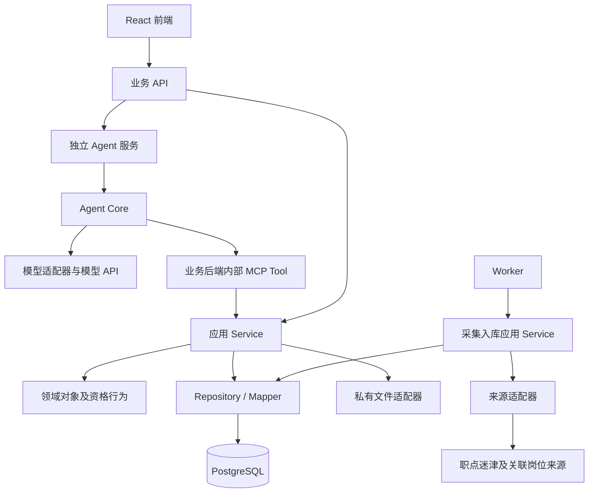

# AI 求职助手实施计划

## 本次批量执行

用户最新指示“将后面任务全部写完吧，明天我来检查”，确认第七步方案0.2并授权第七至十二步连续本地开发与验证；本轮先补各模块方案再实现，不等待中间逐模块确认，最终统一交付用户检查。完成状态仍区分已实现和已验收；远端发布及超预算收费调用不执行。此授权优先于下方一般流程，其他质量与数据边界保持适用。

## 1. 执行与验收规则

本计划受 [开发规范](../AGENT.md) 约束。每一步均采用：

**执行当前步 → 自检和测试 → 提交检查材料 → 停止 → 用户检查 → 修正并复验 → 用户明确通过 → 下一步。**

**每个具体模块另有实现前门禁：生成书面方案 → 提交用户确认 → 停止等待 → 用户明确通过 → 实现。**实现前方案确认和实现后步骤验收不可互相替代。

- 方案放在 `docs/design/`，包含需求、业务流程图、开发实现图、DTO / Entity / Repository / ORM 边界、数据变化、事务、异常、幂等、并发、外部交互、测试及提交边界。
- 一个步骤包含多个模块时逐模块确认，除非用户明确一次批准列明的多个方案。总体计划或其他模块获批，不自动批准当前模块。
- 为每个模块记录方案版本及对应用户确认；未确认的标记“待方案确认”，不开始实现。
- 已确认方案发生范围、接口、规则、数据、事务、并发或外部交互方面的实质变化时，暂停受影响实现，更新方案并重新提交确认。
- 工程基础、验证脚本和共享能力同样先提交相应方案；不能边等确认边编码。

- 不以完成实现代替用户验收，不以沉默或时间经过视为通过。
- 用户提出问题时仅修正当前步，重新提交检查，不提前执行下一步。
- 每次交付提供文件链接、变更、检查或测试命令与结果、限制、待检查项。
- 计划状态使用“未开始 / 待方案确认 / 进行中 / 待用户检查 / 修正中 / 已验收 / 阻塞”。
- 每个提交使用中文信息，包含对应测试；仅本地提交，远端操作单独授权。
- 文档步骤无需初始化运行工程；有服务后才进行启动及代码测试。不能伪造不适用检查的通过结果。

### 当前状态

| 步骤                          | 状态       | 验收记录                                                                             |
| ----------------------------- | ---------- | ------------------------------------------------------------------------------------ |
| 1. 落实规范与计划文档         | 已验收     | 2026-10-30 用户在补充模块方案确认规则后指示“继续吧”，记录为通过并进入第二步          |
| 2. 需求、流程图和接口测试矩阵 | 已验收     | 2026-10-30 用户在对话归档后指示“继续吧”，记录为允许推进；具体模块需另确认            |
| 3. 外部能力验证               | 已验收     | 用户在有限样本及缺口说明后回复“继续”，记录为按披露范围验收；未证明全站或外站原文覆盖 |
| 4. Monorepo、持久化和质量基础 | 已验收     | 用户“我已检查完成，继续实现”明确验收；本地工程提交2d2f003                            |
| 5. 账号与认证模块             | 已验收     | 用户在faf9dd9交付后回复“继续”，记录为通过；[交付记录](auth/README.md)                |
| 6. 采集、证据和更新模块       | 已验收     | 用户在079d85d交付后回复“继续”，记录为通过；[交付记录](ingestion/README.md)           |
| 7. 岗位查询与资格判断模块     | 待用户检查 | 已完成本地实现；本地提交cf449ad，批量授权后集中检查                                  |
| 8. 独立Agent、MCP和对话       | 待用户检查 | 已完成，含真实MCP与受控模型HTTP验证                                                  |
| 9. 简历与画像                 | 待用户检查 | 已完成，含PDF/DOCX提取、草稿确认及删除竞争验证                                       |
| 10. 收藏与投递                | 待用户检查 | 已完成，含幂等、并发及历史记录                                                       |
| 11. 工作台、隐私及整体回归    | 待用户检查 | 已完成本地功能及整体回归，新增真实调用未执行                                         |
| 12. 部署准备与交付            | 待用户检查 | 本地生产容器及备份恢复已通过；远端发布和7天在线未执行                                |

第五、六步已验收；第七至十一步本地实现及第十二步本地部署准备已完成，按最新批量授权集中等待用户检查。既有工程交付见[第四步记录](foundation/README.md)，设计和确认见[方案索引](design/README.md)及[执行记录](execution-record.md)。

## 2. 已确认目标和范围

面向大学生，基于职点迷津真实岗位实现：

**注册登录 → 介绍背景或上传简历 → 确认画像 → 多轮咨询 → 有依据的岗位推荐和条件核验 → 收藏与投递管理。**

确认事项：

- TypeScript 全栈，Agent Core 和业务后端同一 monorepo、独立运行，采用分层架构。
- 数据优先扩大覆盖，包含校招和社招；按具体条件判断应届生资格，不承诺未经验证的全站覆盖。
- 简历工具提取文字，模型理解结构，程序校验，用户确认；支持文本 PDF、DOCX、TXT、粘贴，不做 OCR。
- 用户名、密码和服务端图片验证码注册，不要求邮箱或手机号，不做密码找回。
- 首版包含收藏、手动投递管理；不执行外部自动投递。
- 问答覆盖方向、推荐、核验、简历建议和面试准备；实时查询只核验岗位及关联公告。
- 模型使用用户指定的 `deepseek-v4-pro`；API Key由用户自行在本地私有配置中填写，不进入代码、版本管理或协作导出。
- 每个 HTTP、内部服务和 MCP 接口有测试，每个完整模块有 E2E。
- 公网网站、代码更新后自动部署、完整源码和 Git 历史、岗位数据、可信性说明、投入时间与原始协作记录均为交付项。
- 题目要求收到后 24 小时内提交，至少 7 天可用。用户分步验收规则优先约束执行，不因赶期限跳过验收或测试；记录真实完成范围和时间。

当前环境：正式工程位于`career-assistant/`，旧`app/`已按要求删除。本地Git和正式pnpm workspace已建立；四应用可构建，PostgreSQL迁移及本地服务由独立测试验证。真实模型和来源预算保持原记录，尚无公网部署；部署配置和远端操作仍待后续授权。

## 3. 技术栈、结构与关键契约

| 部分                      | 选型                                                        |
| ------------------------- | ----------------------------------------------------------- |
| 工程                      | pnpm workspace、TypeScript、锁文件                          |
| 前端                      | React、Vite、React Router、轻量CSS及原生可访问表单          |
| 业务 API / Agent 服务入口 | 各自独立 NestJS 应用                                        |
| Agent Core                | 独立包，受限工具调用循环、模型和 MCP 适配器                 |
| MCP                       | 官方 TypeScript SDK，内部 Streamable HTTP                   |
| 契约 / 领域               | Zod DTO；独立 Schema 校验的行为领域类                       |
| 数据库                    | PostgreSQL、Prisma、Unit of Work                            |
| 文档                      | PDF.js、Mammoth、TXT 文本读取                               |
| 采集                      | HTTP、HTML 解析，必要时 Playwright                          |
| 任务                      | 独立 Worker、数据库任务及租约，无独立消息队列               |
| 测试                      | Vitest、真实 PostgreSQL 集成测试、Playwright E2E            |
| 部署                      | 默认 Linux、Docker Compose、HTTPS 代理、持久卷              |
| 自动部署                  | GitHub Actions 检查、构建、迁移、发布及回退；实际执行等授权 |

Monorepo 包括 `apps/web`、`apps/api`、`apps/agent`、`apps/worker`，以及 `packages/contracts`、`business`、`agent-core`、`config`、`observability`、`testing`。逐个包按职责建立，不为空目录制造进度。

前端只访问 API；Agent 不直接访问业务数据库。身份来自受信上下文，MCP 工具按用户归属授权；不让模型任意指定用户。

HTTP 契约覆盖账号、简历、画像、会话和消息、岗位、收藏、投递、数据删除、健康检查；内部契约覆盖 Agent 运行与流式事件。MCP 包括 `read_resume`、`get_profile`、`propose_profile_update`、`search_jobs`、`get_job_evidence`、`evaluate_eligibility`、`request_job_refresh`。具体输入、输出、错误和测试在第二步形成矩阵，编码前对齐。

### 状态、幂等与并发基础规则

| 场景            | 规则                                                         |
| --------------- | ------------------------------------------------------------ |
| 并发同名注册    | 规范化用户名，数据库唯一约束只允许一个成功                   |
| 验证码重放      | 原子消费，有效期内也仅使用一次                               |
| 重复解析        | 同用户、文件版本及解析版本复用任务；显式重试保留新的执行尝试 |
| 画像确认冲突    | 草稿及画像版本条件更新，过期时重新确认                       |
| 重复消息        | 会话内 `clientMessageId` 去重，返回原运行记录                |
| 同会话并发消息  | 首版串行，有运行时返回忙，不隐式重排                         |
| 收藏添加 / 删除 | 用户和岗位唯一；添加返回已有，重复删除也成功                 |
| 重复投递记录    | 每用户每岗位一条记录                                         |
| 并发投递更新    | 版本号条件更新，后提交者收到冲突                             |
| 重复采集        | 来源 ID 唯一，相同内容不产生新版本                           |
| 重复刷新        | 合并有效任务，提高优先级                                     |
| Worker 失去租约 | 执行标识条件更新，拒绝迟到覆盖                               |
| 删除与解析竞争  | 删除优先，迟到结果不得恢复个人数据                           |

主要状态机：

- 简历：排队 → 提取 → 结构化 → 待确认；失败记录阶段，确认后更新独立画像版本。
- 对话：排队 → 执行 → 完成 / 失败 / 中断；重试关联原运行。
- 采集：待执行 → 已领取 → 成功 / 等待重试 / 失败。
- 资格：符合已核验条件 / 明确不符合 / 待核验，绑定画像、岗位和证据版本及核验时间。
- 投递：准备投递、已投递、笔试、面试、录用、未通过、已撤回；手动修正并记录历史。

### 采集与新鲜度

需要自动采集模块；已发现公开页面，带Cookie第2页已通过只读验证；内部接口、完整分页范围和吞吐量尚未验证，不预设必须使用浏览器。

- 优先接口，其次 HTML，必要时浏览器；同时获取岗位详情、关联公告和原始投递入口。
- 默认同域并发最多 2，请求启动间隔至少 1 秒；遵守站点约束并对失败退避。
- 新数据每 2 小时增量发现，在招记录目标每 24 小时复查，48 小时内截止岗位每 2 小时优先复查。
- 明确截止到时本地停推；用户请求核验时优先刷新并合并重复任务。
- 分开记录尝试、成功获取及成功核验时间。失败不刷新成功时间，页面消失不直接认定关闭。
- 普通岗位核验超过 24 小时、临近截止岗位超过 2 小时，不作肯定性推荐；积压显式降级，不虚报达标。
- 条件缺失、来源冲突和未经核验的模型草稿进入待核验。偏好排序与硬性资格分开。
- 持续扩大范围，如实披露实际覆盖，不承诺在 24 小时内采完百万数据。

## 4. 逐步 TODO

每步完成后交付检查材料并停下；只有用户明确通过，才能更新为“已验收”并推进。

第三至十二步均包含以下前置 TODO；每个具体模块及独立实现单元逐一执行：

- [ ] 生成或细化当前模块书面方案，标明版本和相对第二步总体设计的变化。
- [ ] 提交用户检查，停止等待明确确认；有修改时修订并重新确认。
- [ ] 记录用户确认后，才执行本步对应模块的实现 TODO。

### 第一步：落实开发规范和计划文档

- [x] 创建正式文档目录。
- [x] 整理 TypeScript 适配后的 `AGENT.md`。
- [x] 创建读取规范的 `AGENTS.md`。
- [x] 写入分步 TODO、完成标准及用户验收门禁。
- [x] 用户检查文档；补充模块实现前确认规则已落实。
- [x] 用户以“继续吧”同意进入第二步，已记录验收。

**交付物：**三份文档。**自检：**链接、内容完整性、Markdown 结构、无额外工程产物。**停步点：**不初始化 Git、安装依赖或编码。

### 第二步：完成需求、流程图和接口测试矩阵

- [x] 分账号、简历画像、岗位、资格、对话、求职管理、采集更新、个人数据删除整理需求。
- [x] 建立时间、协作记录现状、问题及配置依赖清单；会话已过滤脱敏导出，范围和缺口见manifest。
- [x] 每模块产出正常、异常、边界、状态、数据、外部交互、幂等和并发流程方案。
- [x] 产出含 DTO、领域行为、Repository、Mapper、ORM、事务和异常的开发实现图。
- [x] 定义接口输入输出、错误、身份、幂等键、冲突及提交后任务提案。
- [x] 每接口关联待实现测试；定义各层测试和各模块 E2E。
- [x] 检查公共能力和数据库变更，提交用户检查。
- [x] 用户在对话归档后指示“继续吧”，记录为第二步通过；具体模块实现仍需单独确认。

**完成标准：**设计可直接指导实现，关键问题全部对齐。**停步点：**设计未验收不写业务代码。

### 第三步：验证模型、采集和文档外部能力

- [x] 单独提交具体验证方案0.2，包括输入输出、预算、幂等、失败和测试。
- [x] 用户“继续，下一步”明确确认验证方案0.2；按此方案执行第三步。
- [x] 验证本机HTTP可读公开HTML、robots与分页边界；匿名第2页需登录，用户配置Cookie后同页可见10个岗位标识；范围限制见会话报告。
- [x] 已取得校招与社招真实详情，公告与两个校招岗位双向关联核验通过；社招仅发现外站原文入口，外站和完整范围未验证，缺口已记录。
- [x] 用户配置deepseek-v4-pro后，5次真实请求验证结构化、流式、工具调用、结果回传及字段依据，均通过；模型预算已用完。
- [x] 验证文本PDF、DOCX、TXT及8个文档正负样本；中文复杂PDF和真实多栏尚未验证。
- [x] 保存公开来源快照、虚构文档夹具、时间及摘要；公开来源22次（含本轮关联4次）、会话预留4次、模型5次；认证HTML不存盘。
- [x] 按已确认方案实现独立验证工具，最新格式、Lint、类型及77个测试通过（含验证入口及回放），历史38/64个测试结果保留。
- [x] 用户在有限样本、缺口和工程方案说明后回复“继续”，第三步按披露范围验收并授权第四步；缺口随采集模块继续跟踪。

**完成标准：**有真实外部验证记录，不用替身或虚构数据掩盖失败。**停步点：**未验证配置和范围明确报告，等待检查。

### 第四步：建立 Monorepo、持久化和质量基础

- [x] 验证本地 Git 可用性，建立本地仓库；受限时报告，不绕过权限。
- [x] 建立各应用、共享包、锁文件和配置校验。
- [x] 建立 PostgreSQL、Prisma 迁移、私有文件接口、Unit of Work 和映射模式。
- [x] 建立格式、Lint、类型、架构边界和接口测试清单检查。
- [x] 建立真实 PostgreSQL 集成测试、浏览器 E2E 及外部替身。
- [x] 实现健康检查、请求标识、异常映射和日志脱敏，对接口提供测试。
- [x] 迁移、回滚和各服务本地启动已验证，最终16项检查通过；工程源码、测试及记录纳入中文本地提交并交付检查。

**完成标准：**工程可启动、基础检查可执行、事务和边界有验证。**停步点：**不提前实现账号或后续业务。

### 第五步：账号与认证模块

- [x] 验收第四步，核对公共能力并生成[账号实施方案0.2](design/auth.md)。
- [x] 用户在本模块0.2确认请求后回复“继续”，开始以下编码和测试TODO。

- [x] 实现图片验证码、注册、登录、退出和密码修改。
- [x] 安全密码哈希、会话、限流、用户隔离和受信服务身份上下文。
- [x] 测试用户名竞争、验证码原子消费和重放、认证授权及错误映射。
- [x] 完成每接口测试、Repository 并发测试及注册登录浏览器 E2E。
- [x] 完成本地启动、Review 和本地提交，交付检查。

[本步交付与测试结果](auth/README.md)：136个测试、16项检查通过；用户在本步交付后回复“继续”，记录为验收通过，本地提交faf9dd9。

**完成标准：**可注册登录，无邮箱手机依赖，跨用户隔离及异常路径验证通过。

### 第六步：采集、证据和更新模块

- [x] 记录第五步验收，核对现有任务、持久化和来源验证，细化[采集实施方案0.2](design/ingestion.md)。
- [x] 用户在df71a44交付后回复“继续”，确认本模块0.2及最多40次新增来源验证预算。

获批后按以下顺序实现，每个内部步骤完成汇报；详细契约和测试见方案第8—10节：

1. DTO、领域行为、Repository端口、数据库迁移和并发基础。
2. 来源HTTP/HTML适配、Cookie隔离、robots、限速/预算和证据快照。
3. 任务租约、Worker调度、分页检查点及版本/草稿提交。
4. 核验CLI、刷新/任务/统计HTTP和一致导出。
5. 模块E2E、回归、质量检查、本地启动和有预算的真实取样。
6. Review、中文本地提交和本步交付，停止等待用户验收。

- [x] 实现发现、岗位详情、公告及投递来源采集。
- [x] 实现快照、内容版本、去重、检查点、任务租约和重试。
- [x] 实现条件草稿、核验标记、冲突记录及受保护核验命令。
- [x] 实现更新调度、明确截止停推、证据过期降级及刷新任务合并。
- [x] 展示覆盖、积压和失败统计，持续扩大校招社招范围。
- [x] 完成接口、Repository、重试、并发及 Worker E2E，提交检查。

**完成标准：**重复运行无重复岗位，更新可恢复，失败不伪造核验成功。

[本步交付与测试结果](ingestion/README.md)：180个测试、17项检查通过；真实来源27次、入库4校招+1社招，完整人工核验0。用户在079d85d交付后“继续”验收通过；随后第七步纳入本轮批量实现。

### 第七步：岗位查询与资格判断模块

- [x] 记录第六步验收，核对现有采集、证据、画像依赖和测试，细化[岗位资格方案0.2](design/jobs-eligibility.md)。
- [x] 用户最新批量开发指示授权按方案0.2完成本步及后续本地实现；实现等待集中检查。

获批后按以下顺序实现，每个内部步骤完成汇报：

1. 岗位/画像/资格DTO、领域Schema、条件元数据兼容与只读端口。
2. Job记录时间、Profile和EligibilityCheck迁移、Repository、索引及真实PG并发验证。
3. 资格领域三态组合、教育/专业/日期/经验/证书及有效性规则。
4. 6个新增HTTP接口、Service、权限、幂等和逐接口测试。
5. 岗位与核验页面、两组浏览器E2E、账号/采集回归及本地启动。
6. 完整质量检查、中文本地提交和第七步交付；本轮按批量授权连续推进，最终集中等待用户验收。

- [x] 实现岗位列表、详情、筛选及证据查询。
- [x] 领域行为实现学历、专业、身份、毕业时间、年龄、经验、证书及有效期规则。
- [x] 保留且 / 或、例外和指定计算日期；偏好只排序，不代替资格。
- [x] 逐项输出依据、缺失和三态结果，绑定版本，阻止过期推荐。
- [x] 覆盖应届社招、未知条件、日期边界、冲突及资料更新测试。
- [x] 完成规则、接口及岗位模块 E2E，提交检查。

**完成标准：**符合条件的社招可被应届生匹配；缺失、冲突及过期数据不会视为通过。

### 第八步：独立 Agent 服务、MCP 和对话基础

- [x] 实现独立 Agent 服务、模型适配、工具循环和预算限制。
- [x] 实现已有画像、岗位、证据、资格和刷新工具，并补全逐工具文档和测试。
- [x] 实现会话、消息、摘要、用户事实和假设区分。
- [x] 实现流式事件、消息去重、串行执行、失败、中断及重连契约。
- [x] 支持不依赖上传简历的方向分析、推荐、核验、简历文本建议和面试准备。
- [x] 测试内部接口、真实 MCP 传输、身份隔离、注入、工具失败及模型替身场景。
- [x] 完成 Agent 服务和对话模块 E2E，引用第三步真实联通证据；本轮使用可控HTTP模型，不新增真实调用，集中交付检查。

**完成标准：**Agent 基础可独立运行，为下一步简历模型提取提供能力；不能伪造用户身份或改写资格结论。

### 第九步：简历、画像确认及 Agent 简历工具

- [x] 实现上传、私有读取、TXT / PDF / DOCX 提取和粘贴。
- [x] 对接已验收 Agent，生成带定位依据的画像草稿。
- [x] 实现 `read_resume`、`propose_profile_update` 等简历画像工具，逐个补文档及测试。
- [x] 实现画像确认、修改、版本控制和文件删除，未确认信息不生效。
- [x] 测试扫描件、加密和超限文件、提取失败、确认冲突及删除竞争。
- [x] 完成所有新增接口及简历画像模块 E2E，回归对话 E2E，提交检查。

**完成标准：**用户可纠正并确认画像；Agent 与后端分离；失败不猜测，迟到任务不能恢复已删数据。

### 第十步：收藏及投递管理模块

- [x] 实现收藏、取消、投递记录、状态、日期、备注及状态历史。
- [x] 唯一约束、重复操作和版本冲突处理，过期岗位保留历史。
- [x] 修改来自明确用户操作，不因聊天提及或模型建议自动推进状态。
- [x] 每接口测试、并发测试及收藏投递浏览器 E2E，提交检查。

**完成标准：**记录持久化、可修改和删除，无重复创建及静默覆盖。

### 第十一步：工作台、个人数据删除与整体回归

- [x] 集成各步已交付页面，完善空状态、失败、移动端和无障碍交互。
- [x] 数据与可信说明展示覆盖、来源、时间、局限及核验依据。
- [x] 实现资料、会话和账号删除；文件失败进入可重试补偿，撤销运行任务的写入权限。
- [x] 对删除接口和模块提供测试及 E2E，验证跨用户隔离和迟到任务。
- [x] 全站 E2E 覆盖注册、画像、连续问答、核验、收藏、投递、删除。
- [x] 完成本地模型/来源替身整体回归，汇总差异、限制及测试报告。
- [ ] 新增真实模型与来源最终验证：未增加预算，保持未执行，不将历史证据当作本轮新验证。

**完成标准：**每完整模块有 E2E，接口矩阵无遗漏，删除流程和异常可解释。

### 第十二步：部署准备、交付及授权发布

- [x] 配置 Docker、HTTPS、持久化、备份、健康检查和日志。
- [x] 配置 CI 检查/构建和手动发布包，落实Compose迁移失败门禁及发布/回退手册；服务器发布保持未执行。
- [x] 本地生产构建和启动验证，完成接口测试矩阵及全部模块回归。
- [x] 整理源码和 Git 历史、岗位数据、来源时间和覆盖缺口、可信说明、投入时间、已知问题及脱敏原始协作记录。
- [x] 交付部署配置和检查结果，等待用户检查及明确远端操作授权。
- [x] 用户授权后接入目标服务器并首次发布；Git远端推送仍未授权、未执行。
- [x] 核对公网URL、不可变镜像、真实采集、持久化及恢复；配置Docker开机启动、容器自动重启和证书自动续签。7天尚未实际经过，不记为连续在线验收通过。
- [x] 交付[服务器发布结果及检查材料](delivery/server-release/README.md)。
- [ ] 用户完成线上检查并明确验收。

**完成标准：**上线可追溯、检查全部可核对；凭据及真实个人资料不进 Git，未完成项如实说明。

## 5. 通用完成门禁

**需求及图示对齐 → 契约与数据库设计对齐 → 具体模块书面方案提交 → 停止等待用户明确确认 → 实现符合分层 → 每接口有测试 → 分层及并发测试通过 → 模块 E2E 通过 → 本地启动通过 → Review → 本地提交 → 用户检查并明确验收。**

纯文档的第一、二步使用相应文档检查门禁，不假称运行服务或测试已通过。涉及步骤次序、范围或技术方案的调整必须说明原因并经用户确认。外部环境、模型或授权缺失时标记阻塞或验证未完成，不跳过验收推进。

## 本轮批量交付状态

第七至十一步本地功能及第十二步本地部署准备已实现，集中等待用户检查；真实调用和远端上线仍单列未执行。明日检查入口见[交付说明](delivery/README.md)，具体接口调整和首版容量边界见[运行契约](design/runtime-contracts.md)。

## 检查反馈：合并咨询与简历入口

用户要求“求职咨询和上传简历放到一个入口里吧”。[统一入口方案0.1](design/consultation-entry.md)经用户“先执行改动”授权，已实现待用户检查；[本轮8项浏览器回归与交付](delivery/consultation-entry/README.md)已归档；本轮优先合并入口，不开启岗位采集，不记录为此前步骤已验收。

- [x] 检查现有咨询、简历、导航、路由与浏览器回归能力，产出具体方案。
- [x] 用户“先执行改动”确认统一入口及画像核对路径。
- [x] 复用简历面板，合并导航/咨询入口，兼容旧地址与返回路径。
- [x] 完成8项受影响浏览器回归及质量检查，中文本地提交并交付检查。
- [ ] 用户检查统一入口并明确验收。

## 本地运行：启用岗位采集

用户明确要求“启用worker”，授权现有本地采集流程运行；已启用并登记首批任务，结果见[Worker运行记录](ingestion/local-worker.md)。新库先对账已用27次，沿用总上限40次，本次12次、累计39次，剩1次，达到上限后自动暂停，不转为无预算持续运行。当前首批10条岗位可浏览，完整人工核验0，真实来源累计65次。此授权覆盖本地Worker运行，不改变此前模块待检查状态、不授权远端发布或新增模型调用。数据说明的默认关闭文案误用API进程设置，已记录为尚未修复的显示问题。

## 检查反馈：简历解析失败修复

用户“简历解析还是不行，看看为什么”要求定位，随后明确授权“允许多次检查，直到修复”。按[修复记录](design/resume-parse-fix.md)修正现有模块，真实诊断7次后本份简历已ready并生成未确认草稿，不自动改写正式画像。

- [x] 只读检查配置、模型可用性和已有任务，脱敏记录失败阶段。
- [x] 修复日期可见格式约束、依据定位与原文描述、学历状态不推断及错误分类。
- [x] 使用用户本轮明确授权复验真实简历，结构和原文依据通过，移除临时诊断加载器。
- [x] 完成281个测试和17项质量检查，归档报告并创建中文本地提交；[修复交付](delivery/resume-parse-fix/README.md)待用户检查。
- [ ] 用户检查解析草稿并验收修复。

## 首次服务器部署授权

用户明确要求发布，提供47.95.166.110和本机SSH/sudo，选择完整迁移、开启采集并追加10次来源请求；补充选择先用IP，并在本机终端解锁SSH。按[服务器发布方案](design/server-release.md)完成首次发布，入口https://47.95.166.110。35张表、15个私有文件完整恢复并核对摘要；新增10/10额度已用完，来源任务按上限暂停，原39/40记录保留。281项回归、17项质量检查、12项本地生产容器检查及公网浏览器检查通过。服务重启后个人数据、证书和预算保持，模型列表检查200，无新增模型推理。具体证据及运维入口见[服务器交付](delivery/server-release/README.md)。不推送Git远端，不改动原飞书服务，不将发布完成记为用户验收；本地应用保持停止，原库和文件保留，防止双端采集。
