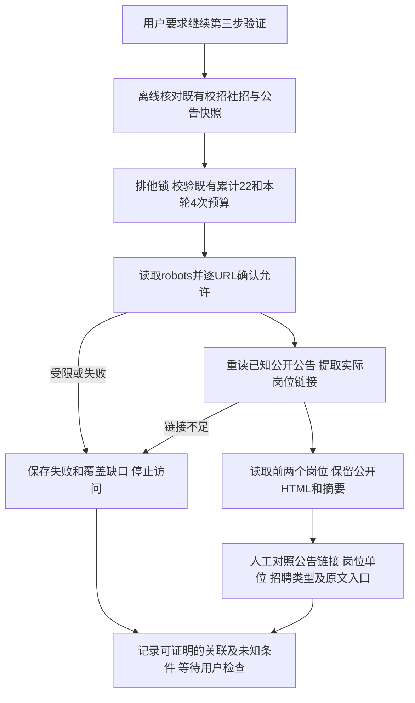

# 第三步：岗位与公告关联核验

## 本轮范围和执行依据

用户在Cookie复测交付后指示“继续验证，第四步是什么？”。本轮继续第三步原方案0.2中尚未完成的岗位与公告样本核验，不增加实现模块，不进入第四步。

先离线检查已保存的真实公开HTML：校招与社招详情均包含“查看原始公告”的外站链接；已取样的塔斯汀公告页列出了6个同站岗位链接。此前没有读取这些关联岗位，因此不能将分别访问成功当成关联核验成功。

按本轮继续验证指示，最多追加4次同站公开GET，累计来源预算从22增至26：robots、该公告、公告实际列出的前两个岗位。复用已确认并测试的SourceAdapter、SourceBudget和ReportStore，以手工核验现有HTML，不新增验证器实现。先检查robots，岗位URL必须来自该次公告响应；重定向同样占次数，失败不自动重试。仅串行访问，启动间隔至少1秒，单次20秒、响应不超过3MiB。

不加载Cookie或模型密钥，不访问外站原文或执行报名，不探测猜测的内部API，不将社招经验缺失解释为应届生可报。模型额度保持5，新增真实调用为0。

请求前登记脱敏预算账本；全局排他锁防止与会话验证同时发起。同runId读取已完成报告，不联网；失败或中断不自动重做。报告原子发布，旧报告保持原状。无数据库、业务事务或外部写入。

## 验收与产物

分别记录：已证实的公告到岗位链接、详情单位及类型是否一致、岗位条件和截止时间缺口、原文链接是否仅已发现而未访问。公司名相同或returnTo参数本身不能替代公告正文中的真实岗位链接。

保存真实响应、请求次数/时间/状态、报告及摘要；核对清单和链接。未改验证器代码时沿用上一轮77个已通过测试的代码基线，不重复调用模型或以测试替身充当真实网站证据。第四步仍是待确认的工程基础方案。

## 执行结果

本轮区间：2026-10-30T06:50:32.732Z至2026-10-30T06:50:35.829Z。4次请求均HTTP200，最短启动间隔1.005秒。累计来源26次，模型保持5次。

| 核验对象 | 结果 | 限制 |
| --- | --- | --- |
| 塔斯汀校招公告 → 集团管培生 | 公告正文含岗位链接，岗位详情反向链接同一公告；单位与原文URL一致 | 学历为空、专业及截止时间未写明，地点为空 |
| 塔斯汀校招公告 → 项目管理 | 公告正文含岗位链接，岗位详情反向链接同一公告；单位与原文URL一致 | 学历为空、专业及截止时间未写明，地点为全国 |
| 既有社招：国海证券行业公司研究岗（电新组） | 离线复查已保存详情，含原始招聘页链接 | 本轮未访问外站；经验要求缺失，不能据此认定应届生可报 |

两个校招详情均写明“经验不限”“27届”。这些字段只能表达已见条件，不能填补学历、专业及截止时间的空缺。集团管培生的空地点也不能推断为全国。

这组取样证实了实际的公告与岗位双向关联，未验证外站原文真实性及最新开放状态。第三步有限样本、模型和文档能力已形成检查材料；全站覆盖、所有岗位条件完整性及生产更新链路仍不在已验证结论内。

证据：

- [本轮报告](d9206958-625a-440e-b8b2-137ba2c11a13/report.json)及[公开HTML摘要清单](d9206958-625a-440e-b8b2-137ba2c11a13/manifest.json)。
- [关联核验记录](d9206958-625a-440e-b8b2-137ba2c11a13/association-evidence.json)：实际公告链接、详情反向链接、原文URL和正文。
- [请求预留账本](source-association-request-ledger.jsonl)与[检查记录](checks-source-association.json)：本轮23—26号请求、时序、摘要校验和代码基线核对。

本轮验证器源码未变，与上一轮77个测试通过的代码逐文件摘要一致；没有重新运行自动测试，不把手工样本核验称为新增接口或模块E2E。

## 第四步说明（尚未开始）

第四步为[Monorepo和公共基础方案](../design/foundation.md)：建立本地Git与pnpm工程、web/api/agent/worker和共享包，配置PostgreSQL/Prisma及事务抽象，接入格式/Lint/类型/依赖边界检查、接口和E2E测试基础，补充健康检查与日志脱敏，并验证迁移、事务及服务启动。具体TODO见[实施计划](../plan.md)。

第四步不包含后续账号和业务模块。第三步仍等待用户检查，工程方案仍待具体确认；本轮没有初始化工程、数据库、Git或部署。
